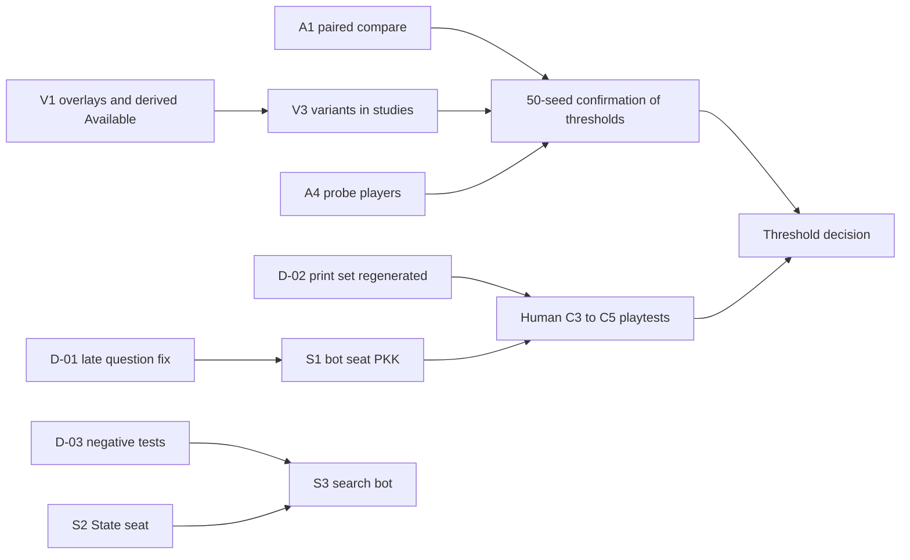

# A Handful of Bandits: playtest readiness audit

- **Reviewed commit:** `main` at `c22d5abe3974f58aa431e2713641428ceed2a9db` ("Test 43/38 thresholds alone", 2026-11-18).
- **Audit date:** 2026-11-18.
- **Scope:** engineering review and tabletop design review. No tracked file changed. Diagnostic output stayed outside the repository.
- **Companion file:** `card-ledger.csv` (193 rows, one per card side, with `path:line` evidence).
- **Effort scale:** S = one focused pull request with tests. M = two to four pull requests. L = five or more. (Project rule: no time estimates.)

> **Status update (2026-11-19):** D-01 is fixed ([#120](https://github.com/Penguin-Pants/HandfullOfBandits/pull/120)). D-02 and conflicts C-1 to C-3 are fixed ([#122](https://github.com/Penguin-Pants/HandfullOfBandits/pull/122)): the print set is built from the package with a drift check in `make test`. The ledger rows marked "Catalogue text stale" and "D-01" describe the reviewed commit, not `main`. Scratch scripts named in this report (`late.ts`, probe, replay attribution) were not committed. The designer answered every Plan 1 decision on 2026-11-19; see `docs/audit/OPEN_QUESTIONS.md`, section "Decisions (2026-11-19)". Plan 1 is complete ([#127](https://github.com/Penguin-Pants/HandfullOfBandits/pull/127)): D-06 fixes C-5 to C-9 (the Ambush decision is now DD-26). M1: `sim/test/no-crash.test.ts` applies every candidate from 50 random states in C1 to C5 (about 5,400) with no throw. D-03 and M3: a recount found 46 of 160 codes untested (the grep in section 2.5 missed codes made with `at(location, "code", ...)`); `sim/test/rejection-codes.test.ts` tests each one and fails if any engine code has no asserting test. D-04: probe players `S-PROBE@1` and `P-PROBE@1` (`sim/src/cli/strategies/probe.ts`); the generator now offers Strike Collaborators after the Operation (decision 10). In run `sim/experiments/runs/d04-probe` (100 games) each of the 21 non-Victory rows below 10 in `dd25-v4b` reaches 16 or more games. By designer decision, the four Victory outcome rows (V-simultaneous, V-harm-gate, V-tie, V-excess-harm) stay reviewed fixtures: a player cannot force them. Next milestone: Plan 2, S1 (bot seat, bot plays PKK).

---

## 0. One-page summary

### What already works for physical playtesting?

- ✅ The **written rules** (`docs/rules/prototype-rules.md`) are current and complete for C1 to C5, including setup 10.2. The engine start position matches 10.2 exactly (State 21, PKK 6, same Control). Confidence: high.
- ✅ The **simulator** is a reliable rules referee for hotseat play: 1,623 tests pass, 720 stored bot games replay hash for hash, and the browser smoke test plays a full campaign.
- ❌ The **printed materials are stale**. The rulebook PDF shows the old 13-space map, Scenario A and Talks. The card PDF and catalogue use the old space "Botan" (73 times) and 41 card sides differ from the package. The rules appendix prints only C1 and C2 cards. **No current printable card set exists for C3 to C5.**

### Can I play a full campaign against a credible bot today?

**No.** Ten qualified bots exist and play all of C1 to C5 legally. But no UI or server route lets a bot take a seat in a human session (`sim/src/server/app.ts:69-154` has no bot route). Also the bots are tuned on archived Scenario A, the State bot passes 36% of its card choices, and two-move planning has no proven gain (doc 37 finding 6).

### How much of the active deck did you verify?

- **99 of 99 package cards accounted for** (90 Event, Capability and Momentum cards, 5 Propaganda, 4 Pivotals). The research CSV has 100 rows: DK-046 is excluded by design (doc 32 point 1).
- **180 Event sides:** 178 verified by execution, 2 partial (DK-079 and DK-080 shaded, defect D-01). 157 sides ran in the 720 replayed bot games, 5 only in my per-card probe and 16 only in fixture tests.
- **4 Pivotals:** 3 played by bots (ARGK 620 times, Serhildan 573, Area Domination 445). DK-098 Coercive Diplomacy on Syria never came up in 720 games; only fixture tests cover it.
- **5 Propaganda cards:** all verified by execution.

### What can I run locally today, and what can I change about setup?

- **Run:** the app, `check`, `test`, `validate`, `batch`, `experiment run/replay/analyze/qualify`, `export`, `regression`. All work on Windows without GNU Make through `npm` in `sim/` (Node 24 is mandatory; Node 22 fails `npm ci`).
- **Change in the UI:** package version, scenario, two options (hot pursuit, Restricted Syria March) and seed only.
- **Change by file:** every start piece, level, marker, track, pool, threshold and Pivotal hand in `scenarios/full-campaign.yaml`, then put the copy under `game-packages/kurdish-coin/<new-version>/`. The Home screen then lists it. Validation catches over-supply and stacking errors (tested, section 2.6).

### What should I build or fix first?

1. ✅ Done (#120). **Fix D-01** (engine accepts a command and then throws): S.
2. ✅ Done (#122). **Regenerate the print set from the package** and add a drift check: M. This unblocks physical playtests of C3 to C5.
3. **Add a bot seat to the app** (bot plays PKK first): M. This is the first playable solo milestone.
4. **Add setup variant overlays** with derived Available pools: M. This removes full package copies for every variant.
5. **Add a paired run-versus-run compare** to `experiment`: S.

---

## 1. Source map

### 1.1 Which file defines what

| Area | Authoritative source (used in this audit) | Generated or derived | Stale or historical |
|:--|:--|:--|:--|
| Rules text | `docs/rules/prototype-rules.md` (R4, includes DD-25) | `docs/rules/prototype-card-reference.md` (Appendix A, C1/C2 only, from package) | `docs/rules/handful-of-bandits-rules-a4.pdf` |
| Rule reasons | `research/research-final/package-b-coin-design/*.md` (chapters 03 to 13) | `game-packages/kurdish-coin/0.1.0/rules.yaml` (`make rules`, checked by `make test`) | none found |
| Card text and effects | `game-packages/kurdish-coin/0.1.0/cards/c1.yaml` to `c5.yaml`, `pivotal.yaml` | none | `docs/card-catalogue/catalogue.json`, `cards-a4.pdf`, `index.html`; `research/research-final/data/prototype-deck.csv` |
| Setup and scenario | `game-packages/kurdish-coin/0.1.0/scenarios/full-campaign.yaml`, `pieces.yaml`, `markers.yaml`, `tracks.yaml` | Engine start state (`sim/src/engine/coin/setup.ts`) | `archive/scenarios/kurdish-coin-0.1.0/*.yaml` |
| Map | `game-packages/kurdish-coin/0.1.0/map.yaml` (18 spaces, DD-22) | atlas geometry | `docs/map-proposals/` |
| Numeric parameters | `game-packages/kurdish-coin/0.1.0/parameters.yaml` | none | none found |
| Victory | `victory.yaml` and `scenarios/full-campaign.yaml` (`thresholds: {state: 49, pkk: 32}`) | none | research 09 s1 ("13 domestic spaces") |
| Design intent | `research/research-final/project-management/design-decisions.md` (DD-nn), `docs/prototype/13-design-decisions.md` (DEC-nn), `assumptions.yaml` (PA-nn) | none | `docs/audit/OPEN_QUESTIONS.md` items 15 to 23 still open |
| Experiments | `docs/prototype/36` to `41`, `sim/experiments/manifests/dd25-*.json`, `sim/experiments/runs/dd25-*` | `analysis-v2/report.md` per run | Scenario A runs (`baseline-*`, `options-*` and others) |
| Test variants | `sim/experiments/packages/dd25-*` (full package copies) | none | none |

**Active full-campaign package:** `game-packages/kurdish-coin/0.1.0`, hash `5a605bb7eee8…` (`npm run sim -- validate` output). The same hash is in `dd25-pilot`, `dd25-pilot-main-players` and `dd25-v4b`.

### 1.2 Conflicts found

| # | Conflict | Evidence | Source used |
|:--|:--|:--|:--|
| C-1 | Rulebook PDF is stale | `pdftotext` shows "13 domestic spaces", "Scenario A thresholds are 49 State and 30 PKK" and 61 hits for Talks, Negotiated Outcome, Scenario A or Botan. The README statement is correct. | `prototype-rules.md` |
| C-2 | Card catalogue and card PDF are stale | `catalogue.json` has "Botan" 73 times; 41 sides differ from package text (ledger column "Defect") | package YAML |
| C-3 | Appendix A covers C1 and C2 only | `prototype-rules.md:14`; DK-035 text also missing | package YAML |
| C-4 | Rule 2.3 says Op Only needs two or more locations; the engine applies this to First Eligible only | `prototype-rules.md:153`, `prototype-notes.md` B.3, `choose-operation.ts` | engine behavior (documented in B.3) |
| C-5 | Research 09 s1 still says "13 domestic spaces" | doc 36 s8 proposal 2, not applied | package (18) |
| C-6 | Two DD-22 IDs (map and Ambush) | doc 36 s8 proposal 3, not applied | both, by content |
| C-7 | Rules header says "R4, 8 November 2026"; content includes DD-25 (17 November). B.1 cites baseline commit `f0e6415` | `prototype-rules.md:4`, `prototype-notes.md` B.1 | content |
| C-8 | Doc 35 s2 says start PKK score 4; rules 10.2 and engine say 6 | `docs/prototype/35-start-setup-options-draft.md:47`; engine `derive()` output | engine and rules |
| C-9 | Research CSV rows DK-042 and DK-054 have 20 and 21 columns (header has 19) | `prototype-deck.csv:44,56` | package |
| C-10 | Thresholds: package 49/32; experiments recommend testing 43/38 | doc 41 s4 | package (baseline) |

### 1.3 Open questions for the designer

1. **Thresholds.** Keep 49/32, or adopt 43/38 after a 50-seed confirmation (doc 41 s4)?
2. **Responder Op Only (C-4).** Must the Second Eligible's Op Only also use two or more locations?
3. **Previous audit items with no recorded decision** (`docs/audit/OPEN_QUESTIONS.md` 15 to 23): Guard Abuse on PKK Harm (m-16), paid actions with no effect (m-17), Leadership return (m-13), Western Cities Guerrillas stuck (m-24), Garrison activation "up to" (m-11), PKK Restraint Broken effect (m-26a), DK-010 "TSK" title (m-27).
4. **Player-facing wording** for the seven Always lines, DK-040 in particular (`docs/card-catalogue/README.md`, open item).
5. **Initiative streaks.** Bots held First Eligible for up to 53 cards in a row (`dd25-v4b` diagnostics `maxFirstEligibleStreak`). Rule 7.4 asks to flag streaks. Is a long Limited Op streak intended?

---

## 2. Engine findings

### 2.1 Trace of normal play

1. **UI** (`sim/src/ui/play/Play.tsx`, `ui/event/decision.tsx`) builds a command. It asks the server to validate it, shows each open question, then submits.
2. **Server** (`sim/src/server/app.ts:87-92`) calls `SessionService.validateCommand` or `submit` (`sim/src/server/service.ts:207-236`). `submit` rejects a stale head (second tab).
3. **Engine** (`sim/src/engine/index.ts`) validates first, then executes the handler on a fresh `Exec` context (`core/exec.ts`). All board writes go through effect primitives (`core/effects/`). Dice and random picks come from the seeded RNG in the state.
4. **Cards** run through `coin/events.ts:126 runOne`. Card YAML uses a closed vocabulary: core primitives, `choice`, `conditional`, `forEachSpace`, `forEachPiece`, `freeAction` (`events.ts:216`, calls the real Op handlers), `addModifier` and named `procedure` (`coin/procedures.ts:66`).
5. **Log and store.** Each action stores its commands, validation, RNG before, log entries and state hash (`service.ts:221-232`). **Replay** (`engine/replay.ts`) reruns commands from the seed and compares hashes.

### 2.2 What works well

- **Pure deterministic core.** Same seed and commands give the same hash. 720 of 720 stored games replayed with zero mismatches in my run.
- **Data-driven cards.** 99 cards need only 14 named procedures. A card change is a YAML edit plus a test.
- **Rule references everywhere.** Each log entry cites a rule; `rules.yaml` resolves it to text. This is excellent for playtest notes.
- **Strong guards.** The package loader checks schema, references, piece totals and stacking. Manifests freeze package hash and code fingerprints.
- **Large, fast test suite** that runs on Windows in CI (`.github/workflows`, `windows-latest`, Node 24).

### 2.3 Where it slows playtesting

- **Print material is not generated from the package** with a drift check (C-1, C-2). Physical tests can use wrong card text.
- **Variants need full package copies** (`sim/experiments/packages/dd25-*`). Each is a byte copy with three changed lines.
- **No bot seat in sessions.** The designer must play both sides in the app.
- **Validation stops at the first die roll** (`core/exec.ts:56`). This is correct for previews but hides later questions (D-01).
- **Experiment set-up friction.** A manifest needs the package hash, a `supersedes` field (required, nullable) and fingerprints. Paired run comparison needs a scratch script (doc 36 s8 item 6).

### 2.4 Commands run and results

| Command (from `sim/` unless noted) | Result |
|:--|:--|
| `npm ci` on Node 22.23.5 | ❌ EBADENGINE (needs Node 24) |
| `npm ci` on Node 24.22.3 | ✅ |
| `make check` (repo root) | ✅ 34 s |
| `make test` (repo root) | ✅ 110 files, 1,623 tests, 128 s |
| `npm run sim -- validate <package>` | ✅ hash `5a605bb7…` |
| `make e2e` (Playwright, repo root) | ✅ all checks, including "full campaign completes five rounds through the session API" |
| `npm run sim -- batch --games 6 --strategy concentration,sanctuary --swap-seats` | ✅ 2.6 s; PKK 6 of 6 (legacy screens) |
| `npm run sim -- fuzz --seeds 5` | ✅ 5 games, 867 commands, apply mean 0.99 ms |
| `experiment run` on a 4-game manifest (2 seeds, S-ADAPT@4 v P-ADAPT@4 and S-POL@1 v P-POL@2) | ✅ 91 s, 4 of 4 complete |
| `experiment replay` and `experiment analyze` on that run | ✅ 4 of 4 identical; report written |
| Replay attribution of `dd25-pilot`, `dd25-pilot-main-players`, `dd25-v4b` (scratch script) | ✅ 720 games, 0 mismatches, 0 rejections, 89 s |
| Per-card probe: every card side, both factions, every generated answer set (scratch script) | ✅ 180 card-faction runs, 0 throws, 0 rejections; 9 PKK refusals as rule 5.1 requires |
| `git status` after all runs | clean |

**Limits of verification:** Linux container, not Windows 11. No full human playthrough in the browser. Bot strength claims come from the repo's stored runs. The probe uses the start board moved to each Campaign, so many effects skip for lack of targets; bot replays and fixture tests cover those.

### 2.5 Defects and risks found

| ID | Severity | Finding | Evidence | Confidence |
|:--|:--|:--|:--|:--|
| D-01 (fixed, #120) | High (blocks C5 human play) | DK-079 and DK-080 shaded with two or more face-down Covert markers: `validate()` returns OK with no answers; `apply()` throws `AnswerNeeded` after the random reveal. The server maps it to HTTP 500 (`app.ts:66`). | Scratch repro `late.ts`: "validate ok: true", "apply threw: AnswerNeeded". Card scan: only these two sides ask a question after a random step. | High (engine); medium (exact UI message, not run in a browser) |
| D-02 (fixed, #122) | High (physical tests) | Printed rulebook, card PDF and catalogue are stale; C3 to C5 cards have no print source | C-1, C-2, C-3 | High |
| D-03 | Medium | 30 of 102 engine violation codes have no test that asserts the code string | grep of `src/engine` codes against `*.test.ts*` (list in Plan 1) | Medium (a test may assert the message instead) |
| D-04 | Medium (simulation validity) | Bots never used Cross-Border, hot pursuit, Restricted entry or any Hostile or Aligned host in 240 `dd25-v4b` games. Village Clearance appeared in 2 games, Guard Abuse in 1. DK-098 never played. | `dd25-v4b/analysis-v2/coverage.json` ledger; replay attribution | High |
| D-05 | Medium (bot quality) | State bots pass 36% of card choices (PKK 14%); State leaves about 5 Resources unused; P-POL loses every game | `coverage.json` diagnostics; doc 41 finding 5 | High |
| D-06 | Low | Documentation drift C-5 to C-9 | section 1.2 | High |

### 2.6 Negative cases checked

- **Illegal Event side:** PKK refused on 9 unshaded sides (DK-037, 051, 060, 065, 066, 067, 068, 085, 094) with `sideRestricted`. Non-player sides stay open, as rule 5.1 says.
- **Setup supply and stacking** (temporary copies of the package):
  - One extra Troop in Hakkari: `V-PIECES … 17 on the map + 14 available + 0 out of play = 31, but pieces.yaml has 30.`
  - Three PKK Bases in Şırnak: `V-STACK … 3 of pkkBase exceed the limit of 2.`
  - A Guard in Van City and an unknown faction threshold: `V-STACK`, `V-REF` and `V-PIECES` errors.
- **Phase and timing:** covered by existing tests for Pivotal Campaign gates, switch gates (`campaign-switches.test.ts`), ceasefire breach warnings and Host Pressure replan (`host-pressure-session.test.ts`).
- **Persistent effects:** Capabilities and Momentum are tested through Reset (`propaganda/redeploy-reset.test.ts`, `ops/modifier-hooks.test.ts`).

---

## 3. Card coverage ledger

### 3.1 Reconciliation

| Source | Count | Notes |
|:--|--:|:--|
| Package card records | 99 | C1 17, C2 19, C3 19, C4 22, C5 22 (Pivotals counted in their Campaign) |
| Event, Capability and Momentum cards | 90 | 78 Events, 5 Capabilities, 7 Momentum |
| Propaganda | 5 | DK-016, 035, 055, 077, 099; inserted by the deck build |
| Pivotals | 4 | DK-015, 054, 076, 098; held in hand |
| Mandatory structural cards | 7 | DK-003, 005, 019, 020, 037, 040, 093 (rule 5.4 agrees) |
| Deck-eligible per Campaign (excluding Pivotal and Propaganda) | 15 / 18 / 17 / 20 / 20 | 3, 6, 5, 8 and 8 cards unused per game |
| Research CSV rows | 100 | Extra: DK-046 (excluded, doc 32 point 1). Two malformed rows (C-9) |
| Catalogue records | 99 | Same IDs; 41 sides have stale text |

### 3.2 Status totals

| Group | Verified by execution | Partial | n/a |
|:--|--:|--:|--:|
| Event, Capability and Momentum sides (180) | 178 (157 bot replay, 5 probe, 16 fixture only) | 2 | 0 |
| Pivotal effects (4 cards) | 4 (3 bot replay, 1 fixture only) | 0 | 4 single-sided "shaded" slots |
| Propaganda cards (5) | 5 | 0 | 0 |

- **Missing, blocked or unreachable:** none found. **Manual by design:** none in card effects; Propaganda spending and Redeploy are normal player inputs.
- **Never chosen by bots** (verified only by probe or fixture): DK-006, 017, 021, 065, 066, 067, 084 unshaded and DK-098.
- **"Empty" runs** mean the Event box was taken but no effect applied. This is legal (decision M-10, item 9) and is how bots keep First Eligible.

### 3.3 Ledger

Legend: ✅ verified by execution; evidence = bot (720 replayed games), probe (my per-card run) or fixture (a passing unit test with a set position). "Engine test" is the first engine test that names the card. Full detail per side, including handler paths and probe counts, is in `card-ledger.csv`.

| ID | Title | C | Type | Unshaded (or card) | Shaded | Card source | Engine test | Defect or note |
|:--|:--|:--|:--|:--|:--|:--|:--|:--|
| DK-001 | Eruh and Şemdinli (15 Aug 1984) | C1 | event | ✅ bot, 73 runs | ✅ bot, 74 runs | `cards/c1.yaml:3` | `coin/pivotal.test.ts:5` | Catalogue text stale |
| DK-002 | Raid in Siirt (17 Aug 1984) | C1 | event | ✅ bot, 17 runs, 7 empty | ✅ bot, 44 runs | `cards/c1.yaml:30` | `coin/ops/review-fixes.test.ts:64` | Catalogue text stale |
| DK-003 | Law 3175 (Mar 1985) (mandatory) | C1 | event | ✅ bot, 20 runs, 4 empty | ✅ bot, 174 runs | `cards/c1.yaml:52` | `coin/events.test.ts:53` |  |
| DK-004 | ERNK Founded (Mar 1985) | C1 | capability | ✅ bot, 38 runs, 10 empty | ✅ bot, 9 runs | `cards/c1.yaml:95` | `coin/cards-a.test.ts:26` |  |
| DK-005 | KDP Orders PKK Out (Oct 1985) (mandatory) | C1 | event | ✅ bot, 6 runs | ✅ bot, 147 runs | `cards/c1.yaml:145` | `coin/events.test.ts:80` |  |
| DK-006 | Chiefs Enter the Guard System (1985) | C1 | capability | ✅ probe, 0 runs | ✅ bot, 6 runs, 5 empty | `cards/c1.yaml:175` | `coin/cards-a.test.ts:27` |  |
| DK-007 | ERNK Action Campaign (Jun-Nov 1985) | C1 | momentum | ✅ bot, 70 runs | ✅ bot, 8 runs | `cards/c1.yaml:239` | `coin/cards-a.test.ts:28` |  |
| DK-008 | Former Member Killed Abroad (Nov 1985) | C1 | event | ✅ bot, 6 runs | ✅ bot, 11 runs | `cards/c1.yaml:275` | `coin/events.test.ts:97` |  |
| DK-009 | Bekaa Training Academy (1986) | C1 | capability | ✅ fixture, 4 runs, 4 empty | ✅ bot, 12 runs | `cards/c1.yaml:298` | `coin/cards-a.test.ts:29` |  |
| DK-010 | Rival Groups Form the TSK (1986) | C1 | momentum | ✅ bot, 7 runs | ✅ bot, 53 runs | `cards/c1.yaml:337` | `coin/cards-a.test.ts:30` | Catalogue text stale |
| DK-011 | PKK Spring Offensive (Mar 1986) | C1 | momentum | ✅ bot, 109 runs, 8 empty | ✅ bot, 14 runs | `cards/c1.yaml:390` | `coin/cards-a.test.ts:31` |  |
| DK-012 | Ankara Names a Guerrilla War (May 1985) | C1 | event | ✅ bot, 176 runs | ✅ bot, 20 runs | `cards/c1.yaml:425` | `coin/events.test.ts:107` |  |
| DK-013 | Border Attack and Air Raid into Northern Iraq (Aug 1986) | C1 | event | ✅ fixture, 1 runs, 1 empty | ✅ bot, 74 runs | `cards/c1.yaml:453` | `coin/cards-a.test.ts:32` |  |
| DK-014 | Human Rights Association Founded (Jul 1986) | C1 | event | ✅ bot, 87 runs | ✅ bot, 2 runs | `cards/c1.yaml:509` | `coin/pivotal.test.ts:51` |  |
| DK-015 | ARGK Formed | C1 | pivotal | ✅ bot, 620 plays | n/a | `cards/pivotal.yaml:3` | `coin/pivotal.test.ts:5` |  |
| DK-016 | Propaganda | C1 | propaganda | ✅ bot, 720 reveals | - | `cards/c1.yaml:530` | `coin/events.test.ts:152` |  |
| DK-100 | Neighbors Condemn the Raid (Sep 1986) | C1 | event | ✅ bot, 108 runs | ✅ bot, 31 runs | `cards/c1.yaml:536` | `coin/events.test.ts:126` |  |
| DK-017 | Air Raids on Camps in Iraq (Mar 1987) | C2 | event | ✅ probe, 0 runs | ✅ bot, 103 runs, 20 empty | `cards/c2.yaml:1` | `coin/cards-a.test.ts:33` |  |
| DK-018 | Killings at Pınarcık (Jun 1987) | C2 | event | ✅ bot, 35 runs | ✅ bot, 20 runs | `cards/c2.yaml:88` | `coin/cards-a.test.ts:34` | Catalogue text stale |
| DK-019 | Syria Security Protocol (Jul 1987) (mandatory) | C2 | event | ✅ fixture, 3 runs, 3 empty | ✅ bot, 31 runs | `cards/c2.yaml:166` | `coin/cards-a.test.ts:35` |  |
| DK-020 | OHAL (Jul 1987) (mandatory) | C2 | event | ✅ bot, 184 runs, 7 empty | ✅ bot, 218 runs | `cards/c2.yaml:214` | `coin/cards-a.test.ts:36` |  |
| DK-021 | Attacks on Rival Newroz Gatherings (Mar 1987) | C2 | event | ✅ probe, 0 runs | ✅ bot, 25 runs | `cards/c2.yaml:268` | `coin/cards-a.test.ts:37` | Catalogue text stale |
| DK-022 | Special Strike Force Planned (Jul 1987) | C2 | capability | ✅ bot, 5 runs | ✅ bot, 98 runs | `cards/c2.yaml:321` | `coin/cards-a.test.ts:38` |  |
| DK-023 | Final Anfal in Badinan (Aug 1988) | C2 | event | ✅ bot, 17 runs | ✅ bot, 26 runs | `cards/c2.yaml:359` | `coin/cards-a.test.ts:39` | Catalogue text stale |
| DK-024 | Iraqi Kurdish Refugees Admitted (Aug-Sep 1988) | C2 | event | ✅ bot, 97 runs | ✅ bot, 19 runs | `cards/c2.yaml:401` | `coin/cards-a.test.ts:40` |  |
| DK-025 | Attacks on Village Schools (Nov 1988) | C2 | event | ✅ bot, 6 runs | ✅ bot, 57 runs | `cards/c2.yaml:444` | `coin/cards-a.test.ts:41` | Catalogue text stale |
| DK-026 | Local Elections (Mar 1989) | C2 | event | ✅ bot, 156 runs | ✅ bot, 145 runs | `cards/c2.yaml:508` | `coin/cards-a.test.ts:42` | Catalogue text stale |
| DK-027 | Regional Force Doubled (1989) | C2 | event | ✅ bot, 12 runs | ✅ bot, 52 runs | `cards/c2.yaml:552` | `coin/cards-a.test.ts:19` | Catalogue text stale |
| DK-028 | Paris Kurdish Conference (Oct 1989) | C2 | event | ✅ fixture, 1 runs, 1 empty | ✅ bot, 7 runs | `cards/c2.yaml:744` | `coin/cards-a.test.ts:44` |  |
| DK-029 | SHP Expels Kurdish Deputies (Nov 1989) | C2 | event | ✅ bot, 50 runs, 1 empty | ✅ bot, 73 runs | `cards/c2.yaml:784` | `coin/cards-a.test.ts:45` |  |
| DK-030 | İkikaya Village Killings (Nov 1989) | C2 | event | ✅ bot, 7 runs | ✅ bot, 20 runs | `cards/c2.yaml:842` | `coin/cards-a.test.ts:46` |  |
| DK-031 | Çukurca Villagers Refuse Guard Duty (1989) | C2 | event | ✅ bot, 11 runs | ✅ bot, 32 runs | `cards/c2.yaml:889` | `coin/cards-a.test.ts:47` | Catalogue text stale |
| DK-032 | Lawyer Access Decree (Sep 1989) | C2 | event | ✅ bot, 161 runs | ✅ bot, 131 runs | `cards/c2.yaml:941` | `coin/cards-a.test.ts:48` |  |
| DK-033 | Abuse and Killings in Custody Reported (1989) | C2 | event | ✅ bot, 31 runs | ✅ bot, 375 runs | `cards/c2.yaml:976` | `coin/cards-a.test.ts:49` | Catalogue text stale |
| DK-034 | Governors Exile Local Party Members (Sep 1989) | C2 | event | ✅ bot, 11 runs, 8 empty | ✅ bot, 92 runs | `cards/c2.yaml:1044` | `coin/cards-a.test.ts:50` | Catalogue text stale |
| DK-035 | Propaganda | C2 | propaganda | ✅ bot, 720 reveals | - | `cards/c2.yaml:1083` | `coin/cards-a.test.ts:89` | Not in Appendix A |
| DK-036 | OHAL Powers (KHK 413, Apr 1990) | C3 | event | ✅ bot, 9 runs | ✅ bot, 290 runs | `cards/c3.yaml:3` | `coin/c3-cards.test.ts:21` |  |
| DK-037 | HEP Founded (Jun 1990) (mandatory) | C3 | event | ✅ bot, 3 runs, 2 empty, PKK refused | ✅ bot, 40 runs, 20 empty | `cards/c3.yaml:25` | `coin/structural.test.ts:16` |  |
| DK-038 | KHK 430 (Dec 1990) | C3 | momentum | ✅ bot, 58 runs | ✅ bot, 263 runs | `cards/c3.yaml:67` | `coin/c3-cards.test.ts:245` |  |
| DK-039 | Law 3713 (Apr 1991) | C3 | event | ✅ bot, 152 runs | ✅ bot, 163 runs | `cards/c3.yaml:89` | `coin/c3-cards.test.ts:35` |  |
| DK-040 | Northern Iraq Vacuum (Apr 1991) (mandatory) | C3 | event | ✅ fixture, 1 runs, 1 empty | ✅ bot, 27 runs | `cards/c3.yaml:117` | `coin/structural.test.ts:61` |  |
| DK-041 | Operation in Northern Iraq (Aug 1991) | C3 | event | ✅ fixture, 4 runs, 4 empty | ✅ bot, 245 runs | `cards/c3.yaml:158` | `coin/c3-cards.test.ts:259` |  |
| DK-042 | Election Brings HEP Deputies to Parliament (Oct 1991) | C3 | event | ✅ bot, 102 runs | ✅ bot, 192 runs, 3 empty | `cards/c3.yaml:182` | `coin/c3-cards.test.ts:54` | Catalogue text stale |
| DK-043 | Newroz Killings (Mar 1992) | C3 | event | ✅ bot, 3 runs | ✅ bot, 207 runs | `cards/c3.yaml:212` | `coin/c3-cards.test.ts:141` | Catalogue text stale |
| DK-044 | Turkey-Syria Accord (1992) | C3 | event | ✅ bot, 5 runs | ✅ bot, 137 runs | `cards/c3.yaml:239` | `coin/c3-cards.test.ts:285` | Catalogue text stale |
| DK-045 | Şırnak Town Battle (Aug 1992) | C3 | event | ✅ bot, 11 runs | ✅ bot, 360 runs | `cards/c3.yaml:267` | `coin/c3-cards.test.ts:156` | Catalogue text stale |
| DK-047 | Large Operation with KDP Help (Oct-Nov 1992) | C3 | event | ✅ fixture, 2 runs, 2 empty | ✅ bot, 221 runs | `cards/c3.yaml:293` | `coin/c3-cards.test.ts:302` |  |
| DK-048 | Houses Burned at Kelekçi (Nov 1992) | C3 | event | ✅ bot, 12 runs | ✅ bot, 230 runs | `cards/c3.yaml:325` | `coin/c3-cards.test.ts:171` | Catalogue text stale |
| DK-049 | Journalists and Press Staff Killed (1992) | C3 | event | ✅ bot, 4 runs | ✅ bot, 64 runs | `cards/c3.yaml:349` | `coin/c3-cards.test.ts:184` |  |
| DK-050 | Özgür Gündem Begins Publication (May 1992) | C3 | momentum | ✅ bot, 5 runs | ✅ bot, 11 runs | `cards/c3.yaml:373` | `coin/c3-cards.test.ts:321` |  |
| DK-051 | Prosecutor Files to Close HEP (Jul 1992) | C3 | event | ✅ bot, 5 runs, PKK refused | ✅ bot, 15 runs | `cards/c3.yaml:395` | `coin/c3-cards.test.ts:86` |  |
| DK-052 | Attack on Boğazköy Gendarme Station (Nov 1992) | C3 | event | ✅ bot, 9 runs | ✅ bot, 31 runs, 5 empty | `cards/c3.yaml:422` | `coin/c3-cards.test.ts:117` | Catalogue text stale |
| DK-053 | Unattributed Killings in the Southeast (1992) | C3 | event | ✅ bot, 4 runs | ✅ bot, 12 runs | `cards/c3.yaml:444` | `coin/c3-cards.test.ts:207` | Catalogue text stale |
| DK-054 | Serhildan | C3 | pivotal | ✅ bot, 573 plays | n/a | `cards/pivotal.yaml:25` | `coin/pivotals.test.ts:20` |  |
| DK-055 | Propaganda | C3 | propaganda | ✅ bot, 709 reveals | - | `cards/c3.yaml:466` | `coin/c3-cards.test.ts:132` |  |
| DK-056 | PKK Unilateral Ceasefire (Mar 1993) | C4 | event | ✅ bot, 147 runs | ✅ bot, 67 runs, 1 empty | `cards/c4.yaml:3` | `coin/c4-cards.test.ts:178` |  |
| DK-057 | Ceasefire Extended at Bar Elias (Apr 1993) | C4 | event | ✅ bot, 28 runs | ✅ bot, 20 runs | `cards/c4.yaml:31` | `coin/c4-cards.test.ts:203` |  |
| DK-058 | President Özal Dies (Apr 1993) | C4 | event | ✅ bot, 108 runs | ✅ bot, 218 runs | `cards/c4.yaml:70` | `coin/c4-cards.test.ts:235` |  |
| DK-059 | Bingöl Road Killings (May 1993) | C4 | event | ✅ bot, 4 runs | ✅ bot, 14 runs | `cards/c4.yaml:96` | `coin/c4-cards.test.ts:251` | Catalogue text stale |
| DK-060 | Constitutional Court Dissolves HEP (Jul 1993) | C4 | event | ✅ fixture, 1 runs, 1 empty, PKK refused | ✅ bot, 30 runs | `cards/c4.yaml:123` | `coin/c4-cards.test.ts:37` |  |
| DK-061 | PKK Attacks on Turkish Offices in Europe (Jun 1993) | C4 | event | ✅ bot, 71 runs | ✅ bot, 111 runs | `cards/c4.yaml:150` | `coin/c4-cards.test.ts:300` |  |
| DK-062 | Deputy Shot Dead in Batman (Sep 1993) | C4 | event | ✅ bot, 158 runs | ✅ bot, 66 runs | `cards/c4.yaml:173` | `coin/c4-cards.test.ts:312` | Catalogue text stale |
| DK-063 | Destruction in Lice (Oct 1993) | C4 | event | ✅ bot, 4 runs | ✅ bot, 247 runs | `cards/c4.yaml:197` | `coin/c4-cards.test.ts:326` | Catalogue text stale |
| DK-064 | Germany Bans PKK and ERNK (Nov 1993) | C4 | event | ✅ bot, 5 runs | ✅ bot, 7 runs | `cards/c4.yaml:223` | `coin/c4-cards.test.ts:341` |  |
| DK-065 | DEP Founded (May 1993) | C4 | event | ✅ fixture, 0 runs, PKK refused | ✅ bot, 9 runs, 9 empty | `cards/c4.yaml:249` | `coin/c4-cards.test.ts:54` |  |
| DK-066 | Parliament Lifts DEP Immunity (Mar 1994) | C4 | event | ✅ probe, 0 runs, PKK refused | ✅ bot, 132 runs | `cards/c4.yaml:283` | `coin/c4-cards.test.ts:86` |  |
| DK-067 | HADEP Founded (May 1994) | C4 | event | ✅ fixture, 0 runs, PKK refused | ✅ bot, 8 runs, 7 empty | `cards/c4.yaml:312` | `coin/c4-cards.test.ts:112` |  |
| DK-068 | Constitutional Court Dissolves DEP (Jun 1994) | C4 | event | ✅ fixture, 1 runs, 1 empty, PKK refused | ✅ bot, 243 runs | `cards/c4.yaml:337` | `coin/c4-cards.test.ts:146` |  |
| DK-069 | HRW Forced-Displacement Report (Oct 1994) | C4 | event | ✅ bot, 137 runs | ✅ bot, 9 runs | `cards/c4.yaml:369` | `coin/c4-cards.test.ts:360` |  |
| DK-070 | KDP-PUK Civil War (May 1994) | C4 | event | ✅ bot, 3 runs | ✅ bot, 14 runs | `cards/c4.yaml:391` | `coin/c4-cards.test.ts:390` |  |
| DK-071 | Operation Steel (Mar-May 1995) | C4 | event | ✅ fixture, 2 runs, 2 empty | ✅ bot, 131 runs | `cards/c4.yaml:426` | `coin/c4-cards.test.ts:414` | Catalogue text stale |
| DK-072 | EU-Turkey Customs Union (Mar 1995) | C4 | momentum | ✅ bot, 231 runs | ✅ bot, 17 runs | `cards/c4.yaml:453` | `coin/c4-cards.test.ts:451` |  |
| DK-073 | Second Unilateral Ceasefire (Dec 1995) | C4 | event | ✅ bot, 96 runs | ✅ bot, 177 runs | `cards/c4.yaml:476` | `coin/c4-cards.test.ts:274` |  |
| DK-074 | US Lending Conditions (1994) | C4 | momentum | ✅ bot, 110 runs | ✅ bot, 142 runs | `cards/c4.yaml:499` | `coin/c4-cards.test.ts:472` |  |
| DK-075 | Raid on Two Guard Villages (Jan 1994) | C4 | event | ✅ bot, 2 runs | ✅ bot, 23 runs, 1 empty | `cards/c4.yaml:521` | `coin/c4-cards.test.ts:501` |  |
| DK-076 | Area Domination | C4 | pivotal | ✅ bot, 445 plays | n/a | `cards/pivotal.yaml:57` | `coin/pivotals.test.ts:27` |  |
| DK-077 | Propaganda | C4 | propaganda | ✅ bot, 659 reveals | - | `cards/c4.yaml:555` | `coin/c4-cards.test.ts:165` |  |
| DK-078 | Suicide Attacks (Jun-Oct 1996) | C5 | event | ✅ bot, 15 runs | ✅ bot, 6 runs | `cards/c5.yaml:368` | `coin/c5-cards.test.ts:403` | Catalogue text stale |
| DK-079 | Susurluk Car Crash (Nov 1996) | C5 | event | ✅ bot, 100 runs | ⚠️ partial | `cards/c5.yaml:48` | `coin/c5-cards.test.ts:23` | D-01 (shaded) |
| DK-080 | Susurluk Commission Report (May 1997) | C5 | event | ✅ bot, 20 runs, 4 empty | ⚠️ partial | `cards/c5.yaml:78` | `coin/c5-cards.test.ts:49` | Catalogue text stale; D-01 (shaded) |
| DK-081 | Emergency Rule Narrowed (1996-1998) | C5 | event | ✅ bot, 75 runs | ✅ bot, 140 runs | `cards/c5.yaml:511` | `coin/c5-cards.test.ts:530` |  |
| DK-082 | Operation Hammer (May-Jul 1997) | C5 | event | ✅ fixture, 6 runs, 6 empty | ✅ bot, 58 runs | `cards/c5.yaml:392` | `coin/c5-cards.test.ts:420` |  |
| DK-083 | US Designates the PKK (Oct 1997) | C5 | event | ✅ bot, 9 runs | ✅ bot, 5 runs, 5 empty | `cards/c5.yaml:422` | `coin/c5-cards.test.ts:447` |  |
| DK-084 | Ankara Process in Northern Iraq (1996-1997) | C5 | event | ✅ probe, 0 runs | ✅ bot, 14 runs, 1 empty | `cards/c5.yaml:222` | `coin/event-move-faces.test.ts:7` |  |
| DK-085 | HADEP Congress Flag Case (1996-1997) | C5 | event | ✅ bot, 7 runs, 6 empty, PKK refused | ✅ bot, 109 runs | `cards/c5.yaml:124` | `coin/c5-cards.test.ts:134` |  |
| DK-086 | Strasbourg Judgments (1997-1998) | C5 | event | ✅ bot, 94 runs | ✅ bot, 105 runs | `cards/c5.yaml:153` | `coin/c5-cards.test.ts:161` |  |
| DK-087 | Migration Commission Report (Jan 1998) | C5 | event | ✅ bot, 12 runs, 3 empty | ✅ bot, 23 runs | `cards/c5.yaml:181` | `coin/c5-cards.test.ts:190` |  |
| DK-088 | Third Unilateral Ceasefire (Sep 1998) | C5 | event | ✅ bot, 22 runs, 6 empty | ✅ bot, 122 runs | `cards/c5.yaml:444` | `coin/c5-cards.test.ts:463` |  |
| DK-089 | Washington Agreement (Sep 1998) | C5 | event | ✅ fixture, 12 runs, 12 empty | ✅ bot, 84 runs | `cards/c5.yaml:271` | `coin/c5-cards.test.ts:275` |  |
| DK-090 | PKK Leader Leaves Syria (Oct 1998) | C5 | event | ✅ bot, 2 runs | ✅ bot, 205 runs | `cards/c5.yaml:293` | `coin/c5-cards.test.ts:299` | Catalogue text stale |
| DK-091 | Adana Minutes (Oct 1998) | C5 | capability | ✅ bot, 7 runs | ✅ bot, 185 runs | `cards/c5.yaml:319` | `coin/c5-cards.test.ts:332` |  |
| DK-092 | Arrest in Rome (Nov 1998) | C5 | event | ✅ fixture, 1 runs, 1 empty | ✅ bot, 10 runs | `cards/c5.yaml:343` | `coin/c5-cards.test.ts:367` |  |
| DK-093 | Capture (Feb 1999) (mandatory) | C5 | event | ✅ bot, 4 runs | ✅ bot, 35 runs, 1 empty | `cards/c5.yaml:6` | `coin/structural.test.ts:92` |  |
| DK-094 | HADEP Wins Local Offices (Apr 1999) | C5 | event | ✅ bot, 93 runs, PKK refused | ✅ bot, 8 runs, 7 empty | `cards/c5.yaml:545` | `coin/c5-cards.test.ts:561` |  |
| DK-095 | Return to Village Project (1999) | C5 | event | ✅ bot, 64 runs | ✅ fixture, 2 runs, 2 empty | `cards/c5.yaml:568` | `coin/c5-cards.test.ts:606` |  |
| DK-096 | Repentance Law (Aug 1999) | C5 | event | ✅ bot, 112 runs | ✅ bot, 174 runs | `cards/c5.yaml:604` | `coin/c5-cards.test.ts:638` |  |
| DK-097 | Leader Calls for Withdrawal (Aug 1999) | C5 | event | ✅ bot, 2 runs | ✅ bot, 56 runs, 4 empty | `cards/c5.yaml:466` | `coin/c5-cards.test.ts:485` |  |
| DK-098 | Coercive Diplomacy on Syria | C5 | pivotal | ✅ fixture, 0 plays | n/a | `cards/pivotal.yaml:80` | `coin/pivotals.test.ts:27` | Never played by bots |
| DK-099 | Propaganda | C5 | propaganda | ✅ bot, 627 reveals | - | `cards/c5.yaml:648` | `coin/c5-cards.test.ts:672` |  |

---

## 4. Plan 1: Defects and rules coverage

**Goal:** the engine never accepts a command it cannot finish, print materials match the package and every rejection rule has a test.

### Fix order

| Order | ID | Severity and impact | Smallest reproduction | Fix | Verification | Effort |
|:--|:--|:--|:--|:--|:--|:--|
| 1 | D-01 | High. Blocks a human player in C5 when the State used Covert Action | C5 board, DK-079 current, Covert markers in two spaces, `ChooseEvent` PKK shaded with `answers: []`. `validate` OK, `apply` throws | In `coin/event-command.ts` `check`: after a `PreviewStop`, run a second dry run in non-preview mode on the same state (the RNG is in the state, so the result is the same) and return only its `AnswerNeeded` question, never its effects. Also make `engine.apply` turn an `AnswerNeeded` into `ok: false` | New test fails before the fix: `validate` returns `needsAnswer` with the "Reveal a second Covert marker" question. Then UI test answers it and commits. Bot generator `lateQuestion` (`cli/candidates.ts:461`) can then be deleted (Edits 6) | S |
| 2 | D-02 | High for physical tests | `grep -c Botan docs/card-catalogue/catalogue.json` gives 73 | Add a sync step that copies package side text into `catalogue.json` `printed` and a `--check` mode run by `make test` (same pattern as `rules.yaml`). Extend Appendix A to C3 to C5. Rebuild `cards-a4.pdf` and the rulebook PDF | Drift check fails on any edit to a package side; `pdftotext` of both PDFs shows 18 spaces and no Talks | M |
| 3 | D-03 | Medium. Untested rejections can let illegal moves through in solo play or simulation | `grep` method in section 2.5 | One negative test per code (list below) | Each new test fails if its check line is deleted | M |
| 4 | D-04 | Medium. Simulation results say nothing about sanctuary and Village Clearance play | `coverage.json` of `dd25-v4b` | Add "probe players" that force each rare system (Plan 3) and fixture positions for each host posture entry | Coverage ledger shows natural exposure for every mechanic in at least 10 games | M |
| 5 | D-06 | Low | section 1.2 | Apply doc 36 s8 items 2 and 3, fix CSV quoting, update rules header and B.1 baseline | Rules and research greps agree | S |

**Codes with no asserting test (D-03), grouped by risk:**

- **Political spending:** `civicNeedsPolice`, `civicNoRoom`, `civicNoMarker`, `civicTooManyShifts`, `civicBadSpend`, `agitateNoRoom`, `agitateNoMarker`, `agitateTooManyShifts`, `agitateBadSpend`.
- **Placement and supply:** `trainBaseLimit`, `trainBaseWhere`, `trainGuardsCount`, `trainOption`, `rallyBaseGuerrillas`, `rallyOption`, `crossBorderSupply`, `upkeepGuards`.
- **Eligibility and timing:** `wrongPhase`, `notPropaganda`, `ceasefireBox`, `ceasefireBreach`, `pivotalPrecondition`, `pivotalAnswer`.
- **Input shape:** `badChoice`, `badMoves`, `badPlan`, `badSide`, `unknownSa`, `extortGuerrilla`, `extortPop`.

### Code entry points

`sim/src/engine/coin/event-command.ts`, `sim/src/engine/index.ts`, `sim/src/engine/coin/events.ts`, `docs/card-catalogue/generate.py`, `docs/rules/build-rulebook.py`, `sim/src/engine/coin/ops/**`.

### Milestones and acceptance

1. **M1 (D-01):** no command passes `validate` and then throws. Acceptance: a property test applies every generated candidate from 50 random mid-game states and finds zero throws.
2. **M2 (D-02):** one command regenerates all print files. Acceptance: drift check in CI; a printed C3 sheet matches the simulator text.
3. **M3 (D-03):** 30 negative tests. Acceptance: every code in `src/engine` has an asserting test (a small script enforces it).

### Decisions you need to make

- Answer open questions 2 and 3 (section 1.3) before M3, because they change what the engine must reject.

---

## 5. Plan 2: Solo opponent

### 5.1 Audit of existing players

| Item | Finding | Evidence |
|:--|:--|:--|
| Roster | 4 State and 4 PKK qualified players (v4), 2 counters, 6 controls; legacy `batch` screens | `docs/prototype/26-bot-reference.md` |
| Factions, decisions, phases | Both factions; every decision kind (card, Pivotal, Host Pressure resume, upkeep, Emergency Rule, Legal Politics, Civic Action, Agitation, Redeploy); C1 to C5 | `cli/candidates.ts:25`, `:655` |
| Information | Allowlisted public view plus own hand; deck sampled by `determinize`; no seed or pile order | `cli/player-observation.ts:51`, `:151` |
| Fallbacks | Qualified players have none for legal moves. Legacy `batch` policies read the full state and fall back to the scripted policy | `cli/strategies/index.ts:16-35` |
| Search | One-step weighted evaluation; v4 adds a two-move line on the top 3 plans; 1,800 engine steps per decision | `cli/strategies/scenario-a.ts`, doc 37 |
| Quality | Weights tuned on Scenario A; C3 to C5 untuned; State passes 36%; no position found where two-move planning beats one-move | doc 26 Part 3; doc 37 finding 6 |
| Speed (this container, 4 games at once) | v4: median 0.5 to 0.7 s, p95 1.3 s, max 2.7 s per decision. v1/v2: median 0.1 s, max 0.7 s | scratch experiment journals |
| Human v bot | **Not available.** No server route or UI control seats a bot | `server/app.ts:69-154` |
| Explanation | Each decision record stores the chosen candidate, value, value components and the best alternative | `cli/game-runner.ts:33-55` |

### 5.2 First playable milestone and faction

**Milestone S1: "Bot seat" in the existing app, with the bot as PKK.** The human plays the State.

Reasons for PKK first:

1. The PKK bots are the stronger side today: P-EXP@4 and P-SURV@4 beat most State bots (doc 41 finding 5). A weak opponent teaches you nothing about your design.
2. The State bot has a known passivity problem (36% Pass). As the State player, you test the side that the balance work targets (thresholds, Police lever).
3. PKK choices are cheaper to search (1-Resource Ops, fewer SA variants), so response time is lower.

**Path to both factions:** S2 adds the State seat after a State retune that targets Pass share and unused Resources. Use the same seat code.

### 5.3 Heuristic baseline compared with search

| Approach | Strength | Weakness | Use here |
|:--|:--|:--|:--|
| Faction priority list (COIN flowchart style) | Transparent; can become a printed solo bot for the physical game | Needs much hand testing per card; brittle across rule changes | Later, derived from search logs, for the physical product |
| Weighted one-step evaluation (current v1 to v4) | Fast, legal, reproducible, explainable components | Myopic; weights tuned on another scenario | Baseline to beat; registered as a control |
| Determinized Monte Carlo search (recommended) | Handles hidden deck and dice by sampling; reuses `determinize`, the candidate generator and the real engine | Strategy fusion: averages over deals the player cannot tell apart (Cowling and others, 2012) | S3 |
| Information Set MCTS | Fixes strategy fusion; anytime | More code; needs a fast rollout policy | S4, only if S3 plateaus |

### 5.4 What "several moves ahead" means here

- **One ply = one faction decision.** A card gives First Eligible one ply and Second Eligible one ply. Eligibility (rules 2.4) decides who acts first on the next card, so plies are not strictly alternating.
- **Depth target:** 4 plies (this card and the next card for both factions), then a static evaluation that projects to the next Propaganda round. The existing v4 line is about 3 plies on 3 plans.
- **Chance nodes:** sample dice and the next card from `determinize`. Never read the real pile.
- **Branching control:** keep the generator's family cap of 14, widen the top families by value (progressive widening) and stop each candidate early when its upper bound cannot beat the leader.
- **Time budget on Windows 11:** anytime search with iterative deepening. Targets: p95 ≤ 5 s, max ≤ 15 s per decision on your reference laptop. The current v4 p95 is 1.3 s on Linux, so there is room.

### 5.5 Milestones

| ID | Content | Entry points | Effort |
|:--|:--|:--|:--|
| S1 | Session option `seats: {pkk: "P-SURV@4"}`; route `POST /api/sessions/:id/bot-step` that observes, decides and submits through `SessionService.submit`; UI auto-steps the bot and shows "Why?" from the decision record | `server/service.ts`, `server/app.ts`, `cli/player-registry.ts`, `ui/play/Play.tsx` | M |
| S2 | State seat after a State retune (Pass share ≤ 20%, unused Resources ≤ 2 at Propaganda) | `cli/strategies/scenario-a.ts` `FAMILIES`, `evaluation.ts` | M |
| S3 | Determinized search to 4 plies with anytime budget; v4 kept as control | new `cli/strategies/search.ts` | L |
| S4 | Post-game review: per decision, top 3 candidates, value components and the sampled principal line, linked to the History screen | `game-runner.ts` record, `ui/history` | M |
| S5 | C3 to C5 retune with your input on good play (Village Clearance, ceasefire, Legal Politics) | `qualification.ts` fixtures | M |

### 5.6 Acceptance tests

1. **Legality:** 200 bot-seat games (100 per seat), C1 to C5: 0 rejected commands, 0 throws, 100% replay identity. Every decision kind reached at least once.
2. **Decision quality:** extend `qualification.ts` with at least 10 C3 to C5 positions with a clear best move (for example: Village Clearance at Legitimacy 2 × Pop + 1, accept a ceasefire with a State Restraint Broken marker on the map, last-round Agitation allocation, Covert Action before a victory check). Pass ≥ 90%. Random and control bots must fail.
3. **Response time:** measured on Windows 11 with `experiment` decision times: p95 ≤ 5 s, max ≤ 15 s.
4. **Strength:** paired matched-seed run against v4 on 50 seeds per opponent. The new bot gains ≥ 5 points of win rate with a bootstrap interval above 0, and loses no cell by more than 5 points.
5. **Review:** for any committed bot action, the History shows why in under 3 clicks.

### 5.7 Decisions you need to make

- Confirm the bot plays PKK first.
- Set the Windows response-time budget (default proposal: p95 5 s).
- Say whether the bot may see the opponent's Pivotal hand. The rules make it public (10.1); the bots already rebuild it from setup.

---

## 6. Plan 3: Local simulation and analysis

### 6.1 Audit of current tooling

| Tool | Works today | Gap |
|:--|:--|:--|
| `sim batch` | Fast (6 games in 2.6 s), CSV per round | Legacy policies see the full state and fall back to the scripted policy; screens only |
| `sim experiment run` | Frozen manifest, fingerprints, seed registry, worker concurrency, `--resume`, journals, `failures.json` with replayable prefix | Manual hash entry; required `supersedes`; output "n/N" lines only |
| `experiment replay` / `analyze` | Hash replay; Wilson intervals, seed-cluster bootstrap, coverage ledger, review triggers | No paired run-versus-run mode (doc 36 s8 item 6); doc 41 found a scratch script counted "reached" at the wrong threshold |
| `experiment qualify` | 8 State and 10 PKK fixtures; baselines must fail | Fixtures from C2 positions mostly |
| Windows | Every command runs through `npm run sim -- …` in `sim/`; CI runs `make` in bash on `windows-latest` | GNU Make not needed; Node 24 mandatory |

### 6.2 Proposed workflow (same engine as human play)

1. **Make a variant** as an overlay file (Plan 4) on the baseline package. The tool computes the hash.
2. **Write a study file:** baseline, variant(s), players per seat, seeds (development or evaluation) and games per cell. A new `sim experiment new` command fills hashes and fingerprints.
3. **Run** with progress to the console and a `status.json` (done, failed, rate, time left). `--resume` after a stop.
4. **Compare** with a built-in `experiment compare --paired`: same cell and seed in both runs.
5. **Review:** open the report; open any game in the app at any decision from its journal.

### 6.3 Report contents

- **Results:** win rate by faction, by policy and by cell, with n and 95% intervals; paired change with bootstrap interval.
- **Margins and length:** final margin distribution (p10, p50, p90), end round, check wins against final scoring.
- **Trends:** per-round score, Legitimacy, Europe, Harm and Resources by Campaign (`RoundMetrics` already exists).
- **Coverage:** mechanic ledger plus card side counts (the attribution script from this audit, made a command).
- **Health:** failed or incomplete games with reason and journal path; Pass share; First Eligible streaks.

### 6.4 Detecting policy or setup dependence

- **Leave-one-out:** recompute the roster average without each policy. Flag a conclusion that changes sign or crosses the target band.
- **Interaction check:** report the variant effect per policy pair. Doc 41 already shows cells from 13% to 100%.
- **Generation check:** repeat a key comparison with v1 bots. A result that holds for v1 and v4 depends less on one tuning.

### 6.5 From observation to design change

| Observation | Other plausible causes | Test that separates them | Human check |
|:--|:--|:--|:--|
| +1 Police in Siirt and Bitlis lowers State wins by about 6 to 12 points (docs 39, 41) | Bots misuse the extra Police (Garrison or Train choices); seed noise | Same change with v1 bots; per-policy breakdown; 50 fresh seeds | Two State games with and without the Police |
| 43/38 gives 65% State | Final-scoring handicap, not a better check (doc 37 finding 2) | Report check wins and final-score wins apart | Do C3 checks feel reachable for the PKK? |
| First Eligible streak of 53 cards | Bot Limited Op loop; rule 2.4 design | Count streaks with a "no Limited Op twice" control bot | Does a human repeat Limited Ops to hold initiative? |
| State Pass share 36% | Weights; real State economy limit (playtest D3) | Probe bot that never passes with Resources ≥ 4 | Track State Pass count in your games |

### 6.6 UI against CLI

- **UI:** start a bot game, pick seats and players; open a report; compare two runs; jump from a report row to the game at that decision.
- **CLI:** write and run studies, qualification, archives and long runs.

### 6.7 Milestones and acceptance

| ID | Content | Entry points | Effort | Acceptance |
|:--|:--|:--|:--|:--|
| A1 | `experiment compare --paired` | `cli/experiment.ts`, `experiment-analysis.ts` | S | Reproduces doc 41 paired numbers from the stored runs |
| A2 | `experiment new` fills hashes; `supersedes` optional | `cli/experiment-manifest.ts:66` | S | A study runs with no manual hash |
| A3 | Card side coverage command | new `cli/experiment-cards.ts` | S | Same counts as this audit's ledger |
| A4 | Probe players for rare systems | `cli/candidates.ts`, `player-registry.ts` | M | Every coverage row natural in ≥ 10 games |
| A5 | Report viewer in the app | `server/review.ts`, `ui/metrics` | M | Open a report and jump to a game decision |

**Decisions you need to make:** the target band (today 60 to 65% State in bot games) and the seed count before a rules change (docs 37 to 41 propose 50 per cell).

---

## 7. Plan 4: Setup and playtest controls

### 7.1 What you can change today

| Lever | UI | Package file | Source code |
|:--|:--|:--|:--|
| Starting pieces by space, levels, markers | No | `scenarios/full-campaign.yaml` `spaces` | No |
| Reserve and off-board pieces | No | `available`, `outOfPlay` | No |
| Total pieces per faction | No | `pieces.yaml` `count` | No |
| Thresholds, start tracks, Pivotal hands, flags | No | `thresholds`, `tracks`, `pivotals`, `flags` | No |
| Options (hot pursuit, Restricted Syria March) | Yes | `manifest.yaml` `options` | No |
| Costs and limits | No | `parameters.yaml` | Some rule logic |
| Map, links, terrain | No | `map.yaml` | Bot names in `cli/candidates.ts` (doc 36 s8 item 4) |
| Deck composition | No | card YAML, `excludedCards`, `pileSize` | No |

To use a changed file in the app today: copy the package folder to `game-packages/kurdish-coin/<new-version>/`, edit, run `npm run sim -- validate <dir>`, then pick it on Home. `HOB_PACKAGES` can point the app to another packages folder (`sim/src/main.ts:12`).

### 7.2 Recommended first version

- **Variant overlay file** `variants/<name>.yaml`: name, base package hash, and only the changed fields (thresholds, start tracks, per-space pieces, piece totals, out of play).
- **Derived Available:** Available = total − on map − out of play. Today you must keep three numbers in step by hand (V-PIECES).
- **Setup editor screen:** space by piece table, live faction totals ("Troops: 16 on map + 14 Available = 30 of 30"), errors inline.
- **Save, reset, export and import:** save as a named variant; reset to baseline; export and import the YAML; show a diff against baseline (reuse `sim diff`).
- **Traceability:** sessions and experiment runs store the variant name and hash next to the package hash (sessions already store the package hash).
- **New sessions only.** A live edit would break replay identity (DEC-19). For "what if" play, branch from the current position into a session marked "edited, not replayable".

### 7.3 Errors the engine must catch

1. More pieces placed than the faction owns (exists: V-PIECES).
2. More than two Bases of a faction in a space; Guards or a PKK Base in a City (exists: V-STACK).
3. A Guard on the map or in Available before Law 3175 (new warning).
4. Troops or Police in an external box, or any piece in Europe or Iran (new error).
5. A level outside −2 to +2 in a domestic space, or any level in an external box (check the existing range rule).

### 7.4 Other levers: when to expose them

| Lever | Playtest value | Cost | Recommendation |
|:--|:--|:--|:--|
| Thresholds | High; current top question | Low | Version 1 |
| Start pieces and pools | High | Low with derived Available | Version 1 |
| Deck composition (include or exclude cards, pile size) | Medium | Low; `excludedCards` exists | Version 2 |
| Costs and income parameters | Medium | Medium; bots tuned to costs | Version 2, with a warning |
| Map spaces and links | Low now; DD-22 just settled the map | High: art, layout, bot names | After the full game is validated |

### 7.5 Physical setup sheet

Export each variant as a printable sheet in the rule 10.2 table format, plus a short delta list, for example: "Siirt: +1 Police (from Available). State threshold 43." Use the same text in the session export so a paper game and a simulator game name the same variant.

### 7.6 Milestones and acceptance

| ID | Content | Entry points | Effort | Acceptance |
|:--|:--|:--|:--|:--|
| V1 | Overlay loader, derived Available, hash | `package/load.ts`, `package/validate.ts`, `schema/scenario.ts` | M | `dd25-thresholds-43-38` rebuilt as a 3-line overlay gives the same package hash content |
| V2 | Setup editor, save, reset, export, import | `ui/home`, `server/service.ts` | M | Each error in 7.3 shows inline; a saved variant starts a session |
| V3 | Variant in experiment manifests | `cli/experiment-manifest.ts` | S | A study names a variant, not a package copy |
| V4 | Printable setup sheet | `export/markdown.ts` | S | Sheet matches rule 10.2 layout for the baseline |

**Decisions you need to make:** where variants live (inside the repository or in a user folder) and whether bots must be requalified per variant.

---

## 8. Cross-plan sequence

- **Blocks reliable bot or simulation results:** D-04 (rare systems never played, so results say nothing about sanctuary and Village Clearance balance) and the open rules decisions 2 and 3 in section 1.3 (they change the legal move set).
- **Blocks reliable human solo play:** D-01 in C5.
- **Can run in parallel:** D-02 (print), V1 to V4 (setup), A1 to A3 (analysis) and S1 (bot seat).

---

## 9. Public sources and how they apply

| Source | Practice | Application to this repository |
|:--|:--|:--|
| [Cowling, Powley and Whitehouse, "Information Set Monte Carlo Tree Search" (2012)](https://eprints.whiterose.ac.uk/75048/1/CowlingPowleyWhitehouse2012.pdf) | Search over information sets; determinization has "strategy fusion" | `determinize` already samples legal decks. Use it for S3 and move to ISMCTS only if S3 stalls |
| [Inside GMT, "The Science of the COIN Bot: Volume I"](https://insidegmt.com/?p=16740) | Sequential priorities, tie-breakers, limited randomness; testers try to manipulate the bot | Derive a printable solo priority list from S3 logs later; add "exploit hunts" to S1 acceptance |
| [Inside GMT, "Colonial Twilight: Playing the Game Solitaire"](https://insidegmt.com/?p=16463) | Two-player COIN with a non-player procedure | The closest model for a printed solo mode of this two-faction game |
| [de Mesentier Silva and others, cited in "Exploring Gameplay With AI Agents" (arXiv 1811.06962)](https://arxiv.org/pdf/1811.06962) | Several heuristic agents; cards common in winning sets flag balance issues | Plan 3 card coverage plus win-rate by card side |
| [BackerKit, "The 3 stages of playtesting: internal, local and blind"](https://www.backerkit.com/blog/tabletop-games-crowdfunding-roadmap/playtest/the-3-stages-of-playtesting-internal-local-and-blind/) and [Stonemaier Games](https://stonemaiergames.com/?p=25290) | Blind tests learn from the rules alone | P4-08 tester run and a regenerated print set (D-02) before blind tests |

I read the GMT "Science of the COIN Bot" page. For the other sources I used abstracts and search summaries only.

---

## 10. What to reuse for the digital edition

- **Rules specifications:** the package schema, the effect vocabulary and the 14 named procedures; `rules.yaml` rule index; DD, DEC and PA registers.
- **Fixtures:** the 1,623 tests, the full-campaign golden replay, the 720 stored bot games as a conformance corpus (replay each in the new engine and compare end states), the qualification positions and this card ledger.
- **Design learnings:**
  1. Generate every printed and on-screen text from one data source, with a drift test.
  2. A validator must reach every question a command can ask, including after a random result.
  3. Keep the observation allowlist and determinization from day one; it makes bots fair and reviewable.
  4. Derive pools from totals; never store the same count twice.
  5. Store variant identity with every game and run.
