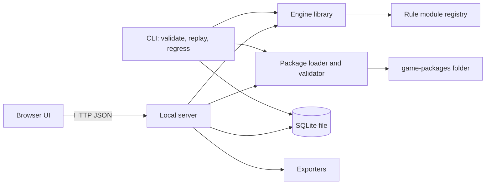
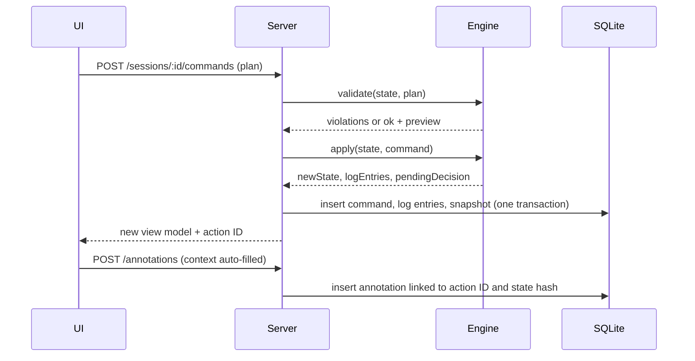

# 03 Architecture

Status: planning document. Phase 1 layers exist in `sim/`: engine entry points, core, coin, package, store and annotate (IC-1).

## 1. Decision summary

| Item | Decision | Confidence |
|---|---|---|
| Architecture | Hybrid simulator, with one narrow revision (section 2) | High |
| Stack | Local web app: TypeScript on Node.js, React UI in the browser, SQLite file | High |
| Process model | One local Node process on `127.0.0.1`. Browser is a thin client | High |
| Engine | Pure TypeScript library. No I/O, no clock, no global random | High |
| Package format | YAML files validated by Zod schemas. JSON Schema generated for editor hints | Medium |
| Extensions | TypeScript rule modules compiled into the app. Packages reference them by ID and version. Packages never carry code | High |
| Persistence | SQLite. Append-only command log, state snapshot per command, annotations | High |
| Packaging | `npm start` for MVP. Electron wrapper is a Phase 5 option | Medium |

## 2. Hybrid architecture: validation and one revision

### 2.1 What the research shows

1. The design uses about 100 mechanics (01-mechanics-inventory.md). Most numbers are `[tune]` values. Those must be data.
2. The 17 operations and special activities are specific procedures. Example: Village Clearance has 4 conditions and 7 ordered effects (06 s3.4). Rally has 3 options, a Europe location and an Agitate sub-step (06 s4.1).
3. A declarative format that expresses these procedures would become a scripting language. The brief says to avoid that.

### 2.2 Revision: "procedures in code, values in data"

| Layer | Holds | Changes need code? |
|---|---|---|
| Package data | Map, pieces, tracks, markers, every cost and limit, every `[tune]` value, deck, card effects built from primitives, scenarios, victory formulas, sequence tables | No |
| Generic COIN handlers | Reusable procedures with data parameters: Train, Sweep, Assault, Rally, March, Attack, Control, CT initiative, Propaganda pipeline | Only for a new procedure shape |
| Game rule modules | Kurdish-specific procedures: Village Clearance, Covert Action, Legal Politics table, Ceasefire, Cross-Border, Pivotals, structural Always lines | Yes, in the same repository, versioned with the package |

Effect: changing Sweep cost from 2 to 1 is a data edit. Changing the order of Village Clearance effects is a module edit with a test.

Problem this avoids: a "universal" operation DSL. Problem this accepts: some design iterations need a TypeScript change. The build plan keeps those changes small (11-build-plan.md, task P3 series).

## 3. Technology stack

| Concern | Choice | Reason |
|---|---|---|
| Language | TypeScript, strict mode | One language for engine, server, UI and tests |
| Runtime | Node.js 24 LTS or later (DEC-27) | Runs on Windows 11 without extra toolchains |
| UI | React with Vite | Fast local dev. Large ecosystem. Plain SVG board |
| HTTP | Fastify | Small, typed, JSON schema routes |
| Database | SQLite through `better-sqlite3` | One local file. Synchronous API fits a single user. Prebuilt Windows binaries ship in the package (DEC-28; fallback is `node:sqlite`) |
| Schemas | Zod 4 with its built-in `z.toJSONSchema` (DEC-37) | One schema source for runtime validation and editor hints |
| YAML | `yaml` package | Comments in card files. Readable diffs |
| Tests | Vitest. One Playwright smoke test | Fast unit tests. Chromium is pre-installed in CI images |
| Lint | ESLint with a restricted-globals rule for the engine folder | Blocks `Date`, `Math.random`, `fetch`, `fs` in the engine |

Rejected stacks are in 13-design-decisions.md (DEC-03).

## 4. Process view

1. The server is the only writer to SQLite.
2. The engine runs only on the server. The UI never computes rules. This keeps one source of truth.
3. The CLI uses the same engine and loader. It needs no server.

## 5. Module boundaries

Single Node project. One `package.json`. Folders act as modules.

| Folder | Responsibility | May import |
|---|---|---|
| `sim/src/engine/*.ts` | Engine entry points `start`, `validate`, `apply` (05 s1, DEC-44) | core, coin, modules |
| `sim/src/engine/core` | State types, canonical hash, seeded RNG, effect primitives, effect applier, log entry builder | nothing outside core |
| `sim/src/engine/coin` | Generic COIN handlers: control, shifts, ops, initiative, Propaganda pipeline, victory evaluator | core |
| `sim/src/engine/modules` | Rule module registry and game modules (`kurdish-coin/*`) | core, coin |
| `sim/src/package` | Load YAML, validate, compile to `Ruleset`, compute package hash | core, modules (registry lookup only) |
| `sim/src/store` | SQLite schema, migrations, repositories | core types |
| `sim/src/annotate` | Context capture types, context builder, category config | core types |
| `sim/src/export` | JSON, Markdown, CSV exporters | store, annotate |
| `sim/src/server` | HTTP routes, session service | all above |
| `sim/src/cli` | `validate`, `replay`, `regress`, `export` commands | all except server and ui |
| `sim/src/ui` | React app | shared types only (no engine import) |
| `game-packages/kurdish-coin/<version>/` | Package data | none (data) |

Dependency rule: arrows point down the table. A test checks imports (P1-01).

## 6. Extension points

| Point | Interface | Used by |
|---|---|---|
| Operation handler | `validate(ctx, plan)` and `resolve(ctx, plan)` | Every Op and SA |
| Event effect primitive | Typed effect object, applied by core | Card effects |
| Rule module hook | `onCardReveal`, `onPhase`, `modifyCost`, `modifyLimit`, `isActionAllowed` | Structural cards, Capabilities, Momentum, Ceasefire limits |
| Propaganda phase | Ordered list of phase handlers named in the package | Sequence of play |
| Sequence of play | `SequenceModel` interface: `legalChoices`, `afterChoice`, `nextCard` | CT two-faction track (MVP). Three or four factions later |
| Victory evaluator | Formula terms in data plus optional module term | Scores, gates, margins |
| Exporter | `export(sessionIds, options)` | JSON, Markdown, CSV |

### 6.1 Rule module contract

1. A module is a TypeScript file under `sim/src/engine/modules/<game>/`.
2. It exports `id`, `version`, `ruleRefs` and its hook functions.
3. Inputs: a frozen read-only `RuleContext` (state view, ruleset, parameters, `rng`, `ruleRef` helper).
4. Output: a list of `Effect` objects, or a `Decision` request, or a `Violation` list. Never a state object.
5. The engine applies effects through core primitives. Core primitives enforce stacking, supply, clamps and shift blocks. A module cannot skip them.
6. Every effect carries a `ruleRef`. The log shows which module and rule produced it.
7. Each module ships with unit tests in the same folder. CI fails if a module has no test file.
8. A package names modules as `kurdish-coin.village-clearance@1`. Validation fails if the registry lacks that ID and major version.

### 6.2 Untrusted packages

1. Package files are data only. The loader never evaluates code, templates or expressions from a package.
2. Formulas use a closed set of term types (04-game-package-spec.md, section 8). No string expressions.
3. An imported package that names an unknown module fails validation.

## 7. Data flow for one action

## 8. Faction count support

| Configuration | Support in this plan |
|---|---|
| 2 factions, CT track | MVP and Phase 3 |
| 3 factions (MOD-3B) | Data model and engine support N factions from Phase 1. Needs a second `SequenceModel` (PP 2.3) in Phase 5 |
| 4 factions (MOD-4A) | Same as 3 factions, plus a shared victory gate term |
| Non-player actors | Rule modules on phase hooks (Legal Politics). No faction seat |

Every state structure is keyed by faction ID. No code path assumes exactly two factions except the CT `SequenceModel`.

## 9. What the architecture does not do

1. No networking beyond `127.0.0.1`.
2. No AI opponent and no move suggestion in the UI. Command-line scripted strategies for batch analysis are allowed (DEC-34).
3. No LLM in rule adjudication.
4. No generic board game platform. Generic COIN handlers exist only where the Kurdish design needs them.

Next step: read 04-game-package-spec.md.
