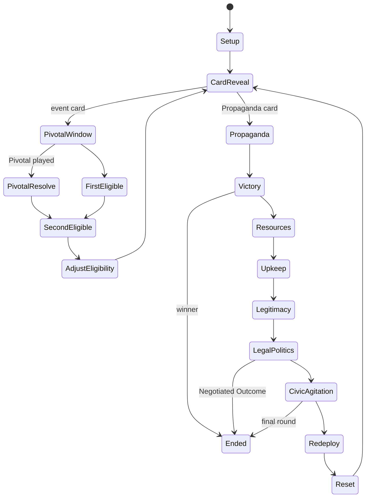

# 05 Rules Engine Specification

Status: planning document. Type sketches describe data shapes, not implementation.

## 1. Engine contract

The engine is one pure function family:

1. `start(ruleset, scenarioId, seed) -> Transition`
2. `legalChoices(ruleset, state) -> ChoiceSet`
3. `validate(ruleset, state, command) -> ValidationResult`
4. `apply(ruleset, state, command) -> Transition`
5. `derive(ruleset, state) -> DerivedView` (Control, totals, scores, Harm counts, margins)

`Transition = { state, stateHash, logEntries[], pending: Decision | null }`. `apply` returns `{ ok: true, validation, transition }` or `{ ok: false, validation }` (DEC-44, `sim/src/engine/index.ts`).

Rules:

1. `apply` never mutates its input. It returns a new state.
2. Identical `ruleset` hash, `state` and `command` give an identical `Transition`. A test asserts this for every command type (09-testing-and-replay.md).
3. `apply` calls `validate` first. An invalid command returns no new state and a `Rejected` result. It never applies part of a command.

## 2. Game state

| Field | Content |
|---|---|
| `meta` | `packageHash`, `rulesetVersion`, `scenarioId`, `seed`, `stateSeq` |
| `rng` | Generator state (section 8) |
| `turn` | `campaign`, `propagandaRound`, `cardIndex`, `phase`, `step` |
| `deck` | `piles[]` (card ID order), `currentCard`, `played[]`, `setAside[]` |
| `hands` | Pivotal cards per faction |
| `initiative` | Cylinder box per faction, `firstEligible`, `secondEligible`, `actedThisCard[]` |
| `spaces` | Per space: pieces by type and flip state, `level`, markers by type and side |
| `pools` | Per piece type: `available`, `outOfPlay` |
| `markerPools` | Available count per marker type |
| `tracks` | All numeric and ordinal tracks, including Resources |
| `flags` | Structural switches, for example `law3175`, `northernIraqVacuum`, `ohalPowersPlayed` |
| `modifiers` | Active Capabilities and Momentum with source card and duration |
| `hidden` | Face-down marker records with space and the engine `stateSeq` at placement. Store action IDs never enter game state; the store maps `stateSeq` to its action ID |
| `pending` | Open `Decision`, if any |
| `history` | Per-game counters needed by rules, for example "Talks held since round N" |
| `ended` | Result object, or null |

Derived values (Control, Total Support, scores, Harm counts) are never stored in `state`. `derive` recomputes them. Log entries record derived values at the moment of each step.

State size: 13,751 bytes as canonical JSON (1,410 bytes gzip) for the full campaign setup (18 spaces, 6 piece types, 15 marker types, 100 card IDs). Measured at P1-03 with a hand-built research setup. Since P2-02 the test measures the Kurdish package setup (`sim/test/state-size.test.ts`): 13,514 bytes (1,457 gzip). Types: `sim/src/engine/core/types.ts` (DEC-36).

## 3. Commands

| Command | Payload | Who issues |
|---|---|---|
| `PlayPivotal` | faction, card ID | Player |
| `ChooseEvent` | faction, side (`unshaded` or `shaded`) | Player |
| `ChooseOperation` | faction, box, `ActionPlan` | Player |
| `Pass` | faction | Player |
| `DeclareCeasefire` | faction (PKK) | Player |
| `ResolveDecision` | decision ID, answer | Player |
| `PropagandaChoice` | phase, choice payload | Player |
| `Advance` | none (reveal next card or next phase when no choice is open) | Player or auto |

Undo is not an engine command. It is a session operation (06-playtest-data-model.md, section 6).

### 3.1 ActionPlan

An `ActionPlan` is the full set of player choices known before resolution.

| Field | Content |
|---|---|
| `op` | Action ID, for example `state.sweep` |
| `locations` | Ordered list of space or box IDs |
| `perLocation` | Handler-specific choices: option number, moves, counts |
| `sa` | Optional `{action ID, locations, perLocation, timing}` with timing `before` or `after` (DEC-16). A later handler may add named interleave points, for example `afterLocation: N` |
| `subActions` | Civic Action or Agitate spend in one space |

Choices that depend on a die roll or hidden result are not in the plan. The engine opens a `Decision` for them during resolution (section 5).

## 4. Validation

`validate` returns `{ ok, violations[], warnings[], preview }`.

| Field | Content |
|---|---|
| `violations[]` | `{ code, message, ruleRef, location }` |
| `warnings[]` | Provisional rule used, ceasefire breach that the action will cause |
| `preview` | Cost per location, total cost, and deterministic effects (piece moves, shifts, activations) where no roll is needed |

### 4.1 Validation layers

1. Sequence: Is the faction eligible? Is the box legal from the responder matrix? Limited Op has one location? Is an SA allowed with this box?
2. Availability: Campaign, flags, Emergency Rule step, posture, Capability or Momentum conditions.
3. Location: Each location meets the handler conditions (terrain, pieces, level, markers, Control).
4. Cost: The faction can pay each location in full (06 s1.4).
5. Supply and stacking: Pieces and markers exist. Stacking holds after the action.
6. Ceasefire: The action is legal but breaks the ceasefire. This is a warning, not a violation (06 s1.8).

### 4.2 Explaining unavailable actions

`legalChoices` returns every action for the active faction, including illegal ones. Each illegal action carries its violations. The UI shows the first violation per action and the full list on expand. Example: `Village Clearance: Emergency Rule is Martial Law. Needs OHAL or OHAL Extended Powers (06 s3.4 condition 1).`

## 5. Resolution model

### 5.1 Steps

Resolution runs as an ordered list of steps. Each step:

1. Reads the current working state.
2. Calls a handler or module, which returns effects or a `Decision`.
3. Applies effects through core primitives.
4. Recomputes Control in touched spaces.
5. Emits one log entry per effect group.

### 5.2 Decisions

A `Decision` pauses resolution. It has an ID, the deciding faction, the prompt, legal answers and the rule that asks.

Examples:

1. Attack: after the roll, the PKK picks which Troops or Police to remove (06 s4.3 item 3).
2. Guard upkeep shortfall: the State picks Guards to remove (05 s6.3).
3. Event choice with no named chooser: the executing faction picks (PA-01).

Solo play: the user answers every Decision. The UI labels which faction is deciding.

The open Decision is part of `state`. Saving and resuming in the middle of an action works.

### 5.3 Atomic commit unit

A player command plus all Decisions it opens form one Action Transaction. The transaction gets its action ID when the first command is accepted. Each Decision answer is a child command with its own sequence number under the same action ID.

## 6. Turn structure as a state machine

The phase list is data (`sequence.yaml`). Each phase name maps to a handler. Phases skip by condition, for example Legal Politics before C3 (05 s6.5).

Structural Always lines run in `CardReveal`, before the Pivotal window (05 s5.7).

Pivotal window: the engine opens one Decision per eligible faction that holds a playable Pivotal. If both play, the Second Eligible faction has priority and the First keeps its card (research 05 s4 item 3).

## 7. Core primitives and invariants

Core primitives are the only code that writes state.

| Invariant | Enforced by |
|---|---|
| Piece counts per type are constant across map, pools and boxes | Every piece primitive. Checked after each step in debug and test builds |
| Stacking limits | `placePieces`, `movePieces` |
| Track bounds and clamps (PA-04) | `adjustTrack`, `stepOrdinal` |
| Legitimacy overflow to Resources (04 s3.2) | `adjustTrack` for Legitimacy |
| Shift blocks and Office caps | `shiftLevel` |
| Marker supply (PA-09) | `placeMarker` |
| Underground placement default | `placePieces` |

## 8. Determinism

1. Random source: xoshiro128** 1.1, seeded by two SplitMix64 outputs (DEC-35, `sim/src/engine/core/rng.ts`). Its full state (four 32-bit words) lives in `state.rng`. No library random source. Bounded draws use rejection sampling, so no modulo bias.
2. Every die roll and random pick logs the raw value, the modifiers and the result.
3. Deck building uses the same generator. The deck order is stored in `state.deck`. The seed alone can rebuild it, and the stored order is a check.
4. No clock. Timestamps are added by the store, outside the engine.
5. Iteration order: every map or set iteration uses sorted IDs or package order. Never object insertion order from runtime data.
6. Canonical serialization: sorted keys (UTF-16 code unit order), no undefined values, safe integers only, plain objects and arrays only. The state hash is lowercase hex SHA-256 of the UTF-8 text (`sim/src/engine/core/canonical.ts`).
7. Lint: the engine folder bans `Date`, `Math.random`, `performance`, timers, network and file APIs.

## 9. Scoring and victory

1. `derive` computes Total Support, Total Opposition, domestic Bases, Legitimacy, Harm counts, face-down Covert count and both scores from `victory.yaml` terms.
2. Victory phase: if not the first Propaganda round, evaluate each faction: score minus Covert penalty (09 s3 step 1), Harm gate, qualification. Apply PA-10 for equal margins.
3. Final scoring: reveal Covert markers, recompute, apply the final margin formula and tie order (09 s4).
4. Negotiated Outcome: concessions, then final margins with the Covert switch (09 s5).
5. The log stores a `ScoreCheck` entry at every check with each term value. The record sheet (09 s6) is computed at game end and stored with the result.

## 10. Log entries produced by the engine

| Kind | Content |
|---|---|
| `CardRevealed` | Card ID, pile, Always line effects |
| `ChoiceMade` | Faction, box, side or plan |
| `ValidationPassed` | Checks run with their rule refs (summary) |
| `CostPaid` | Track, amount, per location |
| `EffectApplied` | Primitive, parameters, before and after values, rule ref, PA ref if any |
| `EffectSkipped` | Primitive, reason (supply, block, clamp), rule ref |
| `DieRolled` | Purpose, raw, modifiers, result |
| `DecisionOpened` / `DecisionAnswered` | Decision record |
| `ControlChanged` | Space, before, after |
| `EligibilityChanged` | Factions and boxes |
| `PhaseStarted` / `PhaseEnded` | Phase ID |
| `ScoreCheck` | All score terms, thresholds, gates, result |
| `GameEnded` | Result, labels, record sheet |
| `StopRuleFlag` | Research stop rule number (12 s9) and evidence. Rule 3: a harmful action raised its user's net score. Rule 4: a faction wins with Harm above its limit (also a test failure). Rule 6 (proxy): a faction's only legal choice was Pass on 3 cards in a row, for the second time in the game. The research rule says "no useful action"; legal but useless actions stay a designer judgment through notes (DEC-34) |

Every engine entry has its kind, the `stateSeq` it belongs to, rule and PA refs and a data body. The engine never sees action IDs (section 2). The store adds `entryId = <actionId>-E<n>` and the action ID (06 s2, s3.6).

## 11. Performance target

One command applies in under 50 ms on a normal laptop. A full campaign replay (about 400 commands) runs in under 10 seconds.

Measured at P2-12 (`sim fuzz --seeds 50`, Node 24.22.1, Linux cloud container): 1,200 commands over 50 S0 games, apply mean 0.68 ms, max 5.50 ms. At that rate 400 commands replay in about 0.3 s. A full campaign has more pieces in play; remeasure in Phase 3c.

Next step: read 06-playtest-data-model.md.
