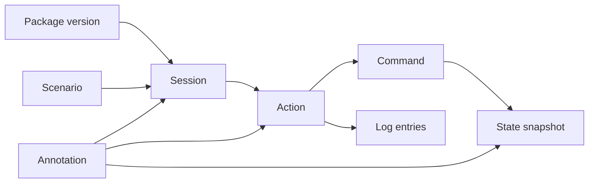

# 06 Playtest Data Model

Status: planning document. Table sketches describe the SQLite schema, not final DDL.

## 1. Chain of evidence

Every record links back along this chain:

Package version, then scenario, then state, then action, then result, then observation.

## 2. Identifiers

| ID | Format | Stable because |
|---|---|---|
| `packageHash` | SHA-256 of canonical package content | Content-addressed |
| `sessionId` | ULID created by the store | Created once |
| `actionId` | `<sessionId>-A<seq>` where seq counts accepted Action Transactions across the whole session, all branches | Never reused, even after undo or in another branch |
| `commandId` | `<actionId>-C<n>` | Parent plus order |
| `entryId` | `<actionId>-E<n>` | Parent plus order |
| `stateHash` | SHA-256 of canonical state | Content-addressed |
| `annotationId` | ULID | Created once |
| `branchId` | ULID. Main branch created with the session | Created once |

ULIDs are generated in the store, not in the engine. They never affect rules.

## 3. Tables

### 3.1 package_versions

| Column | Meaning |
|---|---|
| `package_hash` (PK) | Content hash |
| `package_id`, `version`, `ruleset_version`, `schema_version` | From manifest |
| `parent_version`, `change_description` | From manifest |
| `content` | Compressed canonical package content |
| `app_version` | Simulator version that first stored this package content (informational; sessions hold their own code identity) |
| `stored_at` | Timestamp |

### 3.2 sessions

| Column | Meaning |
|---|---|
| `session_id` (PK) | ULID |
| `name` | User label |
| `package_hash` (FK) | Exact rules |
| `scenario_id` | From package |
| `seed` | Integer |
| `options` | JSON of option values used |
| `app_version` | Simulator build that created the session |
| `code_fingerprint` | SHA-256 over all rules-execution code: `engine/core`, `engine/coin` and `engine/modules` |
| `modules` | JSON list of `id@semver` and source hash per module |
| `excluded_cards` | JSON list with reasons |
| `created_at`, `updated_at` | Timestamps |
| `status` | `active`, `ended`, `abandoned`, `readOnly` |
| `current_branch_id`, `head_action_id` | Pointer |
| `result` | JSON result and record sheet when ended |
| `notes` | Free text session header |

### 3.3 branches

| Column | Meaning |
|---|---|
| `branch_id` (PK) | ULID |
| `session_id` (FK) | Parent |
| `forked_from_action_id` | Null for main |
| `label`, `created_at` | Display |

MVP uses one branch per session plus undo (section 6). The table exists from Phase 1 so branching needs no migration later.

### 3.4 actions

| Column | Meaning |
|---|---|
| `action_id` (PK) | See section 2 |
| `session_id`, `branch_id` | Owners |
| `seq` | Session-wide allocation order (part of the ID) |
| `branch_seq` | Order inside the branch, used for history and replay |
| `kind` | `cardChoice`, `pivotal`, `propagandaChoice`, `advance`, `setup` |
| `faction` | Acting faction or null |
| `card_id` | Current card |
| `campaign`, `propaganda_round`, `card_index`, `phase` | Turn position |
| `box` | Initiative box or null |
| `summary` | One-line human text, for example "PKK Rally in Botan, Hakkari (2 Resources)" |
| `state_hash_before`, `state_hash_after` | Links |
| `status` | `committed`, `undone`, `pending` (Decision open) |
| `undone_by` | Action ID of the undo marker, if any |
| `created_at` | Timestamp |

### 3.5 commands

| Column | Meaning |
|---|---|
| `command_id` (PK) | See section 2 |
| `action_id` (FK) | Parent |
| `n` | Order in action |
| `type`, `payload` | Engine command as JSON |
| `validation` | JSON of violations, warnings and preview at submit time |
| `rng_before` | Generator state before |

### 3.6 log_entries

| Column | Meaning |
|---|---|
| `entry_id` (PK) | See section 2 |
| `action_id` (FK) | Parent |
| `n` | Order |
| `kind` | From 05-rules-engine-spec.md section 10 |
| `rule_ref`, `assumption_ref` | Rule ID and PA ID if any |
| `data` | JSON body: before and after values, roll data, reasons |
| `text` | Rendered sentence for the history view |

### 3.7 states

| Column | Meaning |
|---|---|
| `state_hash` (PK) | Hash |
| `content` | Compressed canonical state |
| `derived` | JSON of derived view (Control, scores, Harm counts) for fast review |

Snapshot policy: store the state after every committed command. Deduplicated by hash. Reason: about 30 KB per state, about 400 actions per campaign, under 15 MB per full campaign before compression. This removes replay as a dependency for review and undo. Replay remains the integrity check (09-testing-and-replay.md).

### 3.8 annotations

Full definition in 07-annotation-and-feedback-spec.md. Key links: `session_id`, `branch_id`, `action_id`, `anchor` (`executed`, `proposed`, `decision`, `state`, `session`, `debrief`), `state_hash`, `context` JSON, `category_ids`, `text`.

### 3.9 categories

| Column | Meaning |
|---|---|
| `category_id` (PK) | Slug, for example `balance` |
| `label`, `hotkey`, `color`, `sort`, `active` | Display |

Seeded with the 14 categories in the brief. The user edits them in settings. Removing a category deactivates it. Existing notes keep it.

### 3.10 regression_cases

| Column | Meaning |
|---|---|
| `case_id` (PK) | ULID |
| `source_session_id`, `source_action_id`, `source_annotation_id` | Where it came from |
| `package_hash` | Original rules |
| `seed`, `scenario_id`, `options` | Inputs |
| `command_range` | First and last command IDs |
| `expectations` | JSON list of checks (09-testing-and-replay.md, section 7) |
| `label`, `created_at` | Display |

### 3.11 regression_runs

| Column | Meaning |
|---|---|
| `run_id` (PK) | ULID |
| `case_id` (FK) | Case |
| `target_package_hash` | New rules |
| `outcome` | `same`, `changed`, `incompatible`, `error` |
| `first_failure` | Command ID and violation, if incompatible |
| `diff` | JSON of metric differences |
| `created_at` | Timestamp |

### 3.12 metrics

Per session, per Propaganda round: Resources, Legitimacy, Europe, scores, margins, Harm counts, Pass counts, action counts by type, Available pieces. Rebuilt from states. Stored for fast cross-session review. Fields cover the logging sheet in 12 s4 (research).

## 4. Mapping to the research logging sheet

| Sheet item (12 s4) | Source in the data model |
|---|---|
| 1 Scenario, rules version, setup, seed, card order | `sessions`, `package_versions`, `states.content.deck` |
| 2 Initiative variant | `sessions.options` |
| 3 Card, First Eligible, choices and boxes | `actions` |
| 4 Best alternative and why | Annotation category `alternative` (07 s3) |
| 5 Rules question and answer source | Annotation category `rule-ambiguity` |
| 6 to 12 Per round values | `metrics` |
| 13 Decision changed by Legal Space or Offices | Propaganda prompt (07 s4.4) |
| 14 Harmful action uses | `metrics` action counts |
| 15 Pieces Available at Reset | `metrics` |
| 16 to 17 Result and record sheet | `sessions.result` |
| 18 Play time | Store timestamps |
| 19 Content comments | Annotation categories `historical`, `content` |

## 5. Write rules

1. One SQLite transaction per accepted command: command, log entries, state, action update.
2. Rows in `commands`, `log_entries` and `states` are never updated after commit. An `actions` row with status `pending` (open Decision) may update `state_hash_after`, `summary` and `status`. When its Action Transaction completes, the row freezes, except `status` and `undone_by` for undo.
3. Annotations are editable. Each edit keeps the previous text in `annotation_revisions`.
4. WAL mode on. Auto backup at session start through the SQLite online backup API (or `VACUUM INTO`), never a raw file copy, because committed rows can still sit in the WAL. Keep the last 10 (P3a-08).

## 6. Undo

1. Undo applies to the last committed action in the current branch.
2. The store sets the action to `undone` and adds an `undo` entry to the history. Nothing is deleted.
3. Head moves to `state_hash_before` of that action.
4. Annotations on the undone action stay. Their view shows "linked action was undone".
5. The next new action gets a new seq. Its ID never equals the undone ID.
6. Redo is out of scope for MVP. Branching from an undone action is Phase 4.
7. If the undone action used the seeded RNG (a die roll, shuffle or random pick in its log), the undo entry sets `undoneAfterRandom: true` (DEC-33). Undo stays allowed. The flag lets analysis spot repeated rolls.

## 7. Session compatibility

| Case | Behavior |
|---|---|
| Same package hash | Resume |
| Package folder changed, hash differs | Resume with the stored package content. Banner: "This session uses version X. Current folder is version Y" |
| `code_fingerprint` differs (any rules code changed, shared or module) | Replay check first. Identical: resume. Different: read-only |
| Module major version missing | Read-only. Banner names the module |
| Schema version unsupported | Read-only. Export still works |
| Replay check fails on load (optional in settings) | Read-only. Report the first differing command |

Next step: read 07-annotation-and-feedback-spec.md.
