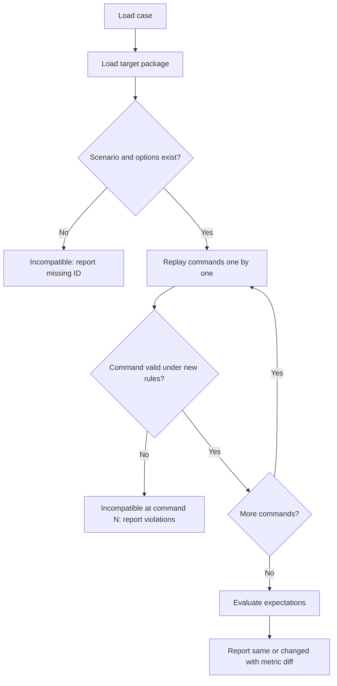

# 09 Testing and Replay

Status: planning document.

## 1. Test pyramid

| Layer | Tool | Runs | Scope |
|---|---|---|---|
| Unit | Vitest | Every save and CI | Core primitives, handlers, modules, schema, derive |
| Rule scenario | Vitest with YAML fixtures | CI | One rule situation: board fixture, command, expected log and state facts |
| Replay | Vitest and CLI | CI | Recorded command logs replay to the same hashes |
| Integration | Vitest against the server with a temp SQLite file | CI | Session lifecycle, notes, export |
| End to end | Playwright, one smoke test | CI on main | Start, act, note, export |

TDD rule from `AGENTS.md`: write the failing assertion first, then the minimum code.

## 2. Required test suites

| ID | Suite | Examples |
|---|---|---|
| T-PRIM | Rule primitives | Stacking refusal. Supply exhausted (PA-09). Track clamp (PA-04). Legitimacy overflow to Resources. Shift blocks and Office cap |
| T-VAL | Action validation | Each op: one legal case, one case per violation code. Limited Op with two locations rejected. SA with Limited Op rejected. Ceasefire breach gives a warning |
| T-OPS | Op resolution | Worked example from 06 s7 (Botan Sweep) reproduces exactly. Mountain modifier rounding. Assault never removes Underground. Attack roll and attrition with a fixed seed |
| T-EVT | Event effects | Each encoded card side: fixture, apply, expected facts. "Do as much as you can" partial cases. Always lines on reveal and under a Pivotal |
| T-SEQ | Turn sequencing | Each responder matrix row (05 s2.3). Eligibility after each box. Both pass. Pivotal priority. Reset sets PKK First |
| T-PROP | Propaganda | Each phase in order. Skip rules (first round victory, Legal Politics before C3). Final round stops after phase 6.6 |
| T-SCORE | Scoring | Start scores of all four scenarios equal 09 s2 tables (State 21 and PKK 4 for the full campaign, and so on) |
| T-VIC | Victory | One qualifies. Both qualify, higher margin. Equal margin (PA-10). Harm gate blocks. Covert penalty at check. Final margin formula. Tie order |
| T-PERV | Perverse incentive | 09 s7.1 table cases: relative change for Village Clearance is never positive |
| T-DET | Determinism | Same seed and commands twice give equal hashes. Different seeds give different deck orders |
| T-SAVE | Save and load | Save, restart server, resume. Resume at an open Decision. Package folder changed: session still loads stored content |
| T-PKG | Package validation | One fixture per V- code in 04 s9 with the exact message |
| T-ANN | Annotation context | 07 s10 list |
| T-EXP | Export integrity | Every ID reference in a JSON export resolves. Markdown export contains each note text and its action ID. CSV has one row per note |
| T-MOD | Module contract | Each module has tests. Each module output passes through core primitives (spy test). No module returns a state object |
| T-ARCH | Architecture | Import boundaries (03 s5). Engine folder free of banned globals |

## 3. Rule scenario fixtures

A fixture is a small YAML file:

| Field | Content |
|---|---|
| `package` | Package path or test package |
| `start` | Scenario ID, or a partial state patch over a scenario |
| `seed` | Integer |
| `commands` | List of engine commands |
| `expect` | Facts: `track`, `pieces`, `level`, `marker`, `control`, `violations`, `logContains`, `decisionOpen` |
| `source` | Research rule reference under test |

Facts are behavior assertions. A fact that would still pass if the rule were inverted must be removed (`AGENTS.md` testing rule 3).

## 4. Golden replay files

1. `sim/test/golden/*.json` hold full sessions: package hash, seed, commands, final state hash and per-action hashes.
2. CI replays each one. Any hash change fails with the first differing action ID.
3. A rule change that changes a golden file needs the file regenerated in the same pull request with a note in the PR body.

## 5. Card encoding checks

1. Each encoded card side has at least one T-EVT fixture.
2. A review list (`sim validate --cards`) prints prose and encoded effects side by side for human review. `reviewedAgainstText` is set only by the designer.
3. A check fails if an encoded side names a space, piece or number that does not appear in its prose. This catches typos. It cannot prove meaning.

## 6. Replay and undo

| Need | Mechanism | Phase |
|---|---|---|
| Undo a recent action | Move head to the stored `state_hash_before`. Mark action undone (06 s6) | 2 |
| Inspect earlier state | Load stored snapshot by hash | 2 |
| Replay a session | Start from scenario and seed. Apply the commands of committed, not-undone actions on the branch path, in `branch_seq` order, then the accepted commands of a `pending` action at the head, and compare the head snapshot. Before each action, check that the current hash equals its `state_hash_before`. Compare each `state_hash_after` | 2 (CLI), 4 (UI) |
| Reproduce a reported issue | Open the note's state. Or replay to its action | 2 |
| Branch from a past action | New branch row, head at that state | 4 |
| Compare two branches or versions | Metric diff per round | 4 |

Undone actions are skipped when replaying to the current head. Regression extraction instead follows the target action's historical path: the actions that led to its `state_hash_before`, plus the target itself, even if the target was later undone. The `state_hash_before` check catches a broken chain at once.

Snapshots make undo and inspection independent of replay. Replay proves that stored snapshots are correct.

## 7. Regression cases from playtests

### 7.1 Case content

A case is: package hash, scenario, seed, options, a command list (from session start to a target action) and expectations.

Expectation types:

| Type | Example |
|---|---|
| `stateFact` | After A-0042: Botan level is Passive Opposition |
| `metric` | After round 2: PKK score is 18 |
| `logFact` | A-0042 log contains `EffectApplied` with rule `pkk.rally` |
| `outcome` | Session winner and label |

### 7.2 Run against a new version

1. Seeds stay fixed. A deck change can still change card order. The report flags "deck order differs" as its own result.
2. A command that is not valid under the new rules is never forced. The run stops and reports it. This meets "report compatibility failures explicitly".
3. Diff report: tracks, scores, margins, Harm counts and action outcome facts, per round, old against new.

### 7.3 Limits

1. A case shows how the same choices play under new rules. It does not show what a player would choose under new rules.
2. Batch play and strategy search are Phase 5.

## 8. CI

1. `npm test` runs unit, rule scenario and replay suites.
2. `npm run check` runs lint, type check and package validation for every version folder in `game-packages/`.
3. Coverage target: 90 percent lines for `engine/core` and `engine/coin`. No target for UI.

Next step: read 10-mvp-scope.md.
