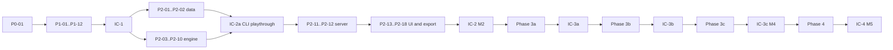

# 11 Build Plan

Status: planning document. Phase 1 done: P0-01, P1-01 to P1-12 and IC-1. Phase 2 done: P2-01 to P2-18, IC-2a and IC-2. Phase 3a built (P3a-01 to P3a-10); IC-3a open. Phase 3b done (P3b-01 to P3b-08, PRs #45 to #61); IC-3b open. Phase 3c done (P3c-01, P3c-02; DEC-78); IC-3c open. Phase 4 started before IC-3c by owner decision (DEC-80): P4-01 to P4-03 done. **Next: P4-04** (branch from a past action).

## 0. Resume here (updated 2026-11-05, P4-03)

A new session starts here. Read this section, then `AGENTS.md`, then the task row.

**Next: P4-04** (branch from a past action; accept: new branch plays, original branch intact). Phase 4 started before IC-3c by owner decision (DEC-80). IC-3a, IC-3b and IC-3c stay open for the designer.

**P4-03 is done:** Home nav **Metrics review** shows one row per session and Propaganda round with research 12 s4 items 6 to 12, 14 and 15, grouped by item; checked sessions limit the table and the `metrics.csv` download. `sim export --format csv` also writes `metrics.csv`; Markdown section 5 uses the same table. Item 13 still needs the 07 s4.4 prompt (no task). Sessions stored before P4-03 show blanks for the new board columns.

**P4-02 is done:** `sim export <sessionId...> --format markdown` writes all six 07 s8.2 sections; `--format csv --out <folder>` writes `annotations.csv` and `actions.csv` (07 s8.3). Acceptance per DEC-82: the brief is not in the repository, so a test reads each research 12 s4 logging sheet input that 06 s4 maps to notes, actions or sessions from the export. No UI link yet for Markdown or CSV (Home links JSON only).

**P4-01 is done:** the Feedback review screen filters by ruleset version (`rulesetVersion`, with a Ruleset column), sets the status of the selected notes in one request (`POST /api/review/status`) and keeps named filters in the browser (DEC-81). Remaining 07 s7 items with no task yet: the date range filter and the bulk add tag and export selection actions (P4-02 exports whole sessions, not a note selection). Create regression case fits P4-06.

**P3c-02 is done:** `scenarios/full-campaign.yaml` (10 s2) now has tests for every track, level, marker, Pivotal hand and the five piles (`test/full-campaign.test.ts`), beside the existing score, Control and totals tests (`test/kurdish.test.ts`). Golden `test/golden/full-campaign-seed-7.json`: 158 commands, C1 to C5, final scoring in round 5. The CLI replay, package load included, runs in under 10 seconds (measured 185 to 286 ms; 05 s11).

**P3c-01 is done:** structural switches (10 s6.2) are flags. Parameters `switch.on.<Campaign>` and `switch.off.<Campaign>` hold the table; `coin/switches.ts` sets them at setup (every Campaign up to the first) and at each Reset (the Campaign entered). Six gates now read the flag, not the Campaign: hot pursuit, Village Clearance, Covert Action, Declare Ceasefire, OHAL Extended Powers and Return by Civic Action. The five-pile deck and Campaign advance already existed (P2-04, P3a). **Old sessions (DEC-79):** a session stored before P3c-01 opens read-only; start a new session for IC-3a or IC-3b play.

**P3b-08 is done:** `scenarios/scenario-b.yaml` and `scenario-c.yaml` from research 10 s4 and s5; start scores equal 09 s2.3 (B 20 and 14, C 16 and 23). Scenario B State threshold: manifest option `threshold.state` (48 default, 46; DEC-24, DEC-77). P3b-07 is complete: P3b-07k is done (DK-081, DK-094, DK-095, DK-096; procedure `legal.localWins`, condition `markersAtLeast`; the P3b-07h "reveal a second" Drop is fixed). P3b-07j is done (DK-078, DK-082, DK-083, DK-088, DK-097; free action constraint `activeGuerrillas`). P3b-07h is done (DK-079, DK-080, DK-085, DK-086, DK-087, Propaganda DK-099; procedure `strasbourg.report`). P3b-07i is done (DK-084, DK-089 to DK-092; no engine addition).
1. Already built: all C3 cards and the C3 Propaganda card (P3b-07a to 07c); C4 legal-party cards DK-060, DK-065 to DK-068 and Propaganda DK-077 (P3b-07d), with procedures `legal.ban`, `legal.successor` and `legal.successorFull` (one copy shared with the phase); C4 ceasefire cards DK-056 to DK-059 and DK-073 (P3b-07e), with procedures `ceasefire.declare` (shared with the command), `ceasefire.accept`, `ceasefire.end` and `ceasefire.pkkBroken`; C4 Europe, harm and report cards DK-061 to DK-064 and DK-069 (P3b-07f), with procedures `hrw.denial` and `hrw.report`; C4 Northern Iraq, Momentum and Guards cards DK-070 to DK-072, DK-074 and DK-075 (P3b-07g), with modifiers `customs-union` and `lending-conditions` (read by Village Clearance) and free action constraints `maxLift` and `saAtCost`; all C5 cards and Propaganda DK-099 (P3b-07h to 07k), with procedures `strasbourg.report` and `legal.localWins`, free action constraint `activeGuerrillas` and condition `markersAtLeast`; all four Pivotals and the three structural cards (P3b-06); procedures `legal.officeLines`, `covert.revealRandom` (DK-079 and DK-080 reveal up to 2), `hizbullah.unattributed`; Event Europe cap; PKK side restriction (`executors`).
2. Remaining in Phase 3b: IC-3b only. C4 has 20 eligible cards and C5 has 19 and DK-093, each for a pile of 12. V-CARDS passes; the full campaign starts (DEC-76). Phase 3c checks its play.

**Owner decisions in force**
- **DEC-82 (2026-11-05):** P4-02 acceptance is the 07 s8.2 sections, the 07 s8.3 files and the logging sheet inputs (items 1 to 5, 14, 16 to 19) in the export.
- **DEC-80 (2026-11-05):** Phase 4 starts before IC-3c. IC-3c findings may force rework; record any in this plan.
- **DEC-81 (2026-11-05):** saved review filters live in the browser.
- **DEC-78 (2026-11-05):** Phase 3c starts before IC-3b. IC-3b findings may force rework; record any in this plan.
- **DEC-79 (2026-11-05):** sessions stored before P3c-01 open read-only.
- **DEC-70 project order (2026-11-04):** 1. Finalize rules, cards and mechanics (P3b-07 C4 and C5, P3b-08 scenarios, Phase 3c full campaign). 2. Finish the engine and UI for manual play and test (IC-3a to IC-3c). 3. Automated games with bot profiles, as the Scenario A program (docs 19 to 23): extend profiles to every C3 to C5 rule and card, then run and review. Stage 3 replaces "automated opponents" and "batch execution" in Phase 5. The no-simulations rule holds until stage 3.
- **DEC-77 (2026-11-05):** Scenario B State threshold default 48; 46 stays a session option (DEC-24).
- **DEC-76 (2026-11-05):** the full campaign starts once V-CARDS passes; no extra block until Phase 3c.
- Phase 3b proceeds before IC-3a. IC-3a findings may force rework; record any in this plan.
- **No more automated simulations for now.** Do not start frozen runs. The bot reference [26](26-bot-reference.md) lists what to review before the next ones.
- Deeper bot planning (three-step beam search, option A in 26) is proposed, not approved.

**Open items outside the task order**
- IC-3a: the designer's full Scenario A playthrough. Briefing: [25](25-p-shield-designer-notes.md) (P-SHIELD test).
- Printable rulebook PDF is stale since DEC-62 (Host Pressure, rules 4.3.4). Run `make rulebook` where XeLaTeX is installed.
- **Repository renamed** to `Penguin-Pants/HandfullOfBandits`. Older links to `HandfulOfBandits` redirect. A session needs the new name in its GitHub scope to resolve review threads.

**Carried follow-ups from P3b-02 to P3b-07g** (details in section 4). Closed in P3b-06a: the ceasefire step concern (Drop, DEC-67) and the Event Europe cap (fixed).
1. **Before the next simulations:** batch bots never file a closure case, declare a ceasefire (by command; ceasefire cards are Events they may take), answer the ceasefire step (`cli/candidates.ts` `AUTO_PHASES`) or play a Pivotal other than ARGK (`cli/candidates.ts` pivotal family).
2. **Proposed (P3b-07, doc 32 s5):** `movePieces` with `toState` moves Underground Guerrillas first, so "move ... Underground" sides (DK-005, DK-017, DK-041, DK-047, DK-071) leave Active ones behind. Fix: move the other faces first. Changes C1 and C2 play; needs approval.
3. **Proposed, not approved:** one shared Campaign comparison helper for the repeated `campaign.order` checks (six call sites; P3b-06b added `coin/pivotal.ts` `campaignReached`).
4. **Closed (DEC-72):** DK-051 now files only while Legal Space is Open or Prosecuted (fixed in P3b-07d, PR #52).
6. **Closed (owner approved, P4-02):** `server/service.ts` stores `DeclareCeasefire` as kind `cardChoice` in box `limitedOp` (it was `advance` with no box). Sessions stored before keep the old row; the export counts it by command type.
5. **Proposed (P3b-08):** the Home screen lists every manifest option for every scenario, so `threshold.state` shows for Scenarios A and C (where it does nothing) and `hotPursuit` for B and C (C1 and C2 only). Fix: list only the options the chosen scenario sets (`scenarios[].options` keys in the package summary, `ui/home/Home.tsx`). Needs approval.
7. **Proposed (P4-03):** global link color: `a { color: var(--accent); }` in `ui/styles.css` in place of `.metrics a`, so the Home JSON export link reads on the dark theme. Needs approval.

**Recent merged work**

| PR | Content |
|---|---|
| #40 | Scenario A automated playtest program (docs 19 to 23) |
| #41 | Exact spending search (`cand-4`) and rerun |
| #42 | Tied Civic Action allocations (`cand-5`), `experiment run --resume`, rerun; current evidence |
| #43 | DEC-62: Host Pressure with no legal replacement ends the Operation; overview [24](24-scenario-a-playtest-overview.md) |
| #44 | P-SHIELD designer notes [25](25-p-shield-designer-notes.md) and bot reference [26](26-bot-reference.md) |
| #45 | P3b-01: Emergency Rule step table tests; Phase 3b started |
| #46 | P3b-02 to P3b-05: Village Clearance, Covert Action, Legal Politics, Ceasefire and review fixes |
| #47, #48 | P3b-06a and P3b-06b: structural cards and the general Pivotal window |
| #49 to #53 | P3b-07a to P3b-07e: C3 cards, C4 legal-party and ceasefire cards (DEC-68 to DEC-73) |
| #54 | P3b-07f: C4 Europe, harm and report cards |
| #55 | P3b-07g: C4 Northern Iraq, Momentum and Guards cards |
| #56, #57 | C5 encoding draft (doc 34, DEC-75) and P3b-07h: C5 reports, harm and flag case cards |
| #58 | P3b-07i: C5 Syria and northern Iraq cards |
| #59 | P3b-07j: C5 operations cards (DEC-75, DEC-76) |
| #60 | P3b-07k: C5 late politics cards; P3b-07 complete |
| #61 | P3b-08: Scenarios B and C |
| #62 | P3c-01: structural switches as flags (DEC-78, DEC-79) |
| #63 | P3c-02: full campaign setup tests and golden replay |
| #64 | P4-01: cross-session review (ruleset filter, bulk status, saved filters) |
| #65 | P4-02: full Markdown and CSV export |

**Environment:** Node 24 is required (`sim/package.json`). Use `make check` and `make test` from the repository root. Work on the branch the session names; open each task as one PR.

## 1. How to use this plan

1. Each task is one small pull request. Target under 400 changed lines, tests included. Generated files (for example `game-packages/_schema/`) and test fixture data do not count.
2. Do tasks in ID order inside a phase unless "Deps" allows parallel work.
3. Each task follows TDD (`AGENTS.md`): failing assertion first.
4. A phase ends at its integration checkpoint (IC). Do not start the next phase until the IC passes.
5. Paths are relative to the repository root. `sim/` is the application. `game-packages/` holds data.

Task field key: **Obj** objective, **Files** files or modules, **Deps** dependencies, **Steps** implementation steps, **Accept** acceptance criteria, **Tests** automated tests, **Risks**, **Out** deliverables.

## 2. Phase 1: rules and data foundation

### P0-01 Toolchain and repository skeleton

- **Obj:** Create `sim/` with TypeScript strict, Vitest, ESLint, scripts `test`, `check`, `start`.
- **Files:** `sim/package.json`, `sim/tsconfig.json`, `sim/eslint.config.*`, `sim/vitest.config.*`, `Makefile` (targets `test`, `check`, `start`).
- **Deps:** none.
- **Steps:** 1. Confirm current Node LTS and `better-sqlite3` Windows prebuilds. Record result in 13-design-decisions.md. 2. Scaffold. 3. Add one placeholder test that fails, then passes.
- **Accept:** `make test` and `make check` pass on Windows 11 and Linux CI.
- **Tests:** Placeholder test.
- **Risks:** Native SQLite module fails on Windows. Fallback: `node:sqlite`.
- **Out:** Working toolchain.

### P1-01 Module boundaries and banned globals

- **Obj:** Enforce 03 s5 import rules and engine purity.
- **Files:** `sim/eslint.config.*`, `sim/test/arch.test.ts`.
- **Deps:** P0-01.
- **Steps:** 1. Restricted-imports rule per folder. 2. Restricted-globals rule for `sim/src/engine/**`.
- **Accept:** A test file that imports `fs` in the engine fails lint.
- **Tests:** T-ARCH.
- **Risks:** Rules too strict for test helpers. Exclude `*.test.ts`.
- **Out:** Lint config.

### P1-02 Seeded RNG and canonical hash

- **Obj:** Deterministic random source with serializable state. Canonical JSON and SHA-256.
- **Files:** `sim/src/engine/core/rng.ts`, `sim/src/engine/core/canonical.ts`.
- **Deps:** P1-01.
- **Steps:** 1. Implement a documented generator (xoshiro128** or PCG32). 2. `rollDie`, `pickRandom`, `shuffle` return `{value, rng}`. 3. Canonical serializer with sorted keys.
- **Accept:** Known-answer vectors match. Same seed gives same shuffle on two runs.
- **Tests:** T-DET (unit part).
- **Risks:** Subtle bias in `pickRandom`. Use rejection sampling.
- **Out:** RNG and hash utilities.

### P1-03 Core state types

- **Obj:** Define `GameState`, `DerivedView`, `Command`, `Decision`, `LogEntry`, `Effect` types (05 s2, s3, s10).
- **Files:** `sim/src/engine/core/types.ts`, `sim/src/engine/core/state.ts`.
- **Deps:** P1-02.
- **Steps:** 1. Types keyed by faction ID (N factions). 2. `emptyState(ruleset)`. 3. Measure canonical size of a full setup state.
- **Accept:** Full campaign setup state serializes under 30 KB or the measured value is recorded in 06 s3.7.
- **Tests:** Round trip serialize and hash.
- **Risks:** Over-design. Add only fields named in 05 s2.
- **Out:** Type module.
- **Done:** Types in `types.ts`, `emptyState(ruleset, scenarioId, seed)` in `state.ts` (DEC-36). Full setup state measures 13,751 bytes (05 s2, 06 s3.7).
- **Open for P2-01:** Research lists Campaign as a track (research 04 s3). State holds it in `turn.campaign` (05 s2). Do not add a Campaign track too, or two fields hold one value.

### P1-04 Package schemas (core subset)

- **Obj:** Zod schemas for manifest, parameters, factions, pieces, map, tracks, markers, scenarios.
- **Files:** `sim/src/package/schema/*.ts`.
- **Deps:** P1-03.
- **Steps:** 1. Schemas per 04 s3 to s4. 2. Generate JSON Schema to `game-packages/_schema/`.
- **Accept:** Valid fixture parses. Each invalid fixture fails with a path.
- **Tests:** T-PKG (schema cases).
- **Risks:** Schema churn. Keep `schemaVersion: 1` until P2 ends.
- **Out:** Schemas and JSON Schema files.
- **Done:** One schema per file in `sim/src/package/schema/`, `parsePackageFile(file, data)` returns issues with dot paths (DEC-37). `make schema` writes `game-packages/_schema/`; a test fails on drift. Field shapes recorded in 04 s4. T-PKG schema cases: 1 valid fixture per file, 33 invalid cases.
- **Open for P1-05:** Compile schema output to `Ruleset` (needs the package hash). V-REF for `placedAs`, `emblemState`, `resourcesTrack`, `owner`, link ends, gate steps and stacking IDs.
- **Resolved after review:** Harm count only in `victory.yaml` (DEC-38). Support scale and level caps as data (DEC-39). Schema changes move to P1-05.

### P1-05 Package loader, hash and reference validation

- **Obj:** Load a YAML folder, compute content hash, run V-REF, V-PIECES, V-STACK, V-LINKS, V-PARAM, V-FACTIONS.
- **Files:** `sim/src/package/load.ts`, `sim/src/package/validate.ts`, `sim/src/cli/validate.ts`.
- **Deps:** P1-04.
- **Steps:** 1. Schema changes: remove marker `countsAs` (DEC-38); add `map.yaml` `supportLevels` and marker `capsLevel` (DEC-39). 2. Load and normalize. 3. Hash. 4. Validators return messages per 04 s9, including scenario `level` within the `supportLevels` range. 5. CLI `sim validate <dir>`.
- **Accept:** CLI prints file, path, ID and sentence for each error. Exit code 1 on error.
- **Tests:** T-PKG fixtures, one per code.
- **Risks:** Hash changes on whitespace. Hash the normalized object, not the bytes.
- **Out:** Loader, validator, CLI command.
- **Done:** Schema changes for DEC-38 and DEC-39. `sim/src/package/load.ts` (`readPackageDir`, `loadPackage`, `compileRuleset`), `validate.ts` (V-REF, V-PIECES, V-STACK, V-LINKS, V-PARAM, V-FACTIONS and new V-RANGE), CLI `make validate DIR=<dir>` (DEC-40). Fixture `sim/test/fixtures/packages/valid/`. T-PKG: 27 invalid cases covering every code, plus missing file, YAML syntax error, duplicate key, unknown-file warning, hash stability and CLI exit codes.
- **Open for later tasks:** V-FACTIONS match with the sequence model (P2-03). V-REF for card IDs in `pivotalHand`, `pivotals` and `excludedCards` (P2-05). V-MODULE, V-OPTIONS, V-CARDS, V-ENCODE, V-EFFECT, V-VICTORY, V-MISSING, V-PROVISIONAL and V-SCORE-CHECK with the files they check. Core `Ruleset` does not carry `supportLevels` or `capsLevel` yet; add them when P1-07 `shiftLevel` reads them.

### P1-06 Test package "tiny"

- **Obj:** A 4-space, 2-faction test package for engine tests.
- **Files:** `sim/test/packages/tiny/*.yaml`.
- **Deps:** P1-05.
- **Steps:** 1. Two factions, 2 piece types each, 1 track each, 1 ordinal track, 3 cards.
- **Accept:** `sim validate` passes.
- **Tests:** Used by later tasks.
- **Risks:** None.
- **Out:** Fixture package.
- **Done:** `sim/test/packages/tiny/`: factions `blue` and `red`, pieces `soldier`, `fort`, `rebel` (flip states), `camp`; spaces `city`, `farm`, `hills` and external `refuge`; tracks `cash.blue`, `cash.red` and ordinal `border`; markers `harm` (blocks), `mark` (sides), `office` (`capsLevel`). Scenario `start` added for P1-10 `start` and IC-1. `make validate DIR=sim/test/packages/tiny` passes; `sim/test/tiny.test.ts` checks it.
- **Done in P2-05:** the 3 cards (`sim/test/packages/tiny/cards/c1.yaml`).

### P1-07 Core effect primitives

- **Obj:** `placePieces`, `removePieces`, `movePieces`, `setPieceState`, `adjustTrack`, `setTrack`, `stepOrdinal`, `placeMarker`, `removeMarker`, `flipMarker`, `setFlag`, `shiftLevel` with invariants (05 s7).
- **Files:** `sim/src/engine/core/effects/*.ts`.
- **Deps:** P1-06.
- **Steps:** 1. One primitive per file. 2. Each returns `{state, entries}`. 3. PA-04 and PA-09 behavior with `assumption_ref`. 4. `count` accepts an integer or `{min, max}` (04 s5, DEC-33).
- **Accept:** Piece total invariant holds after every primitive in property tests.
- **Tests:** T-PRIM.
- **Risks:** Shift blocks need markers config. Read from ruleset.
- **Out:** Primitive library.
- **Done:** 12 primitives in `sim/src/engine/core/effects/` with `applyEffect` (DEC-41). `Ruleset` now carries stacking, space kind and terrain, `levelRange`, marker `blocks` and `capsLevel`, piece `placedAs` and track `overflow`. New track field `overflow: {track, costParam}` with V-REF and V-PARAM checks. Tiny gains track `standing` with overflow. T-PRIM: unit cases for every primitive and skip reason, unknown IDs, and a random-effects test (5 seeds x 400 effects) that checks piece totals, marker totals, track bounds, stacking, level range and input immutability.
- **Moved by DEC-41:** step 4 (`count {min, max}`) goes to the card effect schema in P2-05. The PA-09 Harm warning goes to P1-09.

### P1-08 Parameters access and literal check

- **Obj:** Handlers read numbers only through parameter IDs.
- **Files:** `sim/src/engine/core/params.ts`, `sim/test/no-literals.test.ts`.
- **Deps:** P1-07.
- **Steps:** 1. `param(ruleset, id)` with typed access and a clear error. 2. Static scan of handler folders for numeric literals above 2.
- **Accept:** A handler with literal `3` fails the scan.
- **Tests:** Scan test.
- **Risks:** False positives. Allow-list by comment with a reason.
- **Out:** Parameter helper.
- **Done:** `Ruleset.parameters` and `param(ruleset, id, kind)` in `sim/src/engine/core/params.ts` (DEC-42). Lint rule `local/no-game-literals` in `sim/eslint/literals.js` scans `engine/coin` and `engine/modules` for numeric literals other than 0, 1 and 2; allow comment `// literal-ok: <reason>`. Tests: `params.test.ts` (each kind and error), load test for the compiled map, `sim/test/no-literals.test.ts` on fixtures in `sim/test/fixtures/literals/` (literal `3` in a handler fails).
- **Changed from Steps:** the scan flags every literal other than 0, 1 and 2 (04 s4.5), not only literals above 2, so fractions fail too.

### P1-09 Derive: Control, totals, scores

- **Obj:** `derive` for Control and formula terms (04 s8).
- **Files:** `sim/src/engine/coin/derive.ts`, `sim/src/engine/core/terms.ts`.
- **Deps:** P1-07.
- **Steps:** 1. Control per 03 s6. 2. Term evaluator for the closed set. 3. Score and Harm count terms. 4. PA-09 warning when a Harm marker type runs out (moved from P1-07, DEC-41).
- **Accept:** Tiny package values match hand math.
- **Tests:** T-SCORE (tiny).
- **Risks:** Term set too small. Add terms only with a schema bump.
- **Out:** Derive module.
- **Done:** `victory.yaml` is a core file with a schema subset: `scores`, `harmCount`, `totals` (DEC-43). V-REF, V-RANGE and new V-VICTORY check its terms; V-VICTORY also needs a scenario threshold per player faction. `Ruleset` gains space `pop`, piece `countsForControl`, `victory`, `harmMarkers` and scenario `thresholds`. `sim/src/engine/core/terms.ts` evaluates the 8 formula terms and 8 space conditions. `sim/src/engine/coin/derive.ts`: `control` (pieces exceed all other factions combined) and `derive` (Control, totals, scores, Harm counts, margins). `placeMarker` adds `warning: harmSupplyExhausted` to its PA-09 skip for a Harm marker. Tiny gains `victory.yaml`. T-SCORE: `derive.test.ts` hand math on tiny, `terms.test.ts` edge cases, 12 new loader cases, 8 new schema cases.
- **Size:** about 620 changed lines without fixtures and generated files, above the 400-line target. The victory.yaml schema and its checks were not in Files; they are the only data source for score terms (DEC-38).
- **Open for later tasks:** `moduleTerm` and the track, campaign, flag, option, adjacency and `selected` conditions (P2-05 and the module registry). `harmLimit`, `checkSkipFirstRound`, `tieOrder`, `finalMargin`, `recordSheet` and the Covert penalty at a check (P3a-02). P2-01 must ship a `victory.yaml`: start scores 21 and 4 come from it.

### P1-10 Engine apply loop and log entries

- **Obj:** `start`, `validate`, `apply` skeleton with one command type (`AdjustTrackDebug` in test builds only) and full log entries.
- **Files:** `sim/src/engine/index.ts`, `sim/src/engine/core/log.ts`.
- **Deps:** P1-09.
- **Steps:** 1. Transition type. 2. Validation result type. 3. Log entry builder with rule refs.
- **Accept:** Applying one command returns a new state, a hash and entries with before and after values.
- **Tests:** T-DET (apply twice, same hash).
- **Risks:** Debug command leaks to production. Register it only in tests.
- **Out:** Engine entry points.
- **Done:** `createEngine(handlers)` in `sim/src/engine/index.ts` with `start`, `validate`, `apply`; `logEntry` in `sim/src/engine/core/log.ts`, now used by the effect primitives (DEC-44). Types `AnyCommand`, `Violation`, `ValidationResult`, `Transition` (with `stateHash`), `ApplyResult`, `CommandHandler` in `types.ts`. `AdjustTrackDebug` lives in `sim/test/debug-command.ts`. `start` builds the scenario position from new `Ruleset.scenarios` (replaces `Ruleset.thresholds`) through `setupState`. New lint layer `engine` for files directly in `sim/src/engine/`. Tests: `index.test.ts` (start, validate, apply, rejection, input immutability, `ControlChanged`, T-DET), `setupState` cases, loader scenario compile, 4 new T-ARCH fixtures.
- **Fixed in review:** the bare-import purity check skipped the new `engine` layer (fixture `engine/bad-bare.ts`). Three copies of the own-key lookup merged into `own` in `core/state.ts`.
- **Size:** about 470 changed lines in `sim/src` and `sim/eslint`, tests included, above the 400-line target. Scenario compile is the only source for `start` (DEC-44).
- **Open for later tasks:** scenario `pivotals`, `options`, `excludedCards` and `finalRound` (P2-04, P2-05, P2-10). Phase stays `setup` after `start` until the deck exists (P2-04).

### P1-11 Store schema with annotation tables

- **Obj:** SQLite schema for all tables in 06 s3, including annotations, categories, branches and regression tables.
- **Files:** `sim/src/store/schema.sql`, `sim/src/store/migrate.ts`, `sim/src/store/repos/*.ts`.
- **Deps:** P1-10.
- **Steps:** 1. Migration 001. 2. Repos for package_versions, sessions, actions, commands, log_entries, states, annotations, categories. 3. One-transaction commit function.
- **Accept:** Commit of one command writes action, command, entries and state atomically. A thrown error leaves no rows.
- **Tests:** Store integration tests on a temp file.
- **Risks:** Schema churn. Migrations, never edits to 001 after merge.
- **Out:** Store layer.
- **Done:** Migration 001 `sim/src/store/schema.sql` with all 06 s3 tables plus `annotation_revisions`, 15 seeded categories (07 s5). `sim/src/store/migrate.ts` (`openStore`, `migrate`), `ulid.ts`, `common.ts`, repos `packages`, `sessions` (session, main branch and setup action in one transaction), `actions` (`commitAction`), `commands`, `log-entries`, `states`, `annotations` (revisions, one debrief per session), `categories` (DEC-45). Tests: `store.test.ts` on a temp file (atomic commit, rollback on a mid-commit error, rollback of a failed session start, state dedup, unknown session, annotations), `ulid.test.ts`. A mutation check (transaction removed) fails the rollback test.
- **Size:** about 850 added lines, 190 of them SQL DDL and seed data and 220 tests, above the 400-line target. The plan puts all tables and 8 repos in one task.
- **Open for later tasks:** append Decision answers to a `pending` action (P2-09 or the first handler with a Decision). Repos for branches, metrics and regression tables come with their users (P2-10, P4-04, P4-06). Undo (P2-17). Backup (P3a-08).

### P1-12 Annotation context builder

- **Obj:** Build the context object of 07 s4 from state, derived view, action record and a UI focus input.
- **Files:** `sim/src/annotate/context.ts`, `sim/src/annotate/types.ts`.
- **Deps:** P1-11.
- **Steps:** 1. Pure function `buildContext(input)`. 2. Size check under 8 KB.
- **Accept:** Context for the P1-10 transition contains every 07 s4.1 and s4.2 field that has a source.
- **Tests:** T-ANN-03, T-ANN-04.
- **Risks:** Field drift from spec. Test lists fields by name from 07.
- **Out:** Context builder.
- **Done:** `buildContext(input)` in `sim/src/annotate/context.ts`, input and context types in `types.ts` (DEC-46). `RulesetFaction.resourcesTrack` compiled from `factions.yaml`. Tests in `context.test.ts`: every 07 s4.1 and s4.2 field by name (T-ANN-03), nulls only where the source has no value yet, values for the P1-10 transition, compact diff of pieces, levels, markers and Control, costs, rolls and PA refs, proposed plan with violations, no action fields without an action, size under 8 KB, input unchanged (T-ANN-04 engine part; store part in IC-1).
- **Open for later tasks:** `active_faction` from the sequence model (P2-03), `current_card_title` from cards (P2-05), `legal_choices_summary` from `legalChoices` (P2-03), `rule_sources` from the package rule index (P4-08). The session service fills them (P2-11).

### IC-1 Integration checkpoint (Phase 1 exit)

Script test: load `tiny`, start a session in the store, apply one command, save a note anchored to the action, reload from disk, verify hashes and note links. Matches the Phase 1 exit criterion in the brief.

- **Passed:** `sim/test/ic1.test.ts`. The stored package reloads with the same hash, both stored states hash to their keys, the stored command replays from the stored package to the same hashes, entries keep before and after values, the note links to the action and its after state, and saving the note does not move the head (T-ANN-04). New `packageContent(data)` in `sim/src/package/load.ts` is the one source for the package hash and the stored content (04 s10.3).
- **Phase 1 status:** done, except the 3 tiny cards of P1-06 (blocked until P2-05). Phase 2 may start.
- **Open for P2-11:** the session service renders log entry `text` (IC-1 uses a plain form) and fills the caller inputs of the context builder (DEC-46).

## 3. Phase 2: first playable slice (S0 Opening)

### P2-01 Kurdish package 0.1.0: static data

- **Obj:** Map, pieces, tracks, markers, factions, parameters from 03, 04, 05 and 09.
- **Files:** `game-packages/kurdish-coin/0.1.0/*.yaml`.
- **Deps:** IC-1.
- **Steps:** 1. Enter data by hand from research tables. 2. Cite sections in `source`. 3. Add `assumptions.yaml` with PA-01 to PA-17.
- **Accept:** `sim validate` passes. Start scores equal 21 and 4 (09 s2.2).
- **Tests:** T-SCORE for the full campaign setup.
- **Risks:** Typos in adjacency. Test that adjacency equals the 03 s4.1 list.
- **Out:** Package data.
- **Done:** `game-packages/kurdish-coin/0.1.0/`: manifest, parameters (03, 04, 05, 09 values), factions, pieces, map (18 locations, 25 links), tracks, markers, victory, `assumptions.yaml` (PA-01 to PA-17) and `scenarios/full-campaign.yaml`. `sim/test/kurdish.test.ts`: validate passes with no issues, adjacency equals the 03 s4.1 list, T-SCORE 21 and 4, margins -28 and -26, Control as in 10 s2.2. New optional schema `assumptions` (04 s7, DEC-49).
- **Moved:** the full campaign scenario file came with P2-01, because its accept test (start scores) needs a setup. P2-02 adds S0 and the totals check.
- **Open for later tasks:** operation and SA parameters come with their handlers (P2-06 to P2-08). Host posture limits on external links are handler rules (07 s5), not map gates (DEC-49). Pivotal hands and `excludedCards` come with cards (P2-05).

### P2-02 Scenarios: full campaign setup and S0

- **Obj:** Scenario files for the full setup and S0.
- **Files:** `game-packages/kurdish-coin/0.1.0/scenarios/*.yaml`.
- **Deps:** P2-01.
- **Steps:** 1. Full setup from 10 s2. 2. S0 with `testOnly: true`, `finalRound: 1`, pile size 8.
- **Accept:** V-PIECES passes. Totals reconcile with 10 s2.
- **Tests:** T-PKG.
- **Risks:** None.
- **Out:** Scenario files.
- **Done:** `scenarios/s0.yaml` (10-mvp-scope s2.1): full campaign setup, `testOnly`, `finalRound: 1`, new optional scenario field `pileSize: 8`, no Pivotals, `excludedCards` for the 7 C1 Capability, Momentum and DK-013 cards plus Pivotal DK-015. `full-campaign.yaml` gains its 10 s2.3 Pivotals. `sim/test/kurdish.test.ts`: both setups reconcile with the 10 s2.2 totals table. `sim/test/state-size.test.ts` now measures the package setup; `sim/test/full-setup.ts` is deleted.
- **Open for later tasks:** `propagandaLast` (P2-04). V-REF for card IDs in `pivotals` and `excludedCards` (P2-05).

### P2-03 CT sequence model

- **Obj:** `SequenceModel` for the CT two-faction track (05 s2 to s3).
- **Files:** `sim/src/engine/coin/sequence/ct.ts`.
- **Deps:** IC-1.
- **Steps:** 1. Legal boxes from the adjacency graph. 2. Eligibility update. 3. Pass income. 4. Both pass.
- **Accept:** Each matrix row returns the 05 s2.3 cells.
- **Tests:** T-SEQ.
- **Risks:** Hidden two-faction assumptions leak. Keep them inside this file.
- **Out:** Sequence model.
- **Done:** `sequence.yaml` with schema (`model`, `boxes`, `adjacency`, `swapAfter`, `firstEligibleAtStart`, `passIncome`), loaded as a core file into `Ruleset.sequence`. V-FACTIONS checks the player count against the model in `engine/modules/registry.ts`; V-REF checks factions and boxes. `engine/coin/sequence/ct.ts`: legal boxes from the graph, sequence violations, cylinder placement, eligibility adjustment. `Pass` handler with pass income (`coin/handlers.ts`). `start` sets the PKK First Eligible. Resolution context `engine/core/exec.ts` and optional `CommandHandler.execute` (DEC-50). T-SEQ: `engine/coin/sequence/ct.test.ts`.
- **Open for later tasks:** `legalChoices` (05 s1 item 2) grows with the handlers (P2-06 to P2-09). Pivotal window (Phase 3a). `propagandaPhases` in `sequence.yaml` (P2-10).

### P2-04 Deck building

- **Obj:** 05 s1.1 procedure with seeded shuffle, mandatory top-8 rule and chain order.
- **Files:** `sim/src/engine/coin/deck.ts`.
- **Deps:** P2-03.
- **Steps:** 1. Pile size from scenario. 2. Mandatory swap. 3. Chain order. 4. Propaganda in bottom third. 5. Scenario flag `propagandaLast` for S0.
- **Accept:** 1000 seeds: mandatory cards always in the top part. Propaganda position always in range. With `propagandaLast`, all 8 cards precede it.
- **Tests:** Property tests.
- **Risks:** Scaled pile rule for S0 differs from research. S0 is `testOnly`.
- **Out:** Deck builder.
- **Done:** `engine/coin/deck.ts` `buildDeck(ruleset, rng, cards, chains, options)`: pure, seeded, one pile per Campaign. Parameters `deck.pileSize` (12) and `deck.topSize` (8). Scenario fields `pileSize` and `propagandaLast` (S0 sets both); `RulesetScenario` now carries `finalRound`, `pileSize`, `propagandaLast`, `excludedCards`, `pivotals` and `options`. Property tests over 1000 seeds in `engine/coin/deck.test.ts`.
- **Open for P2-05:** the builder takes card data as input, because cards have no schema until P2-05. P2-05 feeds it from the card files and builds the deck at `start`.

### P2-05 Card schema and encoding of 8 C1 cards plus Propaganda

- **Obj:** Card schema (04 s4.8) with `count` as an integer or `{min, max}` (moved from P1-07, DEC-41), effect primitives `choice`, `conditional`, `freeAction`, `forEachSpace`, `forEachPiece` and condition terms `terrainIn`, `spaceKind`, `adjacentTo`, `selected` (DEC-33). Encode the 8 S0 cards.
- **Files:** `sim/src/package/schema/cards.ts`, `game-packages/kurdish-coin/0.1.0/cards/c1.yaml`.
- **Deps:** P2-04.
- **Steps:** 1. One-time stub generator from the deck CSV (run from `/tmp`, not committed, per `AGENTS.md`). 2. Hand-encode effects. 3. Set `reviewedAgainstText` after review.
- **Accept:** V-ENCODE passes for S0. DK-003 unshaded ("up to 2 Village Guards in each of up to 2 Mountain or Plain spaces with State Control and Police") encodes without a module procedure.
- **Tests:** T-EVT fixture per side (16 fixtures).
- **Risks:** Encoder misreads prose. Side-by-side review output (09 s5).
- **Out:** Encoded cards.
- **Done:** Card schema `sim/src/package/schema/cards.ts` (type-key form like `victory.yaml`): all core primitives plus `transferPool` and `movePieces.toState`, card-level `choice`, `conditional`, `forEachSpace`, `freeAction`, `count {min, max}`, conditions `adjacentTo`, `selected`, `trackAtLeast`, `trackAtMost`, `trackIn`, `flag`. Loader reads `cards/*.yaml`; checks V-REF, V-EFFECT, V-CARDS and scenario-scoped V-ENCODE (DEC-51). `cards/c1.yaml`: 16 C1 cards from a one-time stub generator, 8 S0 cards and DK-016 hand-encoded; `cards/pivotal.yaml`: the 4 Pivotal stubs. `start` builds the deck and Pivotal hands (`engine/coin/setup.ts`) and refuses a blocked scenario. Tests in `sim/test/kurdish.test.ts`, `load.test.ts`, `schema.test.ts`. Tiny gets its 3 cards (closes the P1-06 block).
- **Moved:** the 16 T-EVT fixtures need the event runner, so they come with P2-09. `forEachPiece` has no S0 user; it comes with its first card (Phase 3a).
- **Open:** the full campaign scenario stays blocked by V-CARDS and V-ENCODE until C2 to C5 are encoded (Phase 3). Closed at P3b-07j (DEC-76). Faction default `pivotalHand` is not compiled; scenarios list hands.

### P2-06 State Ops: Train, Garrison, Sweep, Assault

- **Obj:** Generic handlers with Kurdish parameters.
- **Files:** `sim/src/engine/coin/ops/state/*.ts`.
- **Deps:** P2-03.
- **Steps:** 1. Validate per 06 s2. 2. Resolve with PA-07 and PA-08. 3. Civic Action sub-step.
- **Accept:** 06 s7 worked example reproduces.
- **Tests:** T-VAL and T-OPS for each op.
- **Risks:** Train option 3 and Civic Action costs interplay. Separate fixtures.
- **Out:** Four handlers.
- **Done:** Operation framework `engine/coin/ops/`: `ActionHandler` (check, cost, execute), `ChooseOperation` command (box, Limited Op one location, SA only in Op + SA, SA pairing, total cost against Resources, SA timing before or after with each part checked on the board it meets), plan readers, shared helpers and package IDs (`ids.ts`, DEC-52). Handlers `state.train` (3 options, Civic Action sub-action), `state.garrison`, `state.sweep`, `state.assault`; `state/civic-action.ts` is shared with Propaganda (P2-10). Parameters for 06 s2 and 07 s1.3. Preview is the effects up to the first die roll. T-VAL and T-OPS in `ops/state/state-ops.test.ts`, with the 06 s7 worked example.
- **Open:** Cross-Border Sweep and Assault in the KDP and PUK Zones (Phase 3a). `legalChoices` lists (P2-11 uses `validate` per plan).

### P2-07 PKK Ops: Rally, March, Attack, Coerce

- **Obj:** Handlers per 06 s4.
- **Files:** `sim/src/engine/coin/ops/pkk/*.ts`.
- **Deps:** P2-03.
- **Steps:** 1. Rally three options and Europe location. 2. March activation condition. 3. Attack roll, Decision for removal choice, attrition. 4. Coerce with PA-05.
- **Accept:** Each rule line in 06 s4 has a fixture.
- **Tests:** T-VAL, T-OPS.
- **Risks:** Rally option 3 limit (Pop + Bases) on external boxes. Fixture for box Pop 1.
- **Out:** Four handlers.
- **Done:** `ops/pkk/rally.ts` (place, base, grow, flip, Europe track with the Ban cost and cap, host posture rules, Agitate sub-action), `ops/pkk/march.ts` (one-step groups, activation condition, Restricted entry cost and activation, Syria under PA-16 option), `ops/pkk/attack.ts` (seeded roll, removal order with a Police-first choice, attrition, bonus Guerrilla), `ops/pkk/coerce.ts` (PA-05 order, Pop 3+ cost). `ops/pkk/agitation.ts` is shared with Propaganda. Map tag `rallyAtSupport` on Western Cities. One fixture per 06 s4 rule line in `ops/pkk/pkk-ops.test.ts`.
- **Decided:** the Attack removal choice is a plan field (`prefer: police`), made before the roll, not a Decision after it (DEC-51). Rally takes no piece from the map when Available is empty (04 s2.1 item 1 is not in the slice).

### P2-08 SAs: Air Mobility, Ambush, Extort, Strike Collaborators

- **Obj:** Handlers per 06 s3.1, s5.1, s5.2, s5.3 with PA-06, PA-12, PA-14.
- **Files:** `sim/src/engine/coin/ops/sa/*.ts`.
- **Deps:** P2-06, P2-07.
- **Steps:** 1. SA pairing rules. 2. Timing field. 3. Handlers.
- **Accept:** SA with Limited Op rejected. In an Ambush space, Attack resolves as normal and removes 1 extra piece (PA-06).
- **Tests:** T-VAL, T-OPS.
- **Risks:** "Interleaved" timing complexity. MVP allows `before` and `after` only. Record as a decision.
- **Out:** Three handlers.
- **Done:** four SA handlers in `ops/sa/`: `state.air-mobility` (PA-14), `pkk.ambush` (PA-06: Attack as normal plus 1 extra removal in the Attack order), `pkk.extort` (PA-12 subset), `pkk.strike-collaborators` (Law 3175, PKK Harm, Europe -1). Pairing and timing in `ChooseOperation` (DEC-16); an SA sees its Op's locations (`ActionOptions.opLocations`). Tests in `ops/sa/sa.test.ts`: SA with a Limited Op or Op Only is rejected; the PA-06 case removes 1 extra piece.
- **Decided:** Ambush is checked before the Attack activates, so its plan uses timing `before`; its extra removal has no attrition (06 s5.1 "No attrition" kept for the extra piece). Strike Collaborators removes 1 Guard per space unless the plan says `guards`.

### P2-09 Event execution and Always lines

- **Obj:** Execute a card side with "do as much as you can", ownership limits and Always lines on reveal (05 s5).
- **Files:** `sim/src/engine/coin/events.ts`.
- **Deps:** P2-05, P2-08.
- **Steps:** 1. Side choice. 2. Effect list runner with skip logging. 3. Free actions with no eligibility change.
- **Accept:** DK-003 Always line moves 16 Guards to Available on reveal.
- **Tests:** T-EVT.
- **Risks:** Free action needs the full plan UI. Reuse the op plan flow.
- **Out:** Event runner.
- **Done:** `engine/coin/events.ts` runs card effects in order with answers from the command (`ChooseEvent.answers`: option label or index, count, space list, free action plan or null); a missing or bad answer is a `needsAnswer` or `badAnswer` violation that carries a `Question` (DEC-51). Free actions run the action handlers with `free: true` and event constraints, an SA constraint included (DK-002 Attack with Ambush). `coin/turn.ts` reveals cards (Always lines on reveal, a second Propaganda card in a row set aside) and reveals the next card once both factions acted. `Advance` reveals the first card. T-EVT: one fixture per side of the 8 S0 cards plus reveal tests in `engine/coin/events.test.ts`. DK-003 Always moves 16 Guards to Available.
- **Open:** the PKK restriction on Legal Politics event sides (05 s5 item 1) comes with those cards (Phase 3b). Capability and Momentum cards (Phase 3a).

### P2-10 Propaganda round (slice phases) and final scoring

- **Obj:** Phases Victory (skip), Resources, Upkeep, Legitimacy (8 steps), Civic Action and Agitation, final scoring, record sheet.
- **Files:** `sim/src/engine/coin/propaganda/*.ts`, `sim/src/engine/coin/victory.ts`.
- **Deps:** P2-09.
- **Steps:** 1. Phase pipeline from `sequence.yaml`. 2. Phase handlers. 3. Final margin and tie order. 4. One `metrics` row per Propaganda round: score, margin, income, Resources and Harm count per faction (research 12 s4 items 6 to 12; DEC-34). 5. `StopRuleFlag` entries for research stop rules 3, 4 and 6 (05 s10).
- **Accept:** Hand-computed income and Legitimacy for a fixture board match.
- **Tests:** T-PROP, T-VIC, T-PERV (formula level).
- **Risks:** Civic Action cap and choice UI. Decision-based spend form.
- **Out:** Propaganda pipeline.
- **Done:** `sequence.yaml` `propagandaPhases` (checked against the handler registry). Pipeline `coin/propaganda/pipeline.ts`: a Propaganda card starts a round; `Advance` runs the open phase with no choice, `PropagandaChoice` with one. Handlers: Victory (skip in round 1; check with the Covert penalty, Harm gate and PA-10), Resources, Upkeep (Guard removal choice on a shortfall), Legitimacy (8 steps, seeded Covert exposure, 07 s8.2 Emergency steps), Legal Politics (skip while Absent), Civic Action and Agitation as two phases (cap, Control, Troops and Police). Final scoring after Agitation of the final round: Covert reveal, final margins, tie order, labels, record sheet with score change from start for test scenarios. `RoundMetrics` log entry per round; `StopRuleFlag` for rules 3, 4 and the rule 6 Pass-only proxy (`coin/stop-rules.ts`). Tests in `coin/propaganda/propaganda.test.ts`.
- **Open:** Redeploy and Reset (Phase 3a); a non-final round stops there with `notInSlice`. The session service writes `metrics` rows from `RoundMetrics` entries (P2-11).

### IC-2a Engine-only playthrough

CLI test plays S0 to the end with a scripted command list and a fixed seed. Golden replay file stored. No server or UI needed. This proves rules before UI work.

- **Passed:** `sim/test/ic2a.test.ts` plays S0 with seed 7 under `scriptedPolicy` (`sim/src/cli/play.ts`: First Eligible takes the Event with auto answers, the responder takes the first legal one-location Op, else Pass; Advance through Propaganda) to final scoring in 24 commands. Golden file `sim/test/golden/s0-seed-7.json` holds the commands and every state hash; `replay` reports the first differing step. Regenerate with `UPDATE_GOLDEN=1 make test` after a deliberate rules change.

### P2-11 Session service and API

- **Obj:** HTTP API: packages, validate, sessions (create, list, load), commands, legal choices, history, states, annotations, export.
- **Files:** `sim/src/server/*.ts`.
- **Deps:** IC-2a.
- **Steps:** 1. Fastify routes. 2. Session service wraps engine and store. 3. Package content and module source hashes stored on session start. 4. Resume runs a replay check when a module hash differs.
- **Accept:** API integration tests run a short session.
- **Tests:** Integration suite.
- **Risks:** Concurrency with two tabs. One active writer per session, reject stale `head_action_id`.
- **Out:** Local server.
- **Done:** Fastify 5.12.7. `sim/src/server/service.ts` (`SessionService`): package list and validation, session create (package content stored, setup action), command validate and submit as one action transaction with a stale-head check (409), legal choices, history with entry text (`server/text.ts`), states by hash, notes with auto context (`buildContext`), metrics rows from `RoundMetrics`. Sessions reload rules from stored content; a changed code fingerprint (`server/fingerprint.ts`) runs a replay check on first load and marks the session read-only on a difference. Routes in `server/app.ts` under `/api`; `npm start` serves on 127.0.0.1. Store repo `metrics.ts`. Integration suite `sim/test/api.test.ts` plays S0 to the end through the API.
- **Open:** export route (P2-18), undo route (P2-17).

### P2-12 Replay CLI and performance check

- **Obj:** `sim replay <sessionId|file>` compares hashes per action. Measure apply time. `sim fuzz --seeds 50` plays S0 with random legal choices (T-FUZZ).
- **Files:** `sim/src/cli/replay.ts`.
- **Deps:** P2-11.
- **Accept:** Replay of the IC-2a session reports "identical". Timing recorded in 05 s11.
- **Tests:** T-DET, golden replay, T-FUZZ.
- **Risks:** None.
- **Out:** CLI command.
- **Done:** `sim replay <file.json>` and `sim replay <sessionId> [--db]` (`sim/src/cli/replay.ts`) on the shared `engine/replay.ts` step replay (also used by the session service resume check; `store` lists the stored steps). `sim fuzz --seeds N` (`cli/fuzz.ts`) plays S0 with a seeded random policy over legal choices and reports failures with seed and commands. Tests `sim/test/p2-12.test.ts`: the IC-2a file replays "identical", a stored session replays, 50 fuzz seeds pass. Timing in 05 s11: apply mean 0.68 ms, max 5.50 ms.

### P2-13 UI shell, Home screen, package check screen

- **Obj:** React app, Home (package, scenario, options, seed, name, saved sessions) and validation report.
- **Files:** `sim/src/ui/*`.
- **Deps:** P2-11.
- **Accept:** Start disabled with errors. PA warnings listed.
- **Tests:** Component tests for the Start rule.
- **Risks:** Styling time. Plain CSS only.
- **Out:** UI shell.
- **Done:** React 19.3.1 and Vite 8.3.5 (`npm run ui` dev server with `/api` proxy, `npm run build` to `sim/dist/ui`, served by `npm start`). `sim/src/ui/`: `App.tsx` (Home, package check, play), `api.ts` client, `home/Home.tsx` (package, scenario with blocked marks, options, seed with random, name, saved sessions with Resume, PA list), `home/start-rule.ts`, `check/PackageCheck.tsx`, plain CSS with light and dark variables. Engine types reach the UI through `server/api-types.ts` (03 s5). Component tests with jsdom and Testing Library in `ui/home/home.test.tsx`, mocked API in `sim/test/ui/mock-api.ts`.

### P2-14 Board and status bar

- **Obj:** SVG schematic board with selection and detail card. Status bar.
- **Files:** `sim/src/ui/board/*`, `sim/src/ui/status/*`.
- **Deps:** P2-13.
- **Accept:** All 18 locations show counts, levels, markers and Control from the server view model.
- **Tests:** View model mapping unit tests.
- **Risks:** Layout coordinates. Hand-set in `map.yaml`.
- **Out:** Board.
- **Done:** server view model `sim/src/server/view.ts` (`boardView`: 18 locations with layout, level name, Control, pieces by face with shape, variant and emblem face, markers with hidden flag, links, status bar data), sent as `head.view` and at `GET /api/sessions/:id/states/:hash/view`. UI `ui/board/Board.tsx` (SVG nodes, dashed external links, level band, Control ring, click and Shift-click selection, hover title with stack contents, `SpaceDetail` card), `ui/board/PieceIcon.tsx` (DEC-29, DEC-30), `ui/status/StatusBar.tsx`. Tests: `server/view.test.ts` (mapping), `ui/board/board.test.tsx` (components).
- **Open:** right-click menus (DEC-47 B) come with the faction panel actions (P2-15).

### P2-15 Faction panel, event panel, Decisions, Propaganda flow

- **Obj:** Plan building, live validation, preview, commit, Decisions inline, event side choice, phase list.
- **Files:** `sim/src/ui/faction/*`, `sim/src/ui/event/*`, `sim/src/ui/propaganda/*`.
- **Deps:** P2-14.
- **Accept:** Every illegal action shows a reason (T-UI-03).
- **Tests:** Component tests with mocked API.
- **Risks:** Per-op plan forms are many. One generic form driven by handler metadata.
- **Out:** Play controls.
- **Done:** server `legalChoices` returns every box with its reason and every Op and SA with OK (legal locations) or the first violation, plus plan form metadata (`server/forms.ts`, one generic form). View model adds card sides and the Propaganda phase list. UI `faction/FactionPanel.tsx` (boxes, Op list, plan from board selection with per-location fields, SA choice, live validation with each violation and rule, preview, commit, clear), `faction/plan.ts`, `event/EventPanel.tsx` (both sides, inline questions for options, counts, spaces and free actions), `propaganda/PropagandaPanel.tsx` (phase list, Advance, Emergency step, Upkeep removals, Civic Action and Agitation spends), `play/Play.tsx` wiring and Space to Advance. Component tests `ui/faction/panels.test.tsx` cover T-UI-03.
- **Open:** keyboard shortcuts 1 to 5, U and S, right-click menus (DEC-47 B). Sub-action (Civic Action, Agitate) entry in the faction form.

### P2-16 Note bar, anchors, categories, history drawer

- **Obj:** 07 s2 to s6 in the UI. Focus store feeds context.
- **Files:** `sim/src/ui/notes/*`, `sim/src/ui/history/*`, `sim/src/ui/focus-store.ts`.
- **Deps:** P2-15.
- **Accept:** T-ANN-01, T-ANN-02, T-UI-02, T-UI-06.
- **Tests:** Component and API tests.
- **Risks:** Hotkey clashes with plan entry. Note bar captures keys only when focused.
- **Out:** Annotation UI.
- **Done:** `ui/focus-store.ts`; `ui/notes/anchor.ts` (executed within 20 s, proposed with the draft plan, state, session; `#category` tags); `ui/notes/NoteBar.tsx` (N opens outside text fields, Alt+1 to Alt+9, Enter saves, Esc cancels, Tab cycles the anchor, "Saved, linked to" status); `ui/history/HistoryDrawer.tsx` (H toggles; entries and note counts; undone struck through); `ui/notes/EndSession.tsx` with debrief. Server `endSession` and `POST /api/sessions/:id/end` (one debrief, replaced on a second save; status ended or abandoned). Tests: `ui/notes/notes.test.tsx` (T-ANN-01, T-ANN-02 UI, T-UI-02, T-UI-06) and `test/api.test.ts` (T-ANN-02 context, debrief).

### P2-17 Undo, state viewer, basic feedback review

- **Obj:** Undo last action. Read-only board at a hash with before and after. Review table with filters and plain substring search.
- **Files:** `sim/src/server/undo.ts`, `sim/src/ui/review/*`, `sim/src/ui/state-viewer/*`.
- **Deps:** P2-16.
- **Accept:** T-ANN-05, T-ANN-06, T-UI-04. Undo of an action with a die roll sets `undoneAfterRandom` (06 s6 item 7).
- **Tests:** Integration and component tests.
- **Risks:** Substring search is slow on many notes. Acceptable below 10,000 notes. FTS moves to P3a-08.
- **Out:** Review features.
- **Done:** `sim/src/server/undo.ts` (`undoLast`: action `undone`, an `Undo` log entry with `undoneAfterRandom`, head back to the previous committed action, nothing deleted), `service.undo` with the stale-head check, `POST /api/sessions/:id/undo`. `server/review.ts` review rows and filters (faction, card, space from the selected space or plan locations, category with `general`, version, session, anchor, status, substring search), `GET /api/review`. UI: Undo button and Ctrl+Z with confirm, `ui/state-viewer/StateViewer.tsx` (read-only board, Before and After), `ui/review/Review.tsx`, history rows open the state viewer. Tests: `sim/test/undo-review.test.ts` (undo, T-ANN-05, T-ANN-06, undoneAfterRandom), `ui/review/review.test.tsx`, `ui/play/play.test.tsx` (T-UI-04).
- **Decided:** undo adds no action row: the `Undo` entry goes on the undone action's log, so `actions.kind` needs no migration and `undone_by` stays empty (06 s6 item 2 is met by the log entry).

### P2-18 JSON export

- **Obj:** Exporter per 07 s8.1 with a reference check.
- **Files:** `sim/src/export/*`, `sim/src/cli/export.ts`.
- **Deps:** P2-17.
- **Accept:** T-ANN-07, T-ANN-08 and T-EXP pass. The S0 export contains the round metrics row and any stop rule flags (DEC-34).
- **Tests:** T-EXP.
- **Risks:** Large files with states. States off by default.
- **Out:** Exporters.
- **Done:** `sim/src/export/json.ts` (`exportJson`: exportMeta, packages with manifest, parameters and assumptions, sessions with result and `debrief_annotation_id`, branches, used categories, actions with commands, entries and `undoneAfterRandom`, states with derived view and content only with `--with-states`, annotations, metrics rows plus stop rule flags, index; `validateExport` for T-EXP). `sim export <sessionId...> [--db] [--with-states] [--out]` (`cli/export.ts`), `GET /api/sessions/:id/export`, Export link on Home. Tests `sim/test/export.test.ts` (T-ANN-07, T-ANN-08, T-EXP, the S0 metrics row).
- **Open:** the package rule index is empty until P4-08 (`rule_sources`). Markdown and CSV exports are Phase 3a and 4.

### IC-2 Integration checkpoint (Phase 2 exit, M2)

1. Playwright smoke: Home, start S0, one action, one note, undo, JSON export.
2. Manual session by the designer against 10 s2.4.
3. Fix list from that session goes into Phase 3a tasks.

- **Item 1 passed:** `make e2e` (`sim/e2e/smoke.mjs`, Playwright with Chromium, 1366 x 768): Home Start enabled for S0, first card revealed, one action (PKK Pass), one note linked to it, undo restores the board, JSON export holds the note and the undone action. Playwright is not a project dependency, so `make e2e` runs on a machine that has it and is not in CI.
- **Items 2 and 3 passed (designer confirmation, 2026-10-30):** the designer and Claude Code played several sessions. The designer confirmed that UC-1 to UC-9 cover all findings and there are no additional fixes. IC-2 is complete. The UC-9 eligibility streak follows research 05 s2.4 items 1 and 2; taking an Event keeps First Eligible. No rule change is required.

### UC UI clarity round (playtest feedback before IC-2 items 2 and 3)

Requirements agreed with the designer in session; no rule changes. **Round status:** UC-1 to UC-9 done. Proposed out of scope: none. Blockers: none. Plain CSS stays (08 s1 item 7); the one new dependency is `@radix-ui/react-tooltip` 1.4.1.

- **UC-1 Plain-language log and tooltips (R1, R7).** Last action box and History drawer show plain sentences built at display time from stored entry `kind` and `data` (`sim/src/ui/log/plain.ts`); bookkeeping kinds only in History; rule and assumption references in a tooltip (`sim/src/ui/common/Tip.tsx`). History entries gain `cause` and `cardTitle` (`sim/src/server/cause.ts`); `BoardView.supportLevels` added. Export and stored text unchanged. **Status:** done.
- **UC-2 Status pills (R4).** One labeled pill per track; numbered mini track for Legitimacy and Europe; step mini track for Emergency Rule, postures, Ceasefire and Legal Space; Resources value only; readable value names; one score pill per faction. `BoardView.status.tracks` gains `min`/`max` or `steps`; mini track rule: numeric range of 20 or less, or any ordinal track (`sim/src/ui/status/StatusBar.tsx`). **Status:** done.
- **UC-3 Layout (R2, R3, R5, R6).** Card text under the deck; right column order deck, card text or Propaganda, Faction panel, Last action, space detail, buttons; forces side by side under the map; no page scroll at 1920 x 1080 during normal card play, right column scrolls. Play screen is a full-height grid (status, map and forces with right column, note bar); Help, History and End session open as overlays; status bar, cards and tables compacted. `make e2e` checks at 1920 x 950: no page scroll, Faction panel fully visible, forces side by side below the map, right column order. **Status:** done.
- **UC-4 Bigger map (designer playtest at 1907 x 863: map too small, labels hard to read).** No top nav on the play screen; Home and Feedback review sit in the status bar. Track pills in one row; each mini track opens on hover or focus. Thinner victory track. Forces as a one-row bar under the map with a "Show forces table" toggle. Legend behind a "Key" button. Note bar closed is a "Note (N)" button. Map only mode (M) hides the status bar, right column and forces bar. Map labels and counts 18 px (were 13 px), markers and chips larger. Map height at 1907 x 863: 656 px (was 348 px). `make e2e` checks the forces bar below the map and a map at least 600 px tall at 1907 x 863. **Status:** done.
- **UC-5 Mouse-only plans (designer: moves and the free-action plan needed typed text or JSON; "the user should never have to enter free text").** A drag on the map from a start space to a destination adds a move (1 piece per drag) and draws an arrow with the count; Garrison routes stay under its one activation space. Counts are - / + steppers; choices (Option, SA, SA timing, sub-action space, face) are buttons. "Map builds: Op / SA spaces" buttons send map clicks and drags to the SA. An Event free action uses the same plan form; its question carries the action and SA IDs. Propaganda spends and Upkeep Guard removals use steppers. Removed: typed moves (`parseMoves`), the SA spaces field and the Plan (JSON) box. `make e2e` plans a March by a mouse drag and checks the right column has no text, number or list fields. Known gap: moves need a pointer; keyboard-only move entry is not built. **Status:** done.
- **UC-6 Goals and action explanations (designer: "missing explanations of what each move does and what the overall winning conditions and goal of each faction are").** Each action form carries a plain summary from research 06 (sections 2 to 5), shown as the action button's tooltip and under the plan once picked. Help (`?`) gains "How to win" (research 09 s1, s3, s3.1, s4) with this game's thresholds and Harm limit from the board, and "Actions" listing every action by faction with cost and summary. **Status:** done.
- **UC-7 Map and tracks from the board mockup (designer picked mockup C; no links between spaces; light terrain like the reference board).** The track pills leave the status bar. Host postures sit under the Syria-Bekaa, KDP Zone and PUK Zone boxes and the Europe track in the Europe box, each placed clear of other labels. The other tracks are drawn in full in a "Resources and politics" card in the empty space of the map panel (Tracks button hides it). Light terrain: mountain marks in every Mountain space, the Euphrates and Tigris, Lake Van, from approximate coordinates in the map.yaml projection. No adjacency lines. `make e2e` checks the card sits inside the map panel. **Status:** done.
- **UC-8 Eligibility track E4, readable victory track, terrain-style map (designer picked E4 from four mockups; asked for a larger victory track and a map like a road map's terrain view, light and minimal).** Eligibility track: the 1st Eligible's row of boxes over the 2nd's with each cylinder; pointing at a box shows which of the other faction's boxes stay open, and one line states the effect and who is 1st next card; the 2nd Eligible sees the box the 1st took and its own choices. Victory track: 51 numbered cells, a labeled marker per faction, a labeled flag per threshold. Map: beige land, thin dashed province borders, a generated hillshade (faint everywhere, stronger in Mountain spaces) in place of the mountain marks, water in map blues. The relief is generated, not elevation data. **Status:** done.
- **UC-9 Agent playtest fixes (full S0 game in the browser, seed 1, 1600 x 900; engine, export and replay passed).** Event space questions: picks come from map clicks or buttons with space names, no checkboxes or IDs; a count question inside a per-space effect names its space (engine `Question.space`). Action preview: one plain line per effect ("PKK Resources −1", "Place 1 Underground Guerrilla in Dersim"), no JSON. Operation list: space names, cut after 3 with "and N more" (full list in the tooltip). Violations name the space. Space hover and detail card: levels, Control, pieces, markers and tags in words. The right column ends above the fixed Note button (`make e2e` checks it at 1600 x 900). Open design question from the playtest: the State stayed 1st Eligible from card 3 to 9 while it took each Event and PKK passed. **Status:** done.

## 4. Phase 3: full Kurdish COIN prototype

Split into three sub-phases. Each sub-phase ends with a scenario played to the end.

### Phase 3a: Scenario A (C1 and C2)

**Status (2026-10-31): DD-20 integrated; IC-3a remains open.** P3a-01 to P3a-10 are implemented. P3a-08 was pushed in `acb2428`; the remaining phase work passed final local validation and is committed on `codex/phase3a-scenario-a`. All design questions Q-06 to Q-09 are closed by DEC-55 to DEC-58. IC-2 is closed by the designer's S0 sessions and confirmation that UC-1 to UC-9 cover the findings. The designer has not yet played Scenario A to the end, so IC-3a and downstream Phase 3b remain open.

- **P3a-01 to P3a-03:** Redeploy uses frozen Control, requires Troops to leave the Iraq boxes and has a map-built form. Reset applies DEC-53, discards Momentum, clears the listed markers, restores PKK First Eligible and reveals the next card after ending Reset. Multi-round fixtures skip only the first victory check and cover final scoring. Fixed Capability/Momentum hooks, dynamic Rally forms and active-card display are implemented. Kurdish ruleset R3 integrates DD-20 and uses schema 2; schema 1 remains supported.
- **P3a-04 to P3a-06:** Cross-Border, Diplomacy, Host Pressure and Strike Collaborators have posture, timing, cost, PA-02 and PA-03 fixtures. DEC-54 and DEC-56 replan a saved Rally or March with its roll and SA cost retained in one action, including resume, replay, undo and stale-tab checks. Pivotal priority, ARGK, decline and next-card eligibility are tested; DEC-55 flips at every PKK Base. DEC-57 applies Guard Abuse in every qualifying space. Remaining C1 and all C2 cards are encoded and reviewed against CSV prose with the five approved DD-20 C1 overrides in batches of at most five cards. Every dual-use side has a fixture. PR [#32](https://github.com/Penguin-Pants/HandfullOfBandits/pull/32) integrates main `fba79dc` from [#31](https://github.com/Penguin-Pants/HandfullOfBandits/pull/31). Conflict resolution preserves Phase 3a modifiers, Redeploy and Reset alongside all DD-20 rules and skip confirmations.
- **P3a-07, P3a-09 and P3a-10:** `scenario-a.yaml` uses the full setup, C1/C2, final round 2 and ARGK only. It passes V-ENCODE, plays to the end and has `golden/scenario-a-seed-7.json`, verified through the CLI. `sim batch --games 10 --strategy <state>,<pkk> --swap-seats [--out <csv>]` implements six research 12 s7 policies plus `scripted`, paired seeds and the DEC-58 fallback. It exports complete round metrics, win rates and the 8-in-10 flag. The draft SVG has 18 polygons and exactly 25 research borders and was inspected at 1366 × 768. The simulator remains schematic under DEC-47/48.
- **TWO-PASS REVIEW:** complete in `15-phase3a-review.md`. Fixes cover Reset ordering, stale continued actions, piece-face validation, free Strike cost, Capability pass-only detection, sanctuary targeting and early-victory metrics/income, plus the earlier P3a-08 fixes. All Decide findings are resolved. Drop: UC-9 follows the Event eligibility rule; the multi-step Syria concern does not reproduce. Proposed out-of-scope follow-up: review the PKK 9/10 win-rate flag in the designer test and Phase 4. No tuning value changed. Other paired screens were 5/5 and 3/7; actual CSVs are in `phase3a-results/`.
- **Validation and remaining work:** the integrated suite passed 62 files and 807 tests. Final `make check` and targeted review regressions passed after cleanup and simplification. Package validation passed with only the expected later-phase full-campaign blocks; Scenario A has no blockers. Its CLI golden replay is identical across 65 commands. All 30 paired games, the UI build and every S0/Scenario A browser smoke assertion passed. Automated browser play saves and exports a Scenario A note and both round metrics; it does not count as the designer's IC-3a playthrough. Windows execution has not been run here. The previously open rule questions are resolved. DD-20 integration is validated: final-round income is zero, Rally and Propaganda share the baseline Agitation rule, five C1 Events use approved alternatives, Ambush has no roll and button/Space paths confirm skipped choices. The ERNK Rally exception, Ambush Momentum and Redeploy/Reset remain intact. R3 goldens and all three CSV reports were refreshed. No integration blocker remains; IC-3a still gates Phase 3b.

- **Decide resolved, P3a-01 (DEC-53):** the designer confirmed that all Guerrillas flip Underground at Reset, including those in Hostile or Aligned boxes. Research 05 s6.8 and 07 s5.1 now state this exception. Phase work resumed.

- **P3a-08 implementation:** `store/backup.ts` backs up the store before each valid session start with SQLite `VACUUM INTO`, including committed WAL rows. Backups sit beside the store in `backups/`; ten are kept per store. Memory stores skip backup. Failed backup attempts preserve previous backups and stop session creation. Migration 002 adds an FTS5 trigram index with insert, edit and delete triggers and a rebuild for existing notes. Review uses indexed candidates, with the existing JS substring match retained for exact behavior on short, Unicode and punctuation searches. `sim export <sessionId...> --format markdown [--db <file>] [--out <file>]` adds the minimal Markdown export: versions, scope, scenario, seed, result, assumptions, debrief first, action log with note and rule IDs and notes without an action. Full Markdown sections stay in P4-02. Tests: `sim/test/phase3a-tools.test.ts` and the store migration suite.
- **TWO-PASS REVIEW:** Pass 1 traced session start through backup failure, review through the FTS index and final filters and CLI export through JSON reference validation into Markdown. Paths use Node path helpers and file URLs for Windows and Linux. Linux execution is verified; Windows execution is not available here. Pass 2 retained the existing JSON exporter and substring matcher; no unused new code or duplicate implementation remains.
  - **Fix:** a backup filename collision could delete another process's complete backup. Exclusive destination creation preserves it. The survival test fails without the fix with `ENOENT`, then passes with it.
  - **Fix:** multiline action notes lost their Markdown nesting. Indent every line under the action. The multiline assertion fails without the fix, then passes with it.
  - **Fix:** FTS changed note order across sessions. Keep the existing session order and creation order within each session. The two-session order test failed before the fix and passed after it.
  - **Validation:** `make test`: 48 files and 695 tests passed. `make check`: TypeScript and ESLint passed. UI build and all `make e2e` smoke assertions passed. The smoke used installed `/usr/bin/chromium` through a temporary launch shim because the Playwright-managed browser is absent; no browser dependency or repository test script changed. The test suite needs child-process access for its CLI integration tests; the restricted sandbox otherwise returns `EPERM`. Required P3a-08 acceptance: backup retention and WAL recovery, FTS/substring equivalence, schema upgrade with old notes, edit and delete synchronization and Markdown CLI export are covered by tests. Scenario A and IC-3a cannot be verified before the remaining tasks are built.
- **Drop, UC-9 eligibility streak:** research 05 s2.4 item 2 explicitly keeps First Eligible after an Event. The recorded streak does not prove a defect. Keep the rule unchanged.

| ID | Obj | Files | Deps | Accept | Tests | Risks |
|---|---|---|---|---|---|---|
| P3a-01 | Redeploy and Reset phases | `propaganda/redeploy.ts`, `reset.ts` | IC-2 | 05 s6.7 and s6.8 fixtures | T-PROP | Redeploy UI form size |
| P3a-02 | Multi-round play and victory checks | `victory.ts` | P3a-01 | Check skipped only in round 1. PA-10 | T-VIC | None |
| P3a-03 | Capability and Momentum modifiers | `core/modifiers.ts`, hooks | P3a-01 | Momentum discarded at Reset | T-EVT | Hook sprawl. Fixed hook list (03 s6) |
| P3a-04 | Cross-Border, Diplomacy, Host Pressure, Strike Collaborators | `ops/sa/*`, module `cross-border` | P3a-03 | Posture gates and PA-02, PA-03 | T-VAL, T-OPS | Hot pursuit Low evidence. Option flag |
| P3a-05 | Pivotal window and ARGK Formed | `coin/pivotal.ts`, module `pivotal-argk` | P3a-02 | Priority to Second Eligible | T-SEQ | None |
| P3a-06 | Encode remaining C1 and all C2 cards | `cards/c1.yaml`, `c2.yaml` | P3a-03 | V-ENCODE passes for Scenario A | T-EVT per side | Encoding volume. Split per 5 cards per PR |
| P3a-07 | Scenario A file and golden replay | `scenarios/scenario-a.yaml` | P3a-06 | Scenario A plays to end in CLI script | Golden | None |
| P3a-08 | Moved from M2: auto backup, FTS search, minimal Markdown export | `store/backup.ts`, `export/markdown.ts` | IC-2 | Last 10 backups kept. FTS returns same rows as substring search on fixtures | T-EXP | FTS5 build availability |
| P3a-09 | Scripted strategy batch runs: `sim batch --games 10 --strategy <state>,<pkk> --swap-seats`. Strategies are small policies that pick from legal choices. First set from research 12 s7 for Scenario A | `cli/batch.ts`, `cli/strategies/*` | P3a-07, P2-12 | CSV of round metrics and a win-rate report. A side with 8 or more wins in 10 is flagged (research 12 s9) | T-FUZZ harness | Strategies too naive to find exploits. Treat results as screens, not balance proof |
| P3a-10 | Draft map (DEC-48): one simple SVG of the play area in real geography. Southeastern Turkey spaces from 03 s2, Western Cities box, Syria-Bekaa (northern Syria and Bekaa), KDP and PUK Zones (northern Iraq), Iran box, Europe track. Borders and rivers only, no relief art. Adds series parts: edge track, Sequence of Play box, card slots, Pop and terrain per space | `game-packages/kurdish-coin/<ver>/map/draft-map.svg`, polygon per space in `map.yaml` | P2-01 | Every `map.yaml` space has one polygon. Space adjacency on the map matches research 03 s4.1. Reads at 1366 x 768 | Test: polygon IDs equal space IDs | Draft geography is approximate. Label it "draft" |

**IC-3a:** Designer plays Scenario A to the end in the UI. Notes export. Matches stage 0 of the research playtest plan (12 s2).

Automated Scenario A playtests (2026-11-03 and 2026-11-04, PRs #40 to #42, [report](23-scenario-a-automated-playtest-report.md), [overview](24-scenario-a-playtest-overview.md)) supplement but do not close IC-3a. They flag a possible dominant PKK protected-Base line for the designer to test in the IC-3a playthrough ([notes](25-p-shield-designer-notes.md)). They also found the DEC-56 dead end, resolved by DEC-62 (PR #43).

### Board art follow-up (DEC-59, 2026-10-31)

**Status: implemented and locally verified.** The designer's visual reference now guides both the draft printed board and the simulator surface. Separate generated atlas artwork adds light parchment, illustrated ridges and sage foothills. Existing vectors retain regions, borders, rivers, labels, tracks and game pieces. Research 03 and `map.yaml` remain authoritative; geometry and rule data did not change. The image is illustrative, not terrain evidence. Shared artwork is in `map/atlas-terrain.png`; Vite copies the map asset directory into the built UI. Serve the SVG with its adjacent PNG.

TWO-PASS REVIEW is recorded in `16-board-art-direction.md`. Fix: dark-mode passive level badges had insufficient contrast; a browser assertion failed, then passed after map-local light panel colors. Drop: no topology or rule defect reproduced. No new Decide or Propose item. Validation: `make check`, 807 tests in 62 files, UI build and S0/Scenario A browser checks. Browser checks include artwork decoding and dark-theme label contrast. Light/dark UI and the printed board were rendered for inspection. IC-3a remains open; this artwork does not replace the designer's end-to-end Scenario A playtest.

### Approved interactive atlas follow-up (DEC-60, 2026-11-01)

**Scope:** implement the designer-approved option 3 refinement 2 with sourced Lake Van and shared KDP–Syria frontier. This is a simulator presentation phase. Dependencies: P2-14/UC board interaction, DEC-59 artwork, research 03 §2 and §4, and the designer's completed visual approvals.

**Acceptance:** the closer atlas uses gently bent province-based areas and distinct country borders; no river lines; Diyarbakir is a separate illustrated circular space inside Diyarbakir hinterland; every domestic population, name, Control and Support/Opposition counter fits inside its space; display B reflects live state; all 18 locations, pieces, markers, selection, keyboard input, drag plans, postures and Europe remain usable. All 20 domestic links and all 25 legal links stay unchanged. KDP shares the actual Syria frontier for orientation only. Generic/older layouts retain their fallback. Existing package hashes and golden replays stay valid.

**Status:** complete and locally validated. All 831 tests in 63 files, TypeScript/ESLint, production build, package/hash validation and the complete S0/Scenario A browser smoke pass. After the final counter text correction, 32 focused board tests, static checks and the full browser smoke pass again. TWO-PASS REVIEW fixes and outcomes are recorded in `17-approved-atlas-board.md`. No out-of-scope fixes are proposed. Source provenance: `game-packages/kurdish-coin/0.1.0/map/SOURCES.md`. Review: `17-approved-atlas-board.md`. The prior printed draft and rulebook are historical artifacts; this phase does not rebuild them. IC-3a remains open for the designer's full Scenario A playthrough. No blocker or new product decision is open.

### Readable atlas follow-up (DEC-61, approved 2026-11-01)

**Scope and dependencies:** implement the corrected readable layout approved by the designer. Depends on DEC-60, its original province outlines, research 03 §2/§4 and existing board interactions. This is a simulator presentation change.

**Acceptance:** use the full map width with larger interior names, population, Control/Support and counts at 1908 × 904. Place Western Cities and Europe in the top ribbon and Resources and politics in the sidebar with full scales on expansion. Preserve shared borders without overlapping domestic interiors, the city circle, Lake Van, distinct country lines, all 18 selectable locations and all 25 legal links. Retain keyboard controls, drag plans, responsive fallback, rule hashes and saved-session compatibility.

**Status:** complete and locally validated on 2026-11-02. Validation and TWO-PASS REVIEW are in `18-readable-atlas-layout.md`. The designer accepted this as an interim visual layout. No further polish is required for this phase. No blockers, unresolved decisions or proposed out-of-scope fixes remain. IC-3a still requires the designer's complete Scenario A playthrough. Later campaign work remains outside this phase. PRs #35 and #36 are merged; this follow-up starts from main at `dd30e64`.

### Printable rules follow-up (2026-10-31)

**Status: complete.** The designer confirmed the reading edition covers current Scenario A, C1/C2. `docs/rules/handful-of-bandits-rules-a4.pdf` is a 12-page A4 portrait rulebook using the Colonial Twilight format, with editable Markdown, current card text and a `make rulebook` rebuild. It incorporates DD-20 and DEC-53 to DEC-57. No game rule or package data changed. Print at 100% / Actual size; duplex long-edge binding.

TWO-PASS REVIEW and validation are in `docs/rules/review.md`. PDF preflight confirms A4 geometry, embedded fonts, linked contents, matching bookmarks, no blank pages, no text overflow and no missing glyphs. All 66 Event sides match package text; both Propaganda cards and ARGK are included. Static checks and 807 tests in 62 files pass. Two research/implementation differences are explicitly recorded in Appendix B for design review: one-location Op Only and voluntary map-to-Available withdrawals. The reading edition follows current simulator behavior without inventing a rule change. IC-3a remains open.

### Approved Attack attrition follow-up (DD-21, 2026-11-01)

**Status: implemented and validated; current ruleset R4.** Ordinary Attack uses its existing die for both success and conditional attrition. Only when Troops are removed and the result is less than or equal to the Troop count before the Attack, remove one Guerrilla per Troop removed. No second roll; no attrition on a miss or when no Troops are removed. The roll-of-1 bonus remains after attrition. Ambush remains no-roll and exempt. The designer approved this rule and the explicit comparison wording. Research 06, the decision register, UI summary, mechanics inventory and the A4 reading edition now agree.

TWO-PASS REVIEW: `attack-attrition-review.md`. Tests cover all six die results, equality against original Troops, Police-only/zero removals, free Event Attacks, mixed Attack/Ambush and RNG progression. `make check` and all 819 tests in 62 files pass. Both golden replays were refreshed for R4; Scenario A still verifies 65 commands through the CLI. Build and complete S0/Scenario A browser smoke pass. Package validation has no Scenario A blockers; full-campaign exclusions remain expected. The rulebook remains 12 A4 portrait pages with R4 and 1 November 2026 metadata, valid contents links and no text overflow.

All 30 paired screens were rerun with the same seeds and policies. Round CSVs are byte-identical to the existing R3 reports in `phase3a-results/`, so no duplicate CSVs were added. Win totals remain 1/9, 5/5 and 3/7 (State/PKK). These policies do not establish the balance effect of the new rule; the PKK 9/10 flag and IC-3a remain open. Older saved games follow the existing code-fingerprint replay check and may become read-only if replay results differ. No new product decision is required for this change.

### Phase 3b: C3 to C5 systems, Scenarios B and C

**Status (2026-11-04):** Phase 3b started before IC-3a by owner decision; IC-3a findings may require rework. P3b-07 C3 and C4 (P3b-07d to P3b-07g) done; C5 draft [34](34-c5-cards-draft.md) approved (DEC-75); P3b-07h to P3b-07k done, so P3b-07 is complete; P3b-08 done; Phase 3b tasks complete; IC-3b open for the designer; Phase 3c started (DEC-78). P3b-01 is complete (PR #45): the Emergency Rule track, its drain (07 s8.1) and the step-8 moves (07 s8.2 items 1 to 3) were already implemented in P2-10 (`coin/propaganda/legitimacy.ts`). A table-driven T-PROP test now covers every drain, every allowed and refused move in C2 and C3, and the Normalizing-to-OHAL cost; a mutation check (cost 0, Extended Powers from C2) fails it. Step unlocks (Village Clearance, Return) belong to P3b-02.

**P3b-02 (2026-11-04):** complete. The designer approved the effect order and every player-facing string in [27](27-village-clearance-draft.md) before code. `coin/ops/sa/village-clearance.ts` accompanies Sweep or Garrison, checks the four conditions and applies the seven effects in order with rule refs `06 s3.4 effect 1` to `7`. It costs Legitimacy only; four new parameters (`clearance.*`) hold every number. DEC-63: condition 2 reads flag `ohalPowers` or Campaign C3 or later; no card sets the flag yet, so Scenario A cannot use it. PA-18 (GAP-B16): an existing State Harm or Coercion marker blocks the effect-1 shift. Tests: `village-clearance.test.ts` (T-OPS, T-VAL, four T-PERV cases from 09 s7.1) and a summary check in `forms.test.ts`. Mutation checks (swap effects 3 and 4; Pop cost 0) fail the suite.
- **TWO-PASS REVIEW.** Pass 1 traced ChooseOperation with the SA before and after Sweep and Garrison, the re-check after the Op, the Reception shortfall, the blocked shift, the Neutral case and the Rally block that follows. No path code. Pass 2 replaced a local Legitimacy reader with the existing pattern.
  - **Fix:** the first Martial Law message read "martialLaw". Display name added; the message test fails without it.
  - **Propose:** Campaign comparisons repeat in four handlers, and `cross-border.ts` and `host-actions.ts` hold literal `"C3"` and `"C5"`. Proposed: one `fromCampaign(ruleset, state, id)` helper in `coin/ops/common.ts` with parameters for those IDs. Not applied (outside P3b-02).
  - **Drop:** an exhausted Displacement supply skips the marker and the Rally block. PA-09 already covers every marker type.
- **Validation:** `make check` passes. `make test`: 73 files, 985 tests pass. Both goldens were regenerated because the package hash changed; commands and end state are unchanged (S0 25, Scenario A 66 hashes). Package validation shows only the expected full-campaign blocks. UI build and `make e2e` pass. Windows execution not run here.

**P3b-03 (2026-11-04):** complete. The designer approved the text in [28](28-covert-action-draft.md) (DEC-64). `coin/ops/sa/covert-action.ts` accompanies Garrison or Sweep, from C3 (`covert.from`) at Legitimacy 4 or more (`covert.minLegitimacy`). In one space with State Control, Police, an Underground Guerrilla and no Office, it removes 1 Underground Guerrilla and places 1 Covert marker. The reveal (`revealCovert`) and the check penalty (`checkStandings`) already existed; new T-VIC tests cover both. No `core/hidden.ts`: solo play shows hidden markers (GAP-O01) and the view toggle is P4-07, so a hiding module has no caller now (Edits 4). Tests: `covert-action.test.ts` (T-OPS, T-VAL, T-VIC) and a summary check in `forms.test.ts`. Mutation checks (minimum Legitimacy 3; remove 2 Guerrillas) fail the suite.
- **TWO-PASS REVIEW.** Pass 1 traced ChooseOperation with the SA before the Op in a non-Op space, with Garrison in the same space and the refused Assault pairing. With timing `after`, a Sweep in the same space can Activate the target Guerrilla; the existing re-check then skips the SA with a logged reason, which matches 06 s3.5 item 1. No path code. Pass 2: the campaign message reads `covert.from` in place of a literal.
  - **Propose:** carried from P3b-02, one shared Campaign comparison helper (now five call sites).
  - **Drop:** none.
- **Validation:** `make check` passes. `make test`: 74 files, 995 tests pass. Both goldens regenerated for the new package hash; commands and end state unchanged (25 and 66 hashes).

**P3b-04 (2026-11-04):** complete. The designer approved the text in [29](29-legal-politics-draft.md) (DEC-65). `coin/propaganda/legal-politics.ts` replaces the slice stub: State closure filing (choice `closureFiling`, 07 s6.3), then procedure lines 1 to 6 in order (07 s6.4). The Closure Case marker is flag `closureCase`; the Successor value is the new numeric track `successor` (0 to 8), so the sidebar shows one more track. Six new `legal.*` parameters hold the order, minimum Pop, limits and ban costs. The UI shows the approved guide text and a "File a closure case" button when the server allows it (`status.closureFiling`). Tests: `legal-politics.test.ts` (each line, the four DEC-65 points, filing violations, two identical runs) and `view.test.ts`. Mutation checks (off-list Office removed last; filing button never offered) fail the suite.
- **TWO-PASS REVIEW.** Pass 1 traced Advance and PropagandaChoice through each line, the Absent skip, filing with a pending case and a ban with the Ban marker present. No path code. Pass 2 removed the stub and its unused `violation` import.
  - **Fix:** the ban's Europe +1 ignored the German Ban marker cap of 3 (04 s3.6). The cap now applies; the test fails without it.
  - **Applied (designer approval 2026-11-04):** the Legitimacy phase step 6 Europe +1 had the same missing cap. `europeCap` and `adjustEurope` in `coin/ops/common.ts` now serve the ban, step 6 and Rally; the step-6 test failed (Europe 4) before the change.
  - **Propose (P3b-07):** card Event `adjustTrack` on Europe (`coin/events.ts`) still ignores the cap. No encoded card places the Ban marker yet, so it cannot fire in play. Route Event Europe changes through `adjustEurope` when the German ban card is encoded.
  - **Propose:** Scenario A bots auto-advance Legal Politics (`cli/candidates.ts` `AUTO_PHASES`), so they never file. Review before the next simulations (owner rule: none for now).
  - **Propose:** carried, one shared Campaign comparison helper.
  - **Fix:** the Successor row pushed the map under 600 px at 1907 × 863 (`make e2e` failed). The sidebar now hides Successor while its value is 0, as no Successor marker is then on the track; a test covers the shown case.
  - **Propose:** `make ux` fails "no overlapping map text" (Diyarbakır Rural label) here on the base commit too, with Playwright Chromium 1243 (`HOB_CHROMIUM`). Not caused by P3b-04; check on the designer's machine.
- **Validation:** `make check` passes. `make test`: 75 files, 1009 tests pass. `make e2e` passes. Package validation shows only the expected full-campaign blocks. Goldens regenerated for the package hash; commands and end state unchanged (25 and 66 hashes).

**P3b-05 (2026-11-04):** complete in two commits. The designer approved [30](30-ceasefire-draft.md) (DEC-66). `coin/ceasefire.ts`: the `DeclareCeasefire` command (Limited Op box, from C3, Europe +1) and the 07 s7.2 table. A forbidden action stays legal: `CommandHandler.warnings` (new, wired into `validate`) returns the approved warning, the UI asks before commit, and execution applies the breach before the action, including free Event actions and a Host Pressure replacement. `propaganda/ceasefire-step.ts` runs after the procedure table: accept or end, Talks vote, Negotiated Outcome (concessions, PKK removals, Covert reveal unless two full Campaigns, approved labels via `victory.ts` `negotiatedOutcome`) and leaving. New track `ceasefireRounds` (hidden at 0 in the sidebar) and seven `ceasefire.*` and `negotiated.*` parameters. Tests: `ceasefire.test.ts`, `ceasefire-step.test.ts`, `legal-politics-form.test.tsx`. Mutation check (Talks on one yes) fails the suite.
- **TWO-PASS REVIEW.** Pass 1 traced ChooseOperation (both SA timings), the Host Pressure resume, free Event actions, every ceasefire sub-step, the game end and the UI choice payload. No path code. Pass 2 kept one `endCeasefire` for breach, PKK end and leaving, and one `LegalPoliticsForm` for filing and the ceasefire step.
  - **Fix:** a replacement Rally after a Host Pressure pause skipped the ceasefire table. The resume path now applies it; the test failed before the fix.
  - **Fix (PR 46 review):** a free Event action broke the ceasefire with no warning. `chooseEventHandler.warnings` reads the dry run's effects and the Event panel asks before commit (shared `ui/common/confirm.ts`).
  - **Fix (PR 46 review):** a breach costs Legitimacy before the SA's own check, so a confirmed Covert Action or Village Clearance near its Legitimacy floor was skipped at execution. ChooseOperation now checks both parts on the board after the breach.
  - **Fix (PR 46 review):** Negotiated Outcome removals were validated before the procedure table, so a successor that ended Banned skipped the check. The Legal Politics check now runs the procedure first, as `run` does.
  - **Propose:** the ceasefire step runs inside Legal Politics, which 05 s6.5 skips while Legal Space is Absent. If C3 starts without the HEP card, a declared ceasefire never reaches its step. Dropped in P3b-06 (DEC-67): HEP Founded always precedes the C3 Propaganda card.
  - **Propose:** batch bots never declare a ceasefire or answer the step (carried with the Legal Politics note).
  - **Drop:** Negotiated Outcome removals take any face; faces do not affect final margins.
- **Validation:** `make check` passes. `make test`: 79 files, 1034 tests pass (after the PR 46 review fixes). `make e2e` passes. Package validation shows only the expected full-campaign blocks. Goldens regenerated for the package hash; commands and end state unchanged (25 and 66 hashes).

**P3b-06 text (2026-11-04):** the designer approved [31](31-pivotals-structural-draft.md) (DEC-67): section 7 as proposed, Area Domination Assault in the Sweep spaces, and the split into P3b-06a and P3b-06b. Draft review: two documentation fixes (a wrong PA-04 citation; a stale PR 46 merge instruction).

**P3b-06a (2026-11-04):** complete. `cards/c3.yaml` (DK-037, DK-040) and `cards/c5.yaml` (DK-093) hold the three structural cards with the approved Always lines, sides and log notes. New package parts, all optional (schema 2 kept): card condition `atSpace`, `spaceHas.sides`, card effects `procedure` (registry `coin/procedures.ts`, V-EFFECT checks the ID) and `note` (log kind `CardNote`), side field `executors`. `legal-politics.ts` exports `officeLines` (lines 3 and 4) for HEP Founded. ChooseEvent refuses a side whose `executors` exclude the faction (`sideRestricted`, 05 s5 item 1). Capture sets flag `captured`; PKK income adds `income.pkk.captured` (-1, tune) and never goes below 0. Event Europe changes go through `adjustEurope`, so the Ban cap now applies to every Event, DK-020 shaded included. Tests: `structural.test.ts` (T-EVT per side, Always lines, "Always fires once" through a declined Pivotal window), 4 loader error cases, a deck assertion that every mandatory card precedes the Propaganda card. Mutation checks (no Event Europe cap; no income floor; no side restriction; no `sides` check) each fail the suite.
- **TWO-PASS REVIEW.** Pass 1 traced Advance through reveal, the Always line, the Pivotal window and decline; ChooseEvent through the side check, the dry run and execution; the free Sweep with Cross-Border at Tolerant and Host; placement at a stacking or supply limit (`placePieces` places what fits); Reset (flags kept). No path code. Pass 2 merged the Office count and limit into `officeCount` and `officeLimit` (one copy each).
  - **Fix:** the first unknown-procedure check reported V-REF; unknown card references in effects use V-EFFECT (as unknown modifiers). Changed; the loader case asserts V-EFFECT.
  - **Fix:** the approved log lines in [31](31-pivotals-structural-draft.md) s6.3 had no carrier. Added the `note` effect; tests assert both texts.
  - **Drop:** the `sideRestricted` text names the PKK although `executors` is general. Only DD-10.5 restricts sides (05 s5 item 1); the approved text stays.
  - **Propose:** none new.
- **Validation:** `make check` passes. `make test`: 80 files, 1056 tests pass. `make e2e` passes. Package validation shows only the expected full-campaign blocks (C3 to C5 cards, three Pivotals). Goldens regenerated for the package hash; commands and end state unchanged (25 and 66 hashes).

**P3b-06b (2026-11-04):** complete. `coin/pivotal.ts` offers every held Pivotal whose earliest Campaign is reached and whose `precondition` holds; a faction with two eligible cards chooses one. Card field `precondition {text, if}` holds each approved condition and text; the new condition `totalAtLeast` reads a victory.yaml total. ARGK moved to the same check: its precondition reads the new total `domesticGuerrillas` and `domesticPkkBases`; parameters `argk.minGuerrillas` and `argk.minBases` are deleted. ARGK keeps `placements`; the other Pivotals run their card effects with `answers`, as Events do, with the ceasefire warning. Free action constraints `saOptional`, `saTiming: after` and `withinPrevious` serve Area Domination. Violations `pivotalCampaign` and `pivotalPrecondition` carry the approved text. UI: the Event panel's question flow moved to `ui/event/decision.tsx` (`useDecisionFlow`, `DecisionView`); the Pivotal panel uses it for every card except ARGK. Bots offer Pivotal play only for ARGK. Tests: `pivotals.test.ts` (window, both cards, refusals, each card, ceasefire warning), `pivotal.test.tsx` (Serhildan question flow), a loader case. Mutation checks (no Campaign gate; no Sweep-space limit; SA before the Sweep; `totalAtLeast` always true) each fail the suite.
- **TWO-PASS REVIEW.** Pass 1 traced Advance through reveal, the window and decline; PlayPivotal check (dry run, answers, warnings) and execute for ARGK and the effect cards; a skipped free Sweep with the Assault after it (only a skip is legal); Village Clearance after the Sweep on the moved Troops; the UI from Play through validate, question, map hand-off and commit. No path code. Pass 2 moved the question flow out of the Event panel so both panels share one copy, and deleted the two ARGK parameters that lost their callers.
  - **Fix:** the Scenario A qualification fixture kept the old ARGK prompt. It now uses the approved prompt.
  - **Drop:** none. **Propose:** none new; the Campaign helper and the bot gaps are in section 0.
- **Size:** about 490 changed lines in `sim/src` without tests, above the 400-line target. About 150 of them are the Event panel question flow moved to `decision.tsx` (counted as removed and added).
- **Validation:** `make check` passes. `make test`: 81 files, 1070 tests pass. `make e2e` passes. Package validation: no V-ENCODE block remains; full campaign still needs the C3 to C5 cards (V-CARDS). Goldens regenerated for the package hash; commands and end state unchanged (25 and 66 hashes).

**P3b-07 C3 (2026-11-04):** complete in three commits on one PR. The designer approved [32](32-c3-cards-draft.md) (DEC-68) before code: all points as proposed. `cards/c3.yaml` holds all 15 deck-eligible C3 cards and Propaganda DK-055; DK-046 (research lead) stays out.
- **P3b-07a:** DK-036, DK-039, DK-042, DK-051 (State-only), DK-052, DK-055. No engine addition. Flag `ohalPowers` deleted (DEC-68 amends DEC-63); the `clearancePowers` message now reads "Village Clearance is available from Campaign C3 (06 s3.4 condition 2)." and the action summary says "from C3".
- **P3b-07b:** DK-043, DK-045, DK-048, DK-049, DK-053. Procedures `covert.revealRandom` and `hizbullah.unattributed` (parameter `hizbullah.spaces`). Propaganda step 5 and DK-049 share `revealRandomCovert`. Research 05 s5 item 1 now opens DK-053 to both factions.
- **P3b-07c:** DK-038, DK-041, DK-044, DK-047, DK-050. Modifiers `khk-430`, `press-prosecutions`, `press-reporting`; free action constraints `noLift` (Cross-Border) and `ignoreMountain` (Sweep, Assault); condition `spaceHas.min`. `agitationCost` now takes the state and space, so Rally and Propaganda Agitation pay the same.
- Tests: `c3-cards.test.ts` (T-EVT per side, 44 tests), Village Clearance condition test. Mutation checks each fail the suite: no `executors` on DK-051; no `ifEquals` on DK-036; Active-first or reversed tie order in the procedure; no `noLift` check; no Assault `ignoreMountain`; no press cost.
- **TWO-PASS REVIEW.** Pass 1 traced ChooseEvent check and execute for each side; the dry run with the random reveal (RNG copy, same pick at execution); free Sweep then Assault in the KDP Zone with and without a lift; Rally cost and Propaganda Agitation check and run with the press Momentum; Reset discards the three Momentum modifiers (`discardMomentum`). No path code. Pass 2 merged the random reveal into one function and deleted the unused flag.
  - **Fix:** test setup only (a zero-count move; eligibility after the first Event). No code defect found.
  - **Drop:** bot evaluation (`cli/strategies/evaluation.ts`) estimates Agitation and Sweep at base cost and ignores the new Momentum. It is a heuristic; legality uses the engine cost, and simulations are paused (owner rule).
  - **Propose:** `movePieces` face order (section 0, carried follow-up 2).
- **Validation:** `make check` passes. `make test`: 82 files, 1114 tests pass. `make e2e` passes. `make schema` regenerated `cards.schema.json`. Package validation: C3 has no block; the full campaign still needs C4 and C5 (V-CARDS). Goldens regenerated for the package hash; commands and end state unchanged (25 and 66 hashes). Node 24 from `/opt/node24` here. Windows execution not run.
- **Size:** about 100 changed lines in `sim/src` without tests; card YAML is package data.

**P3b-07d (2026-11-04):** complete. `cards/c4.yaml` holds DK-060, DK-065, DK-066, DK-067, DK-068 and Propaganda DK-077 ([33](33-c4-cards-draft.md) s2.1). B1: `propaganda/legal-politics.ts` exports `ban` (line 1) and `successor` (line 2, minus 1 or 0); the phase and procedures `legal.ban`, `legal.successor`, `legal.successorFull` share them. DK-065 and DK-067 shaded have no owner (either) and no `executors`; every other legal side is State-only.
- **Decide (resolved):** DK-065 unshaded while Legal Space is Banned had no rule. Owner decision: nothing happens, as DK-068 (DEC-71, doc 33 point 10).
- Tests: `c4-cards.test.ts` (T-EVT per side, 25 tests). Mutation checks each fail the suite: no Banned guard on DK-065; `legal.successor` without the minus 1; DK-066 open to the PKK; DK-066 `min: 1`.
- **TWO-PASS REVIEW.** Pass 1 traced ChooseEvent check and execute for each side (dry run with the choice and space answers); the phase lines 1 and 2 through the shared functions (`legal-politics.test.ts` unchanged and passing); the scripted policy on a State-only side (`cli/play.ts` `complete` returns null, the policy falls back to an Op). No path code. Pass 2 replaced two successor wrappers with registry lambdas.
  - **Fix:** none in code; test helpers only (unset flag reads as not filed; sorted Office lists).
  - **Drop:** a PKK First Eligible scripted bot never takes DK-065 or DK-067 shaded (it picks unshaded when the shaded owner is not its own, then falls back to an Op). Heuristic only; simulations are paused (owner rule).
  - **Propose, then approved (DEC-72):** DK-051 Banned guard, fixed in the same PR with a test that fails without it.
- **Validation:** `make check` passes. `make test`: 83 files, 1140 tests pass. `make e2e` passes. Card schema unchanged (no `make schema`). Package validation: C4 has 5 eligible cards for a pile of 12; C5 blocks as before (V-CARDS). Goldens regenerated for the package hash; commands and end state unchanged (25 and 66 hashes). Node 24 from `/opt/node24`. Windows execution not run.
- **Size:** about 60 changed lines in `sim/src` without tests; card YAML is package data.

**P3b-07e (2026-11-04):** complete. `cards/c4.yaml` holds the ceasefire cards DK-056, DK-057, DK-058, DK-059 and DK-073 ([33](33-c4-cards-draft.md) s2.2). B2 in `coin/ceasefire.ts` and `coin/procedures.ts`: `ceasefire.declare` (`declareCeasefire`, one copy shared with the DeclareCeasefire command; nothing while a ceasefire is in force, DEC-69 point 5), `ceasefire.end` (`endCeasefire`), `ceasefire.pkkBroken` (PKK Restraint Broken marker in Bingöl-Muş unless one is on the map, point 7). Card procedures use rule ref 04 s3.5, so a card that ends the ceasefire gives no breach warning (`restraintWarningsOf` reads 07 s7.2). DK-057 shaded sets Declared with the PKK flag and no declaration Europe (point 6).
- **Decide (resolved):** DK-057 unshaded with the State Restraint Broken marker on the map had no rule in doc 33. Owner decision: the State may not accept, as the ceasefire step (DEC-73, doc 33 point 11). New procedure `ceasefire.accept` reads `ceasefireOptions().accept`; the card adds Legitimacy +1 only when the ceasefire moved to Reciprocal Restraint.
- Tests: `c4-cards.test.ts` (T-EVT per side, 19 new tests). Mutation checks each fail the suite: declaration with a ceasefire in force; card procedures with rule ref 07 s7.2 (false breach warning); acceptance with the State marker; a second PKK marker; DK-058 ends Talks; DK-057 PUK posture toward Aligned.
- **TWO-PASS REVIEW.** Pass 1 traced ChooseEvent check (dry run, breach warnings) and execute for each side; the DeclareCeasefire command through the shared function (`ceasefire.test.ts` unchanged and passing); card acceptance followed by the next ceasefire step (`ceasefireRounds` goes 0 to 1, so no Talks vote at that step, 07 s7.3 step 2); DK-058 and DK-059 from Reciprocal Restraint (rounds and PKK flag reset by `endCeasefire`, no Europe cost); free Garrison and Sweep during a ceasefire (not limited actions, no marker). No path code. Pass 2 merged the "marker already on the map" check into one `placeRestraintBroken` and moved the Bingöl-Muş ID to `ops/ids.ts` (DEC-52).
  - **Fix:** none in code beyond Pass 2.
  - **Drop:** none. **Propose:** none new.
- **Validation:** `make check` passes. `make test`: 83 files, 1159 tests pass. `make e2e` passes. Card schema unchanged. Package validation: C4 has 10 eligible cards for a pile of 12; C5 blocks as before (V-CARDS). Goldens regenerated for the package hash; commands and end state unchanged (25 and 66 hashes). Node 24 from `/opt/node24`. Windows execution not run.
- **Size:** about 50 changed lines in `sim/src` without tests; card YAML is package data.

**P3b-07f (2026-11-04):** complete. `cards/c4.yaml` holds DK-061, DK-062, DK-063, DK-064 and DK-069 ([33](33-c4-cards-draft.md) s2.3). DK-062 shaded reuses `covert.revealRandom` (as DK-049); DK-063 is block only on the unshaded side (as DK-045). DK-064 unshaded places the Ban marker in the Europe space, so `europeCap` applies to every later rise; then Europe above 3 is set to 3 (the card text; equal to `europe.banCap`). B3 in `coin/procedures.ts`: `hrw.denial` and `hrw.report` count New and Old Displacement markers (DEC-69 point 8) with `onMap` (now exported from `propaganda/legitimacy.ts`) and read four new `hrw.*` parameters.
- Tests: `c4-cards.test.ts` (T-EVT per side, 13 new tests). Mutation checks each fail the suite: no `hrw.maxLoss` cap; denial threshold `<=`; only New markers counted; no Europe set on DK-064; no Ban marker on DK-064.
- **TWO-PASS REVIEW.** Pass 1 traced ChooseEvent check (dry run) and execute for each side; DK-064 at Europe 5 and 2, then a later Europe rise with the marker (stops at 3); DK-061 Europe loss through `adjustEurope` (no cap on a loss); the HRW procedures at 0 to 8 markers. No path code. Pass 2 removed the unused `side` parameter of `onMap` when it was exported.
  - **Fix:** the HRW Legitimacy change logged rule ref `04 s3.5` (the Ceasefire track, `CARD_REF`). Card effects log `05 s5` (`event-command.ts`); the procedures now do too. The test failed before the fix.
  - **Drop:** none. **Propose:** none new.
- **Validation:** `make check` passes. `make test`: 83 files, 1172 tests pass. `make e2e` passes. Card schema unchanged. Package validation: C4 no longer blocks (15 eligible cards for a pile of 12); C5 blocks as before (V-CARDS). Goldens regenerated for the package hash; commands unchanged (25 and 66 steps). Node 24 from `/opt/node24`. Windows execution not run.
- **Size:** about 25 changed lines in `sim/src` without tests; card YAML and parameters are package data.

**P3b-07g (2026-11-04):** complete; C4 is complete. `cards/c4.yaml` holds DK-070, DK-071, DK-072, DK-074 and DK-075 ([33](33-c4-cards-draft.md) s2.4). DK-070 shaded uses the Rally placement rules of DK-040 shaded. DK-071 is encoded as DK-041; its shaded side has one destination. DK-075 places the PKK Harm marker and the Guard in one space with Guards; the executing faction chooses (as DK-021). B4: modifiers `customs-union` (`extra`) and `lending-conditions` (`resources`) in `coin/modifiers.ts`, read by `ops/sa/village-clearance.ts`. The Customs Union Legitimacy is paid with effect 2 and raises condition 4 by the same amount (DEC-74). The lending cost is the handler's Resources cost: refused with `cannotPay`, skipped when free (DEC-69 point 9). B5: free action constraint `maxLift` (`ops/sa/cross-border.ts`) replaces `crossBorder.maxTroops` for the lift.
- **Decide (resolved):** DK-072 shaded with Village Clearance condition 4 had no rule. Owner decision: the requirement rises with the cost (DEC-74, doc 33 point 12).
- **Fix (point 9):** Area Domination's Village Clearance runs "at normal cost", but the free action passed `free` to its SA, so it skipped the lending cost. New constraint `saAtCost` on DK-076 makes the SA not free; `freeAction` (`coin/events.ts`) then checks its cost (`cannotPay`). The test in `pivotals.test.ts` failed before the fix.
- Tests: `c4-cards.test.ts` (T-EVT per side, 17 new tests) and `pivotals.test.ts` (1 new). Mutation checks each fail the suite: Customs Union cost without the condition 4 rise; lending cost on a free action; no `maxLift`; no `saAtCost`; a Guard on DK-075 shaded; DK-071 shaded without `toState: underground`.
- **TWO-PASS REVIEW.** Pass 1 traced ChooseEvent check and execute for each side; ChooseOperation Sweep plus Village Clearance with each Momentum (the SA cost is checked on the board after the Sweep and paid once, in `execute`); Area Domination with the lending Momentum; DK-075 with no Guard space (answer `[]`, Europe -1 applies) and no Guard Available (marker only); every other free SA cost returns 0 when free, so the new `freeAction` cost check changes nothing for them. No path code. Pass 2 removed a repeated `resources` call.
  - **Fix:** the Area Domination cost above.
  - **Drop:** bot evaluation ignores both Momentum costs (as P3b-07c); simulations are paused (owner rule). The Village Clearance form summary shows the base cost only; the action preview shows the real cost.
  - **Propose:** none new. DK-071 shaded joins carried follow-up 2 (`movePieces` face order).
- **Validation:** `make check` passes. `make test`: 83 files, 1190 tests pass. `make e2e` passes. Card schema unchanged (constraints are free-form). Package validation: C4 has 20 eligible cards for a pile of 12; C5 blocks as before (V-CARDS). Goldens regenerated for the package hash; commands unchanged (24 and 65 commands). Node 24 from `/opt/node24`. Windows execution not run.
- **Size:** about 30 changed lines in `sim/src` without tests; card YAML is package data.

**C5 encoding draft (2026-11-04):** written; **approved 2026-11-05 (DEC-75)**: points 2 to 10 as proposed; point 1 lets the executor stop after one reveal; point 11 requires State Control and Police for event marker removals (no new engine code). C2 is dropped (point 6). [34](34-c5-cards-draft.md) covers DK-078 to DK-099 except DK-093 and DK-098 (built): 18 Events, Capability DK-091 and Propaganda DK-099, in batches P3b-07h to P3b-07k. Engine additions: C1 `strasbourg.report` (shares `hrw.report`), C3 constraint `activeGuerrillas`, C4 `legal.localWins`, C5 condition `markersAtLeast`; C2 modifier `adana` only if point 6 takes the alternative. Every other side reuses existing primitives, procedures and constraints.
- **Remaining:** none. P3b-07h to P3b-07k are done (below). V-CARDS stopped blocking the full campaign at P3b-07j (DEC-76).
- **Blocker:** none.
- **TWO-PASS REVIEW.** Pass 1 checked each encoding against the engine source: event posture steps run `shiftHost` (`coin/events.ts`), so DK-090 needs no Leadership procedure; `removePieces` skips absent pieces, so DK-091 needs no "all" count; free Rally and Diplomacy on Europe already exist (`rally.ts`, `host-actions.ts`).
  - **Fix:** two wrong precedent IDs (the "may pay to remove Harm" side is DK-018 shaded; the free Diplomacy with +1 is DK-009 unshaded).
  - **Fix:** point 6 first proposed a new `adana` modifier. Research 10 s5 starts Scenario C at Restricted with the Leadership Present, and nothing flips it back, so the clause is already enforced. Proposed answer changed to no modifier (Edits 4).
  - **Propose:** none new. DK-082, DK-084, DK-090 and DK-097 shaded join carried follow-up 2.
- **Validation:** documentation only; no code, package data or schema changed. `make check` passes. `make test`: 83 files, 1190 tests pass.

**P3b-07h (2026-11-05):** complete. `cards/c5.yaml` holds DK-079, DK-080, DK-085, DK-086, DK-087 and Propaganda DK-099 ([34](34-c5-cards-draft.md) s2.1). DK-079 and DK-080 shaded reveal 1 Covert marker, then ask the executor to stop or reveal a second (DEC-75 point 1). DK-080 and DK-087 unshaded paid removals need State Control and a Police (DEC-75 point 11), with the existing `control` and `spaceHas` conditions; DK-087 runs two 0-to-1 Relief steps so both markers may come from one space. DK-080 shaded uses the Guard Abuse block of DK-006 (DEC-57). DK-085 files only while Legal Space is Open or Prosecuted (DEC-75 point 5). C1 in `coin/procedures.ts`: `reportLoss` serves `hrw.report` (Displacement) and the new `strasbourg.report` (State Harm only); parameters `hrw.markersPerLoss` and `hrw.maxLoss` renamed `report.markersPerLoss` and `report.maxLoss`.
- Tests: `c5-cards.test.ts` (T-EVT per side, 22 new tests). Mutation checks each fail the suite: DK-087 Relief without the Control and Police conditions; `strasbourg.report` counting Disputed Harm.
- **TWO-PASS REVIEW.** Pass 1 traced ChooseEvent for each side from the session command, including the PKK restriction on DK-085 unshaded, 0 State Resources, Resources below the printed cost and empty boards. Pass 2: one shared report function; no unused code (`hrwReport` removed with its only caller).
  - **Fix:** DK-086 unshaded with no State Harm marker had no test; added (Resources -3 still applies).
  - **Fix (PR review):** DK-080 lacked `chainAfter: [DK-079]` (08 s8; doc 34 s1), so the deck could deal it first. Added with a test.
  - **Drop:** DK-079 and DK-080 shaded ask "reveal a second" even when no Covert marker is left; the answer then changes nothing. Guarding it needs condition `markersAtLeast` (gap C5, P3b-07k). Recheck there.
  - **Propose:** none new.
- **Validation:** `make check` passes. `make test`: 84 files, 1212 tests pass. `make e2e` passes. Card schema unchanged. Package validation: C5 has 6 eligible cards for a pile of 12 (V-CARDS, as expected until P3b-07k). Goldens regenerated for the package hash; commands unchanged (24 and 65). Node 24 from `/opt/node24`. Windows execution not run locally (CI runs it).

**P3b-07i (2026-11-05):** complete. `cards/c5.yaml` holds DK-084, DK-089, DK-090, DK-091 and DK-092 ([34](34-c5-cards-draft.md) s2.2). No engine addition. DK-084 unshaded steps KDP or PUK toward Hostile, then Aligned (`shiftHost`). DK-084 shaded moves 0 to 3 Guerrillas one way between the zones (DEC-75 point 4) and places the Base as DK-070 shaded. DK-089 and DK-092 unshaded are free Diplomacy with `bonus: 1`; DK-092 runs only with the Leadership Abroad. DK-090 unshaded is one Syria step; `shiftHost` caps it at Hostile and flips the Leadership. DK-091 is a Capability with no modifier (DEC-75 point 6). DK-092 has `chainAfter: [DK-090]`.
- Tests: `c5-cards.test.ts` (T-EVT per side, 23 new tests), including the DEC-75 point 6 test: after DK-090 and DK-091, Host Pressure on Syria is refused (`leadershipAbroad`). Mutation checks each fail the suite: DK-089 without `bonus`; DK-091 removing 1 Base; DK-092 without the Leadership condition.
- **TWO-PASS REVIEW.** Pass 1 traced ChooseEvent for each side from the session command: postures at each end, Leadership Present, Abroad and captured, the Ban cap, more than 3 Guerrillas and free actions on refused targets. Pass 2: no new code path; every side reuses existing primitives, procedures and constraints.
  - **Fix:** DK-084 shaded left Underground Guerrillas Underground when they entered a Hostile or Aligned zone. 07 s5.1 makes Guerrillas there Active, and the text does not say Underground. A move into a Hostile or Aligned zone now uses `toState: active`. Test added; it failed before the fix.
  - **Fix (PR review):** the first fix flipped every Underground Guerrilla in the destination (`setPieceState` count all), including ones left Underground by Reset (DEC-53). Only the moved Guerrillas now flip. Test added; it failed before the fix.
  - **Fix:** doc 34 s3 listed DK-084 shaded with the "move ... Underground" sides of carried follow-up 2. Its text has no Underground. Removed from the list.
  - **Drop:** DK-090 shaded to the KDP Zone at Hostile or Aligned keeps the Guerrillas Underground. The printed "Underground" governs, as DK-041 and DK-071 shaded.
  - **Drop:** the DK-084 shaded Base block repeats DK-070 shaded. Card YAML has no shared blocks; adding one costs more than it prevents.
  - **Propose:** none new.
- **Validation:** `make check` passes. `make test`: 84 files, 1235 tests pass. `make e2e` passes. Card schema unchanged. Package validation: C5 has 11 eligible cards for a pile of 12 (V-CARDS, as expected until P3b-07j). Goldens regenerated for the package hash; commands unchanged (24 and 65). Node 24 from `/opt/node24`. Windows execution not run locally (CI runs it).

**P3b-07j (2026-11-05):** complete. `cards/c5.yaml` holds DK-078, DK-082, DK-083, DK-088 and DK-097 ([34](34-c5-cards-draft.md) s2.3). DK-078 is encoded as DK-059 (block-only harmer side). DK-082 unshaded is DK-047 unshaded with the Hostile condition only; KDP posture is read once and the step comes after the Assault (DEC-75 point 3). DK-083 shaded and DK-088 shaded reuse DK-092 shaded and DK-073 shaded. DK-097 shaded moves Guerrillas one at a time (`forEachPiece`) into a zone that PKK March may enter: Host, Tolerant or Restricted (DEC-75 point 10). C3 in `coin/events.ts`: free action constraint `activeGuerrillas` (each location needs an Active Guerrilla); 04 s10 lists it.
- **Full campaign unblocked (DEC-76):** C5 now has 16 eligible cards for a pile of 12, so V-CARDS passes and no Kurdish scenario is blocked. The scripted policy plays the full campaign to the end (seed 7, 160 commands). `test/kurdish.test.ts` now expects no blocked scenario and tests the refusal with a blocked copy of S0; `test/api.test.ts` tests the 422 refusal with a copy of the `valid` fixture that excludes its only C1 card.
- Tests: `c5-cards.test.ts` (T-EVT per side, 16 new tests). Mutation checks each fail the suite: no `activeGuerrillas` check; DK-082 without the KDP step; DK-082 at Hostile or Aligned; DK-097 zone open at Hostile and Aligned; DK-097 move without `toState: underground`; DK-088 `maxLocations: 3`; DK-083 without PKK Resources -2; the no-blocked-scenario assertion with an always-true filter.
- **TWO-PASS REVIEW.** Pass 1 traced ChooseEvent for each side from the session command: postures at each end, a ceasefire in force, the Ban cap, Base-only and Underground-only Assault targets, more than 4 Guerrillas, non-domestic origins and closed zones. Pass 2: one new check beside `undergroundAndTroops`; every other side reuses existing primitives, procedures and constraints.
  - **Fix:** DK-097 shaded PUK branch had no test; added.
  - **Fix:** the first DK-078 and DK-097 shaded tests passed without testing the claim (Garrison with 1 Police in a Mountain space activates none; the moved Guerrillas were already Underground). Both now fail under the mutations above.
  - **Decide (answered, DEC-76):** the full campaign became startable one batch before the doc 34 estimate. Owner: unblock now.
  - **Drop:** DK-097 shaded lets the executor choose a closed zone while the other is open; the move is "up to 4", so 0 is legal.
  - **Drop:** the two DK-097 shaded zone blocks repeat each other. Card YAML has no shared blocks (as the P3b-07i Drop).
  - **Propose:** none new. DK-082 and DK-097 shaded stay in carried follow-up 2.
- **Validation:** `make check` passes. `make test`: 84 files, 1251 tests pass. `make e2e` passes. `make validate`: no issues. Card schema unchanged. Goldens regenerated for the package hash; commands unchanged (24 and 65). Node 24 from `/opt/node24`. Windows execution not run locally (CI runs it).

**P3b-07k (2026-11-05):** complete; C5 and P3b-07 are complete. `cards/c5.yaml` holds DK-081, DK-094, DK-095 and DK-096 ([34](34-c5-cards-draft.md) s2.4). DK-081 unshaded follows the 07 s8.2 moves (DEC-75 point 2): OHAL Extended Powers to OHAL, OHAL to Normalizing; no question at Normalizing or Martial Law. DK-094 unshaded is State-only and leaves a filed Closure Case (DEC-75 point 7); the shaded side is open to both factions. DK-095 unshaded removes 0 to 2 Displacement markers, one per space, at 3 Resources each, with State Control and Police (DEC-75 point 11). DK-096 shaded skips Hostile or Aligned host boxes (DEC-75 point 9).
- **C4:** procedure `legal.localWins` (`propaganda/legal-politics.ts`): up to `legal.localWinsOffices` (2) Offices in line 4 order, stopping at the line 3 limit plus `legal.localWinsOverLimit` (1). Nothing while Legal Space is Banned or Absent (DEC-75 point 8). It reuses the line 4 placement; one helper `legalPartyActive` now serves it and the closure filing check.
- **C5:** condition `markersAtLeast {markers, value}` (markers on the map, all sides) in `core/types.ts`, `core/terms.ts`, the card schema, `package/validate.ts` (V-REF) and `cards.schema.json` (`make schema`). 04 s10 lists it.
- **P3b-07h Drop rechecked, now Fix:** DK-079 and DK-080 shaded ask "reveal a second" only while a Covert marker is on the map (`markersAtLeast covert 1`). Covert markers are face down but their presence is public (06 s3.5), so the guard leaks nothing.
- Tests: `c5-cards.test.ts` (T-EVT per side, 20 new tests), `terms.test.ts` (condition) and `load.test.ts` (V-REF). Mutation checks each fail the suite: no "reveal a second" guard; DK-081 Extended Powers straight to Normalizing; DK-081 question at every step; `legal.localWinsOverLimit` 0; `legal.localWins` without the Banned guard; DK-094 unshaded without `ifEquals`; DK-095 without the Control and Police conditions; DK-095 without the cost check; DK-095 shaded threshold 4; DK-096 unshaded from any space; DK-096 shaded with Aligned eligible; `markersAtLeast` with `>`; validation without the marker check.
- **TWO-PASS REVIEW.** Pass 1 traced ChooseEvent for each side from the session command: every Emergency Rule step, every Legal Space step with and without a filed case, Office counts below, at and over the limit plus 1, Resources for 0, 1 and 2 removals, New and Old Displacement, Active Guerrillas in domestic, Hostile, Aligned and Tolerant spaces. Pass 2: one new procedure on the existing placement; one new condition on the existing marker count.
  - **Fix:** DK-081 unshaded asked "move or not" at Normalizing and Martial Law, where no move exists. The question now comes only at OHAL or OHAL Extended Powers. Test added; it failed before the fix.
  - **Fix:** the closure filing check and `legal.localWins` repeated the Open-or-Prosecuted test. Merged into `legalPartyActive`.
  - **Fix:** a DK-079 shaded test passed an answer the card no longer asks for. Removed.
  - **Drop:** DK-095 unshaded removes one marker per space. A space with both a New and an Old marker loses the New one first; Village Clearance refuses a second marker, so only events could stack them.
  - **Drop:** validation does not preview random reveals, so the DK-079 and DK-080 guard tests apply the command (`play`) in place of `codes`.
  - **Propose:** none new.
- **Validation:** `make check` passes. `make test`: 84 files, 1273 tests pass. `make e2e` passes. `make validate`: no issues. Card schema changed (`markersAtLeast`); `make schema` regenerated `cards.schema.json`. Goldens regenerated for the package hash; commands unchanged (24 and 65). Node 24 from `/opt/node24`. Windows execution not run locally (CI runs it).
- **Blocker for the next task:** none. Q-04 closed by DEC-77 (default 48).

**P3b-08 (2026-11-05):** complete. `scenarios/scenario-b.yaml` (10 s4) and `scenario-c.yaml` (10 s5) hold every track, piece, level, marker, flag, threshold and Pivotal of the research tables. Flags: B `law3175`; C `law3175`, `closureCase` (Closure Case marker on the track, P3b-04) and `northernIraqVacuum`. Pools reconcile with the 10 s4.2 and s5.2 totals.
- **Threshold option (DEC-24, DEC-77):** manifest option `threshold.state` (values 48, 46). Scenario B sets it to 48. `withSessionOptions` (`package/load.ts`) applies a `threshold.<faction>` option to the scenario thresholds, only when the scenario lists that option; Scenarios A and C ignore it. 04 s4.10 documents the prefix.
- Tests: `test/scenarios-bc.test.ts` (T-SCORE scores, Harm, totals, Control, pools, tracks, flags, markers and Pivotals for B and C; the threshold option; goldens `scenario-b-seed-7.json` (68 commands) and `scenario-c-seed-7.json` (109 commands), each to final scoring in round 2) and `p2-12.test.ts` (a session with 46; refused option values). Stub scenarios (copies of A) failed 10 assertions before the real files. Mutation checks each fail the suite: the option applied to unlisted scenarios; the option never applied; the head view without session options.
- **TWO-PASS REVIEW.** Pass 1 traced Home create session (text "46"), session resume, the head view, the annotation context, the experiment and replay CLIs (`withSessionOptions`) and direct `engine.start`. Pass 2: the option reuses the existing session options path; no new schema field.
  - **Fix:** `SessionService.head` built the derived scores and the board view from the package ruleset without the session options, so a 46 session showed threshold 48. It now applies the stored options. Test added; it failed before the fix.
  - **Fix:** a session option outside the manifest values reached the engine (a non-integer threshold gave HTTP 500). `createSession` now refuses it with 400. Test added.
  - **Drop:** the server option check repeats the experiment manifest check (`cli/experiment-manifest.ts`). The server compares as text (Home sends text), the manifest check by value; one shared helper costs more than it prevents.
  - **Drop:** the new test pool helper repeats the `kurdish.test.ts` totals loop. Test code only.
  - **Propose:** Home lists every manifest option for every scenario (carried follow-up 5 in section 0).
- **Validation:** `make check` passes. `make test`: 85 files, 1290 tests pass. `make e2e` passes. `make validate`: no issues. Schemas unchanged. S0 and A goldens regenerated for the package hash; commands unchanged (24 and 65). Node 24 from `/opt/node24`. Windows execution not run locally (CI runs it).
- **Blocker for the next task:** IC-3b needs the designer. P3c-01 depends on IC-3b; starting it first needs an owner decision.

| ID | Obj | Files | Deps | Accept | Tests | Risks |
|---|---|---|---|---|---|---|
| P3b-01 ✅ | Emergency Rule step table and Legitimacy phase step 8 | module `emergency-rule` | IC-3a | 07 s8.2 table | T-PROP | None |
| P3b-02 ✅ | Village Clearance | module `village-clearance` | P3b-01 | 7 effects in order. T-PERV cases | T-OPS, T-PERV | Highest ethics sensitivity. Review log text |
| P3b-03 ✅ | Covert Action and hidden markers | module `covert`, `core/hidden.ts` | P3b-01 | Check penalty and reveal | T-VIC | Solo play sees hidden markers. Logged as GAP-O01 |
| P3b-04 ✅ | Legal Politics procedure and closure filing | module `legal-politics` | P3b-01 | Two runs of the table give identical Offices (research M-007) | T-PROP | Line order details |
| P3b-05 ✅ | Ceasefire, restrictions, breach, votes, Negotiated Outcome | module `ceasefire` | P3b-04 | 07 s7 fixtures. PA-11 | T-VAL, T-PROP | Breach warnings in UI |
| P3b-06a ✅ | Structural cards (DK-037, 040, 093), PKK side restriction, Event Europe cap ([31](31-pivotals-structural-draft.md), DEC-67) | `cards/c3.yaml`, `c5.yaml`, `coin/procedures.ts` | P3b-05 | Always lines fire once | T-EVT | None |
| P3b-06b ✅ | General Pivotal window, Serhildan, Area Domination, Coercive Diplomacy on Syria ([31](31-pivotals-structural-draft.md) s1 to s4) | `coin/pivotal.ts`, `cards/pivotal.yaml`, `ui/pivotal/` | P3b-06a | Each Pivotal plays from its earliest Campaign when its precondition holds | T-SEQ, T-EVT | Pivotal UI form size |
| P3b-07 ✅ (C3, C4, C5) | Encode C3, C4, C5 cards | `cards/c3.yaml` to `c5.yaml` | P3b-06 | V-ENCODE passes for B and C | T-EVT | Volume. 5 cards per PR |
| P3b-08 ✅ | Scenarios B and C | `scenarios/*.yaml` | P3b-07 | Start scores equal 09 s2.3 | T-SCORE, golden | Scenario B threshold default 48, option 46 (DEC-24, DEC-77). Package value |

**IC-3b:** Scenarios B and C each played to the end in the UI.

### Phase 3c: full campaign

**Status (2026-11-05):** started before IC-3b (DEC-78). P3c-01 and P3c-02 done; **next: IC-3c** (designer).

**P3c-01 (2026-11-05):** complete. The five-pile deck (`coin/deck.ts`, one pile per scenario Campaign) and the Campaign advance at Reset (`propaganda/reset.ts`) already existed; the scripted policy plays the full campaign to the end. New: the 10 s6.2 switches as flags.
- **Package:** `switch.on.C1 [hotPursuit]`, `switch.on.C3 [villageClearance, covertAction, declareCeasefire, extendedPowers]`, `switch.off.C3 [hotPursuit]`, `switch.on.C5 [returnByCivicAction]`. Removed (replaced): `clearance.from`, `covert.from`, `ceasefire.from`, `emergencyRule.extendedFrom`, `civicAction.returnCampaigns`. 04 s4.5 documents the rows.
- **Engine:** `coin/switches.ts`. Setup applies every Campaign up to the scenario's first one; scenario `flags` override. Reset applies the Campaign it enters with `setFlag` (rule ref `10 s6.2`), only for flags that change, so a flag an event set earlier stays. The six gates read the flag; refusal messages name the Campaign from the rows (`availableFrom`). Cross-Border at Tolerant reads only the Vacuum flag (its C3 check was redundant: the Vacuum card is C3).
- **Not flags:** the Legal Politics phase opens with Legal Space (HEP Founded, C3); the three Pivotals of the table open by their card Campaign (`coin/pivotal.ts`). Both already follow the table.
- **Server (DEC-79):** `lacksSwitches` makes a session read-only when its stored package has Campaigns but no switch rows.
- Tests: `switches.test.ts` (setup for all five scenarios, each Reset row, logged changes, an early flag kept), `test/campaign-switches.test.ts` (full campaign, seed 7: flags on entering C1 to C5 equal the rows), `test/switch-sessions.test.ts` (old package opens read-only, refuses a command with 409). Test fixtures that set a later Campaign use `inCampaign` (`test/board.ts`). The stub failed 4 of 5 assertions. Mutation checks each fail the suite: no Reset switch; rows not cumulative; Reset overwrites every switch; unchanged flags logged; no setup switches; each of the six gates always open; read-only check never true.
- **TWO-PASS REVIEW.** Pass 1 traced engine start for each scenario, Reset C1 to C5 from the Advance command, the scripted full campaign, session create, resume and submit with a stored old package, and every gate from its command. Pass 2 removed the redundant Cross-Border Campaign check and moved `inCampaign` out of production code.
  - **Decide (answered, DEC-79):** an old stored package replays identically but keeps every switch gate closed. Owner: open it read-only.
  - **Fix (PR review):** `switchFrom` threw on a stored package with no switch rows, so the board view of a DEC-79 read-only session failed (the view runs the ceasefire check). `availableFrom` now returns "not available in this package". Test added; it failed before the fix.
  - **Fix:** `inCampaign` had no production caller; moved to `test/board.ts`.
  - **Fix:** the Cross-Border Tolerant exception also compared the Campaign with literal `"C3"`; the Vacuum flag alone decides.
  - **Drop:** `emergencyMoves` no longer reads `ruleset`; the parameter stays so its four callers keep the shared `(ruleset, state)` form.
  - **Drop:** the Return message names C5 as text. It matches `switch.on.C5`; the rule text (07 s3.3) says C5.
  - **Propose:** none new. Carried follow-up 3 (shared Campaign comparison helper) shrinks: the gates no longer compare Campaigns; `coin/pivotal.ts` and the Diplomacy modifiers (`host-actions.ts`, 06 s3.3) still do.
- **Validation:** `make check` passes. `make test`: 88 files, 1299 tests pass. `make e2e` passes. `make validate`: no issues. Package schema unchanged (parameters only). Goldens regenerated for the package hash and start flags; commands unchanged (S0 24, A 65, B 68, C 109). Node 24 from `/opt/node24`. Windows execution not run locally (CI runs it).
- **Blocker for the next task:** none.

**P3c-02 (2026-11-05):** complete. The full campaign scenario already matched 10 s2; scores, Control and piece totals were tested since P2-02. New: `test/full-campaign.test.ts`.
- Setup tests: every 10 s2.1 track in C1; the 10 s2.2 levels; the Leadership as the only marker; five piles; the 10 s2.3 Pivotal hands; Law 3175 not yet in force.
- Golden `test/golden/full-campaign-seed-7.json` (scripted policy, seed 7): 158 commands through C1 to C5, final scoring in round 5 (PKK win). It replays hash by hash, and `replayFile` (CLI path, package load included) reports "identical (158 commands)" in under 10 seconds. Measured: 185 to 286 ms (05 s11).
- Mutation checks each fail the suite: Legitimacy 11; PUK Host; Şanlıurfa level 2; PKK hand without Serhildan; final round 4; time limit 1 ms; no switches at Reset.
- **TWO-PASS REVIEW.** Pass 1 traced engine start, the scripted game to its end, the engine replay and the CLI replay from the file path (`fileURLToPath`, so Windows paths work). Pass 2: the tests reuse the golden pattern of `scenarios-bc.test.ts` and do not repeat the `kurdish.test.ts` score, Control and totals checks.
  - **Drop:** the golden write-and-compare block now appears in four test files. Test code only; a shared helper touches three files outside this task for no behavior gain (as the P3b-08 Drop).
  - **Drop:** 05 s11 names "about 400 commands"; the scripted game is 158. The measured rate gives 400 commands in under 1 s, so a longer fixture adds file size and no evidence.
  - **Propose:** none new.
- **Validation:** `make check` passes. `make test`: 89 files, 1305 tests pass. `make validate`: no issues. No source or package change, so goldens, schemas and the UI are unchanged; `make e2e` not rerun. Node 24 from `/opt/node24`. Windows execution not run locally (CI runs it).
- **Blocker for the next task:** IC-3c needs the designer. Phase 4 depends on IC-3c; starting it first needs an owner decision.

| ID | Obj | Deps | Accept |
|---|---|---|---|
| P3c-01 ✅ | Five-pile deck, Campaign advance and structural switches (10 s6.2) | IC-3b (waived, DEC-78) | Switch flags set at each Reset |
| P3c-02 ✅ | Full campaign scenario and a long golden replay | P3c-01 | Full campaign replays in under 10 seconds |

**IC-3c (M4):** The selected design plays from setup to conclusion. Phase 3 exit criterion met.

## 5. Phase 4: playtest analysis

**Status (2026-11-05):** started before IC-3c (DEC-80). P4-01 to P4-03 done; **next: P4-04**.

**P4-03 (2026-11-05):** complete. Metrics review screen and CSV export (06 s3.12, s4; DEC-34).
- **Engine** (`coin/propaganda/pipeline.ts` `roundMetrics`): RoundMetrics adds `thresholds`, `legalSpace`, `successor`, `closureCase`, `ceasefire`, `markers` (every marker type on the map by side) and `available` (pools). Recorded after Agitation; Redeploy only moves pieces and Reset changes no pool, so `available` is the count at Reset (item 15). Log data only: state hashes and the golden replays are unchanged. Sessions stored before P4-03 keep their old rows, so the new columns are blank for them.
- **Table** (`export/metrics.ts` `metricsTable`): one row per committed metrics row. Board values from the row; round events from the committed actions of the round (after the previous metrics action, up to this one): State step choice (the legitimacy `PropagandaChoice`; none when Advance), closure filings (closure case flag false to true), successor returns (Legal Space Banned to Prosecuted) and action use per faction (item 14). `usesOf` moved here from `markdown.ts`. Marker types never on the map (Capability, Momentum, closure case, Successor) get no item 11 column.
- **CSV and Markdown:** `metricsCsv` (`export/csv.ts`); `sim export --format csv` writes `metrics.csv` beside the other two files. Markdown section 5 prints the same table.
- **API and UI:** `GET /api/metrics?sessions=<id,id>` (JSON table) and `GET /api/metrics.csv?sessions=...` (download); no `sessions`: every session; unknown session 404. `ui/metrics/Metrics.tsx` from the Home nav: session check boxes, item group headers, session names, the table scrolls inside the screen.
- **Not covered:** item 13 needs the 07 s4.4 Propaganda prompt, which has no task (DEC-82). The acceptance "items 6 to 15" holds for 6 to 12, 14 and 15.
- Tests: `test/metrics-review.test.ts` (10: Scenario A through the service, synthetic round events, CSV, CLI, both routes), `ui/metrics/metrics.test.tsx` (3), one engine test in `propaganda.test.ts`, the section 5 test in `export-full.test.ts` updated to the new column order. The stubs failed on assertions. Mutation checks each fail the suite: round window includes the previous metrics action; undone actions counted; a re-set closure flag counted as a filing; an Open to Prosecuted move counted as a successor return; wrong default step choice; `available` dropped.
- **TWO-PASS REVIEW.** Pass 1 traced the screen in Chromium at 1366 x 768 from the Home nav with two scripted Scenario A sessions (4 rows, 2 after checking one session, CSV link with the same filter), the CLI folder output and both routes with a missing and an unknown session. Paths use `node:path` `join`; Windows execution not run locally (CI runs it). Pass 2: one `usesOf`, one `metricsCsv` for CLI and route; the route checks session IDs with `getSession`, not the full session load.
  - **Fix:** the screen widened the whole page (4479 px at 1366) and the CSV link was dark blue on the dark theme; the table now scrolls in its own box and the link uses `--accent`. Checked in the browser.
  - **Fix:** the Session column showed IDs; it now shows session names. UI test added.
  - **Fix:** always-zero item 11 columns for Capability, Momentum, closure case and Successor markers, which contradicted the flag and track columns. Test added.
  - **Fix (Codex review, PR #66):** a metrics response for a superseded session selection could replace the current table. The effect now ignores it. UI test added; it failed before the fix.
  - **Drop:** a zero-fill of marker sides in `roundMetrics`. State already holds every side per space (`core/state.ts`); the mutation survived, so the code was removed.
  - **Propose:** links outside the metrics screen (the Home JSON export link) use the browser default color, dark blue on the dark theme. Fix: move `.metrics a { color: var(--accent); }` to a global `a` rule in `ui/styles.css`. Needs approval.
- **Validation:** `make check` passes. `make test`: 93 files, 1344 tests pass. `make e2e` passes. Package validation passes. Golden replays unchanged. Schema unchanged (no migration). Node 24 from `/opt/node24`.
- **Blocker for the next task:** none.

**P4-02 (2026-11-05):** complete. Full Markdown and CSV export (07 s8.2, s8.3; DEC-82).
- **Markdown** (`export/markdown.ts`): 1. Scope with one line per session (package, rules, scenario, seed, winner). 2. Assumptions. 3. Per session: options, result, record sheet, play time, card order, debrief, action log (faction, box, Op, SA or Event side; undone actions marked) with notes nested. 4. Notes by category label (no category: General observation), each with IDs in brackets, session, turn position, faction, card, action, state changes and rule refs; research sources print once the rule index has them (P4-08). 5. Per-round metrics table. 6. Committed action use by session, faction and action.
- **CSV** (`export/csv.ts`): `sim export <sessionId...> --format csv --out <folder>`. RFC 4180 with CRLF. `annotations.csv`: one row per note, context flattened to two levels. `actions.csv`: one row per action with Op, SA, Event side, costs per track, score, Harm and Control changes, rule refs and note count. `batch.ts` now uses the shared `csvCell` (its old `cell` is deleted). `json.ts` gains `actionPlan`, `obj` and `list` for export rows.
- **Logging sheet coverage (DEC-82):** items 1 to 5, 14 and 16 to 19 are tested. Items 6 to 12 and 15 are P4-03. Item 13 needs the optional 07 s4.4 Propaganda prompt, which has no task.
- Tests: `test/export-full.test.ts` (19 tests, 6 from the review rounds: section order, each section, logging sheet items, both CSV files through an RFC 4180 reader, CLI folder output and the missing `--out` error). The stubs failed on assertions. Mutation checks each fail the suite: multiline note not nested; undone actions counted; uncategorized notes dropped; CSV cells not quoted; LF rows; executed note takes the turn from its context; CSV without `--out` accepted; note without session.
- **TWO-PASS REVIEW.** Pass 1 traced `sim export` from `cli/main.ts` for two sessions into a folder with a space in its name, the missing `--out` branch and an unknown session; Python's `csv` reader reads both files with one width. Paths use `node:path` `join`; Windows execution not run locally (CI runs it). Pass 2: `csvCell` replaces the batch cell writer; export keeps its own `obj` and `list` because 03 s5 lets export import only store and annotate, not engine helpers.
  - **Fix:** a multiline note lost its nesting under its category. Test added.
  - **Fix:** a note with no action did not name its session in a multi-session export. Test added.
  - **Fix:** Advance and setup lines printed an empty faction and box; state changes printed escaped `\>`. Now "card 0: Advance" and "12 to 10". Tests added.
  - **Drop:** CSV formula prefixes (`=`, `+`, `-`, `@`) are not neutralized. The files are for the designer and an AI assistant; changing cell text would change note text.
  - **Drop:** `actions.csv` has rule refs but no assumption refs. The Markdown action log and the note context hold them.
  - **Propose:** none.
- **Codex review on PR #65 (first round, 4 findings, all Fix, each with a test that failed first):** card order now comes from `CardRevealed` entries (an action row holds the card before its command, so the face-up card was missing); the metrics table leaves out rows whose action is undone (undo keeps the row); a note on a factionless action shows `Faction: none`, not the faction active at note time; action use counts fall back to the command type, so `DeclareCeasefire` is not counted as `advance`. Second round (1 finding, Fix): an Op or SA that the engine logs as `EffectSkipped` (an SA made illegal by its Op; Host Pressure with no legal replacement) is not counted as used. Third round (1 finding, Fix): a note on an action with no card shows `Card: none`, not the card current at note time.
  - **Fix (owner approved):** `server/service.ts` stored `DeclareCeasefire` as kind `advance` with no box. Now kind `cardChoice`, box `limitedOp` (`coin/ceasefire.ts`). New sessions only. Test: a Scenario B session declares a ceasefire through the service and checks the row.
- **Validation:** `make check` passes. `make test`: 91 files, 1330 tests pass. `make e2e` passes. Package validation passes. Schema unchanged (no migration). Node 24 from `/opt/node24`.
- **Blocker for the next task:** none.

**P4-01 (2026-11-05):** complete. Cross-session review (07 s7).
- **Ruleset version filter:** `ReviewFilter.rulesetVersion` (`server/review.ts`) matches the note context `ruleset_version`; the screen has a `rulesetVersion` field and a Ruleset column.
- **Bulk status:** `setAnnotationStatus` (`store/repos/annotations.ts`) updates every listed note in one transaction, or none when one ID is unknown. `POST /api/review/status {annotationIds, status}`: 400 for an empty list or a status outside `open`, `addressed`, `wontfix`; 404 for an unknown note. The screen has row checkboxes, Select all and three Mark buttons; the table reloads after a change.
- **Saved filters (DEC-81):** a name and Save filter store the current filter in `localStorage`; each saved name is a button that reapplies it, with a delete button.
- Tests: `test/review-cross-session.test.ts` (3 sessions: 2 on R4 and 1 on a package copy marked R5; the filter and bulk status through HTTP) and `ui/review/review.test.tsx` (filter field, bulk selection, saved filter across a remount). The stubs failed on assertions. Mutation checks each fail the suite: no ruleset filter; unknown ID accepted; no transaction; empty list accepted; bulk status ignores the selection; saved filters not stored.
- **TWO-PASS REVIEW.** Pass 1 traced the review screen from App (F), the filter request, Mark addressed from a real browser at 1366 x 768 (Chromium, built UI, 2 sessions), and a saved filter applied after a page reload. Pass 2: the route reuses the `body` and `ServiceError` patterns; the repo exports `NOTE_STATUSES` for the route check.
  - **Drop:** saved filter values read from `localStorage` are not checked one by one. Only this screen writes the key; a bad entry only fills the filter fields.
  - **Drop:** the UI status list repeats `NOTE_STATUSES` with button labels. The UI imports no store module.
  - **Propose:** none.
- **Validation:** `make check` passes. `make test`: 90 files, 1311 tests pass. `make e2e` passes (it does not open the review screen; the browser check above covers it). Schema unchanged (no migration). Node 24 from `/opt/node24`. Windows execution not run locally (CI runs it).
- **Blocker for the next task:** none.

| ID | Obj | Accept |
|---|---|---|
| P4-01 ✅ | Cross-session review: version filters, saved filters, bulk status | Notes from 3 sessions filter by ruleset version |
| P4-02 ✅ | Full Markdown export and CSV export | Export answers the brief's sample question inputs (07 s8.2 sections present) |
| P4-03 ✅ | Metrics review screen and CSV export. Rows exist from P2-10 (DEC-34) | Matches research logging sheet items 6 to 15 (13 needs the 07 s4.4 prompt) |
| P4-04 | Branch from a past action | New branch plays. Original branch intact |
| P4-05 | Package diff tool | Lists changed parameters, cards, handlers and modules between two versions |
| P4-06 | Regression cases from notes and runs against a target version | Same, changed and incompatible results reported (09 s7) |
| P4-07 | Hidden-information view toggle | Covert markers hidden in view mode |
| P4-08 | Tester materials: `docs/tester/INSTALL.md` (Windows and Mac), `docs/tester/HOW-TO-PLAY.md`, rule lookup from any log rule ref to its text in the package rule index (DEC-34) | A new tester installs and finishes S0 using only these files |

**IC-4 (M5):** Two package versions and at least three sessions compared with recorded evidence.

### PV-01 Vassal test module (DEC-47)

- **Obj:** Play the finished design in Vassal, as a step toward the physical game. No rule automation.
- **Files:** `vassal/` (module source and build note). The `.vmod` is a build output.
- **Deps:** IC-4. Draft map from P3a-10 and final package data.
- **Steps:** 1. Original map image with one `Zone` per space. 2. Pieces in series shapes and DEC-30 colors. 3. Card deck, Sequence of Play box, eligibility pawns, edge track. 4. Toolbar: Draw Card, End Card Play, Propaganda, Undo.
- **Accept:** Two players finish S0 in Vassal. Notes go to the 07 feedback form.
- **Risks:** Module and package drift. Generate the module from the package YAML where it is cheap.
- **Out:** `.vmod` for testers.

## 6. Phase 5: evaluation only

Write a one-page evaluation for each before any build: automated opponents, batch execution, AI-assisted log analysis, package generation from documents, final map art (the draft map is P3a-10), Windows installer (Electron), MOD-3B sequence model, MOD-4A, Concept B map, ranked initiative. None blocks M2 to M5.

## 7. Dependency view

Parallel work allowed: P2-01 and P2-02 (data) alongside P2-03 to P2-10 (engine).

Next step: read 12-architecture-review.md.
