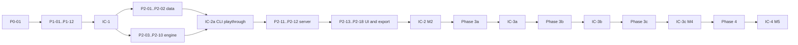

# 11 Build Plan

Status: planning document. Phase 1 done: P0-01, P1-01 to P1-12 and IC-1. Phase 2 in progress: P2-01 to P2-09 done.

## 1. How to use this plan

1. Each task is one small pull request. Target under 400 changed lines, tests included. Generated files (for example `game-packages/_schema/`) and test fixture data do not count.
2. Do tasks in ID order inside a phase unless "Deps" allows parallel work.
3. Each task follows TDD (`AGENTS.md`): failing assertion first.
4. A phase ends at its integration checkpoint (IC). Do not start the next phase until the IC passes.
5. Paths are relative to the repository root. `sim/` is the application. `game-packages/` holds data.

Task field key: **Obj** objective, **Files** files or modules, **Deps** dependencies, **Steps** implementation steps, **Accept** acceptance criteria, **Tests** automated tests, **Risks**, **Out** deliverables.

## 2. Phase 1: rules and data foundation

### P0-01 Toolchain and repository skeleton

- **Obj:** Create `sim/` with TypeScript strict, Vitest, ESLint, scripts `test`, `check`, `start`.
- **Files:** `sim/package.json`, `sim/tsconfig.json`, `sim/eslint.config.*`, `sim/vitest.config.*`, `Makefile` (targets `test`, `check`, `start`).
- **Deps:** none.
- **Steps:** 1. Confirm current Node LTS and `better-sqlite3` Windows prebuilds. Record result in 13-design-decisions.md. 2. Scaffold. 3. Add one placeholder test that fails, then passes.
- **Accept:** `make test` and `make check` pass on Windows 11 and Linux CI.
- **Tests:** Placeholder test.
- **Risks:** Native SQLite module fails on Windows. Fallback: `node:sqlite`.
- **Out:** Working toolchain.

### P1-01 Module boundaries and banned globals

- **Obj:** Enforce 03 s5 import rules and engine purity.
- **Files:** `sim/eslint.config.*`, `sim/test/arch.test.ts`.
- **Deps:** P0-01.
- **Steps:** 1. Restricted-imports rule per folder. 2. Restricted-globals rule for `sim/src/engine/**`.
- **Accept:** A test file that imports `fs` in the engine fails lint.
- **Tests:** T-ARCH.
- **Risks:** Rules too strict for test helpers. Exclude `*.test.ts`.
- **Out:** Lint config.

### P1-02 Seeded RNG and canonical hash

- **Obj:** Deterministic random source with serializable state. Canonical JSON and SHA-256.
- **Files:** `sim/src/engine/core/rng.ts`, `sim/src/engine/core/canonical.ts`.
- **Deps:** P1-01.
- **Steps:** 1. Implement a documented generator (xoshiro128** or PCG32). 2. `rollDie`, `pickRandom`, `shuffle` return `{value, rng}`. 3. Canonical serializer with sorted keys.
- **Accept:** Known-answer vectors match. Same seed gives same shuffle on two runs.
- **Tests:** T-DET (unit part).
- **Risks:** Subtle bias in `pickRandom`. Use rejection sampling.
- **Out:** RNG and hash utilities.

### P1-03 Core state types

- **Obj:** Define `GameState`, `DerivedView`, `Command`, `Decision`, `LogEntry`, `Effect` types (05 s2, s3, s10).
- **Files:** `sim/src/engine/core/types.ts`, `sim/src/engine/core/state.ts`.
- **Deps:** P1-02.
- **Steps:** 1. Types keyed by faction ID (N factions). 2. `emptyState(ruleset)`. 3. Measure canonical size of a full setup state.
- **Accept:** Full campaign setup state serializes under 30 KB or the measured value is recorded in 06 s3.7.
- **Tests:** Round trip serialize and hash.
- **Risks:** Over-design. Add only fields named in 05 s2.
- **Out:** Type module.
- **Done:** Types in `types.ts`, `emptyState(ruleset, scenarioId, seed)` in `state.ts` (DEC-36). Full setup state measures 13,751 bytes (05 s2, 06 s3.7).
- **Open for P2-01:** Research lists Campaign as a track (research 04 s3). State holds it in `turn.campaign` (05 s2). Do not add a Campaign track too, or two fields hold one value.

### P1-04 Package schemas (core subset)

- **Obj:** Zod schemas for manifest, parameters, factions, pieces, map, tracks, markers, scenarios.
- **Files:** `sim/src/package/schema/*.ts`.
- **Deps:** P1-03.
- **Steps:** 1. Schemas per 04 s3 to s4. 2. Generate JSON Schema to `game-packages/_schema/`.
- **Accept:** Valid fixture parses. Each invalid fixture fails with a path.
- **Tests:** T-PKG (schema cases).
- **Risks:** Schema churn. Keep `schemaVersion: 1` until P2 ends.
- **Out:** Schemas and JSON Schema files.
- **Done:** One schema per file in `sim/src/package/schema/`, `parsePackageFile(file, data)` returns issues with dot paths (DEC-37). `make schema` writes `game-packages/_schema/`; a test fails on drift. Field shapes recorded in 04 s4. T-PKG schema cases: 1 valid fixture per file, 33 invalid cases.
- **Open for P1-05:** Compile schema output to `Ruleset` (needs the package hash). V-REF for `placedAs`, `emblemState`, `resourcesTrack`, `owner`, link ends, gate steps and stacking IDs.
- **Resolved after review:** Harm count only in `victory.yaml` (DEC-38). Support scale and level caps as data (DEC-39). Schema changes move to P1-05.

### P1-05 Package loader, hash and reference validation

- **Obj:** Load a YAML folder, compute content hash, run V-REF, V-PIECES, V-STACK, V-LINKS, V-PARAM, V-FACTIONS.
- **Files:** `sim/src/package/load.ts`, `sim/src/package/validate.ts`, `sim/src/cli/validate.ts`.
- **Deps:** P1-04.
- **Steps:** 1. Schema changes: remove marker `countsAs` (DEC-38); add `map.yaml` `supportLevels` and marker `capsLevel` (DEC-39). 2. Load and normalize. 3. Hash. 4. Validators return messages per 04 s9, including scenario `level` within the `supportLevels` range. 5. CLI `sim validate <dir>`.
- **Accept:** CLI prints file, path, ID and sentence for each error. Exit code 1 on error.
- **Tests:** T-PKG fixtures, one per code.
- **Risks:** Hash changes on whitespace. Hash the normalized object, not the bytes.
- **Out:** Loader, validator, CLI command.
- **Done:** Schema changes for DEC-38 and DEC-39. `sim/src/package/load.ts` (`readPackageDir`, `loadPackage`, `compileRuleset`), `validate.ts` (V-REF, V-PIECES, V-STACK, V-LINKS, V-PARAM, V-FACTIONS and new V-RANGE), CLI `make validate DIR=<dir>` (DEC-40). Fixture `sim/test/fixtures/packages/valid/`. T-PKG: 27 invalid cases covering every code, plus missing file, YAML syntax error, duplicate key, unknown-file warning, hash stability and CLI exit codes.
- **Open for later tasks:** V-FACTIONS match with the sequence model (P2-03). V-REF for card IDs in `pivotalHand`, `pivotals` and `excludedCards` (P2-05). V-MODULE, V-OPTIONS, V-CARDS, V-ENCODE, V-EFFECT, V-VICTORY, V-MISSING, V-PROVISIONAL and V-SCORE-CHECK with the files they check. Core `Ruleset` does not carry `supportLevels` or `capsLevel` yet; add them when P1-07 `shiftLevel` reads them.

### P1-06 Test package "tiny"

- **Obj:** A 4-space, 2-faction test package for engine tests.
- **Files:** `sim/test/packages/tiny/*.yaml`.
- **Deps:** P1-05.
- **Steps:** 1. Two factions, 2 piece types each, 1 track each, 1 ordinal track, 3 cards.
- **Accept:** `sim validate` passes.
- **Tests:** Used by later tasks.
- **Risks:** None.
- **Out:** Fixture package.
- **Done:** `sim/test/packages/tiny/`: factions `blue` and `red`, pieces `soldier`, `fort`, `rebel` (flip states), `camp`; spaces `city`, `farm`, `hills` and external `refuge`; tracks `cash.blue`, `cash.red` and ordinal `border`; markers `harm` (blocks), `mark` (sides), `office` (`capsLevel`). Scenario `start` added for P1-10 `start` and IC-1. `make validate DIR=sim/test/packages/tiny` passes; `sim/test/tiny.test.ts` checks it.
- **Done in P2-05:** the 3 cards (`sim/test/packages/tiny/cards/c1.yaml`).

### P1-07 Core effect primitives

- **Obj:** `placePieces`, `removePieces`, `movePieces`, `setPieceState`, `adjustTrack`, `setTrack`, `stepOrdinal`, `placeMarker`, `removeMarker`, `flipMarker`, `setFlag`, `shiftLevel` with invariants (05 s7).
- **Files:** `sim/src/engine/core/effects/*.ts`.
- **Deps:** P1-06.
- **Steps:** 1. One primitive per file. 2. Each returns `{state, entries}`. 3. PA-04 and PA-09 behavior with `assumption_ref`. 4. `count` accepts an integer or `{min, max}` (04 s5, DEC-33).
- **Accept:** Piece total invariant holds after every primitive in property tests.
- **Tests:** T-PRIM.
- **Risks:** Shift blocks need markers config. Read from ruleset.
- **Out:** Primitive library.
- **Done:** 12 primitives in `sim/src/engine/core/effects/` with `applyEffect` (DEC-41). `Ruleset` now carries stacking, space kind and terrain, `levelRange`, marker `blocks` and `capsLevel`, piece `placedAs` and track `overflow`. New track field `overflow: {track, costParam}` with V-REF and V-PARAM checks. Tiny gains track `standing` with overflow. T-PRIM: unit cases for every primitive and skip reason, unknown IDs, and a random-effects test (5 seeds x 400 effects) that checks piece totals, marker totals, track bounds, stacking, level range and input immutability.
- **Moved by DEC-41:** step 4 (`count {min, max}`) goes to the card effect schema in P2-05. The PA-09 Harm warning goes to P1-09.

### P1-08 Parameters access and literal check

- **Obj:** Handlers read numbers only through parameter IDs.
- **Files:** `sim/src/engine/core/params.ts`, `sim/test/no-literals.test.ts`.
- **Deps:** P1-07.
- **Steps:** 1. `param(ruleset, id)` with typed access and a clear error. 2. Static scan of handler folders for numeric literals above 2.
- **Accept:** A handler with literal `3` fails the scan.
- **Tests:** Scan test.
- **Risks:** False positives. Allow-list by comment with a reason.
- **Out:** Parameter helper.
- **Done:** `Ruleset.parameters` and `param(ruleset, id, kind)` in `sim/src/engine/core/params.ts` (DEC-42). Lint rule `local/no-game-literals` in `sim/eslint/literals.js` scans `engine/coin` and `engine/modules` for numeric literals other than 0, 1 and 2; allow comment `// literal-ok: <reason>`. Tests: `params.test.ts` (each kind and error), load test for the compiled map, `sim/test/no-literals.test.ts` on fixtures in `sim/test/fixtures/literals/` (literal `3` in a handler fails).
- **Changed from Steps:** the scan flags every literal other than 0, 1 and 2 (04 s4.5), not only literals above 2, so fractions fail too.

### P1-09 Derive: Control, totals, scores

- **Obj:** `derive` for Control and formula terms (04 s8).
- **Files:** `sim/src/engine/coin/derive.ts`, `sim/src/engine/core/terms.ts`.
- **Deps:** P1-07.
- **Steps:** 1. Control per 03 s6. 2. Term evaluator for the closed set. 3. Score and Harm count terms. 4. PA-09 warning when a Harm marker type runs out (moved from P1-07, DEC-41).
- **Accept:** Tiny package values match hand math.
- **Tests:** T-SCORE (tiny).
- **Risks:** Term set too small. Add terms only with a schema bump.
- **Out:** Derive module.
- **Done:** `victory.yaml` is a core file with a schema subset: `scores`, `harmCount`, `totals` (DEC-43). V-REF, V-RANGE and new V-VICTORY check its terms; V-VICTORY also needs a scenario threshold per player faction. `Ruleset` gains space `pop`, piece `countsForControl`, `victory`, `harmMarkers` and scenario `thresholds`. `sim/src/engine/core/terms.ts` evaluates the 8 formula terms and 8 space conditions. `sim/src/engine/coin/derive.ts`: `control` (pieces exceed all other factions combined) and `derive` (Control, totals, scores, Harm counts, margins). `placeMarker` adds `warning: harmSupplyExhausted` to its PA-09 skip for a Harm marker. Tiny gains `victory.yaml`. T-SCORE: `derive.test.ts` hand math on tiny, `terms.test.ts` edge cases, 12 new loader cases, 8 new schema cases.
- **Size:** about 620 changed lines without fixtures and generated files, above the 400-line target. The victory.yaml schema and its checks were not in Files; they are the only data source for score terms (DEC-38).
- **Open for later tasks:** `moduleTerm` and the track, campaign, flag, option, adjacency and `selected` conditions (P2-05 and the module registry). `harmLimit`, `checkSkipFirstRound`, `tieOrder`, `finalMargin`, `recordSheet` and the Covert penalty at a check (P3a-02). P2-01 must ship a `victory.yaml`: start scores 21 and 4 come from it.

### P1-10 Engine apply loop and log entries

- **Obj:** `start`, `validate`, `apply` skeleton with one command type (`AdjustTrackDebug` in test builds only) and full log entries.
- **Files:** `sim/src/engine/index.ts`, `sim/src/engine/core/log.ts`.
- **Deps:** P1-09.
- **Steps:** 1. Transition type. 2. Validation result type. 3. Log entry builder with rule refs.
- **Accept:** Applying one command returns a new state, a hash and entries with before and after values.
- **Tests:** T-DET (apply twice, same hash).
- **Risks:** Debug command leaks to production. Register it only in tests.
- **Out:** Engine entry points.
- **Done:** `createEngine(handlers)` in `sim/src/engine/index.ts` with `start`, `validate`, `apply`; `logEntry` in `sim/src/engine/core/log.ts`, now used by the effect primitives (DEC-44). Types `AnyCommand`, `Violation`, `ValidationResult`, `Transition` (with `stateHash`), `ApplyResult`, `CommandHandler` in `types.ts`. `AdjustTrackDebug` lives in `sim/test/debug-command.ts`. `start` builds the scenario position from new `Ruleset.scenarios` (replaces `Ruleset.thresholds`) through `setupState`. New lint layer `engine` for files directly in `sim/src/engine/`. Tests: `index.test.ts` (start, validate, apply, rejection, input immutability, `ControlChanged`, T-DET), `setupState` cases, loader scenario compile, 4 new T-ARCH fixtures.
- **Fixed in review:** the bare-import purity check skipped the new `engine` layer (fixture `engine/bad-bare.ts`). Three copies of the own-key lookup merged into `own` in `core/state.ts`.
- **Size:** about 470 changed lines in `sim/src` and `sim/eslint`, tests included, above the 400-line target. Scenario compile is the only source for `start` (DEC-44).
- **Open for later tasks:** scenario `pivotals`, `options`, `excludedCards` and `finalRound` (P2-04, P2-05, P2-10). Phase stays `setup` after `start` until the deck exists (P2-04).

### P1-11 Store schema with annotation tables

- **Obj:** SQLite schema for all tables in 06 s3, including annotations, categories, branches and regression tables.
- **Files:** `sim/src/store/schema.sql`, `sim/src/store/migrate.ts`, `sim/src/store/repos/*.ts`.
- **Deps:** P1-10.
- **Steps:** 1. Migration 001. 2. Repos for package_versions, sessions, actions, commands, log_entries, states, annotations, categories. 3. One-transaction commit function.
- **Accept:** Commit of one command writes action, command, entries and state atomically. A thrown error leaves no rows.
- **Tests:** Store integration tests on a temp file.
- **Risks:** Schema churn. Migrations, never edits to 001 after merge.
- **Out:** Store layer.
- **Done:** Migration 001 `sim/src/store/schema.sql` with all 06 s3 tables plus `annotation_revisions`, 15 seeded categories (07 s5). `sim/src/store/migrate.ts` (`openStore`, `migrate`), `ulid.ts`, `common.ts`, repos `packages`, `sessions` (session, main branch and setup action in one transaction), `actions` (`commitAction`), `commands`, `log-entries`, `states`, `annotations` (revisions, one debrief per session), `categories` (DEC-45). Tests: `store.test.ts` on a temp file (atomic commit, rollback on a mid-commit error, rollback of a failed session start, state dedup, unknown session, annotations), `ulid.test.ts`. A mutation check (transaction removed) fails the rollback test.
- **Size:** about 850 added lines, 190 of them SQL DDL and seed data and 220 tests, above the 400-line target. The plan puts all tables and 8 repos in one task.
- **Open for later tasks:** append Decision answers to a `pending` action (P2-09 or the first handler with a Decision). Repos for branches, metrics and regression tables come with their users (P2-10, P4-04, P4-06). Undo (P2-17). Backup (P3a-08).

### P1-12 Annotation context builder

- **Obj:** Build the context object of 07 s4 from state, derived view, action record and a UI focus input.
- **Files:** `sim/src/annotate/context.ts`, `sim/src/annotate/types.ts`.
- **Deps:** P1-11.
- **Steps:** 1. Pure function `buildContext(input)`. 2. Size check under 8 KB.
- **Accept:** Context for the P1-10 transition contains every 07 s4.1 and s4.2 field that has a source.
- **Tests:** T-ANN-03, T-ANN-04.
- **Risks:** Field drift from spec. Test lists fields by name from 07.
- **Out:** Context builder.
- **Done:** `buildContext(input)` in `sim/src/annotate/context.ts`, input and context types in `types.ts` (DEC-46). `RulesetFaction.resourcesTrack` compiled from `factions.yaml`. Tests in `context.test.ts`: every 07 s4.1 and s4.2 field by name (T-ANN-03), nulls only where the source has no value yet, values for the P1-10 transition, compact diff of pieces, levels, markers and Control, costs, rolls and PA refs, proposed plan with violations, no action fields without an action, size under 8 KB, input unchanged (T-ANN-04 engine part; store part in IC-1).
- **Open for later tasks:** `active_faction` from the sequence model (P2-03), `current_card_title` from cards (P2-05), `legal_choices_summary` from `legalChoices` (P2-03), `rule_sources` from the package rule index (P4-08). The session service fills them (P2-11).

### IC-1 Integration checkpoint (Phase 1 exit)

Script test: load `tiny`, start a session in the store, apply one command, save a note anchored to the action, reload from disk, verify hashes and note links. Matches the Phase 1 exit criterion in the brief.

- **Passed:** `sim/test/ic1.test.ts`. The stored package reloads with the same hash, both stored states hash to their keys, the stored command replays from the stored package to the same hashes, entries keep before and after values, the note links to the action and its after state, and saving the note does not move the head (T-ANN-04). New `packageContent(data)` in `sim/src/package/load.ts` is the one source for the package hash and the stored content (04 s10.3).
- **Phase 1 status:** done, except the 3 tiny cards of P1-06 (blocked until P2-05). Phase 2 may start.
- **Open for P2-11:** the session service renders log entry `text` (IC-1 uses a plain form) and fills the caller inputs of the context builder (DEC-46).

## 3. Phase 2: first playable slice (S0 Opening)

### P2-01 Kurdish package 0.1.0: static data

- **Obj:** Map, pieces, tracks, markers, factions, parameters from 03, 04, 05 and 09.
- **Files:** `game-packages/kurdish-coin/0.1.0/*.yaml`.
- **Deps:** IC-1.
- **Steps:** 1. Enter data by hand from research tables. 2. Cite sections in `source`. 3. Add `assumptions.yaml` with PA-01 to PA-17.
- **Accept:** `sim validate` passes. Start scores equal 21 and 4 (09 s2.2).
- **Tests:** T-SCORE for the full campaign setup.
- **Risks:** Typos in adjacency. Test that adjacency equals the 03 s4.1 list.
- **Out:** Package data.
- **Done:** `game-packages/kurdish-coin/0.1.0/`: manifest, parameters (03, 04, 05, 09 values), factions, pieces, map (18 locations, 25 links), tracks, markers, victory, `assumptions.yaml` (PA-01 to PA-17) and `scenarios/full-campaign.yaml`. `sim/test/kurdish.test.ts`: validate passes with no issues, adjacency equals the 03 s4.1 list, T-SCORE 21 and 4, margins -28 and -26, Control as in 10 s2.2. New optional schema `assumptions` (04 s7, DEC-49).
- **Moved:** the full campaign scenario file came with P2-01, because its accept test (start scores) needs a setup. P2-02 adds S0 and the totals check.
- **Open for later tasks:** operation and SA parameters come with their handlers (P2-06 to P2-08). Host posture limits on external links are handler rules (07 s5), not map gates (DEC-49). Pivotal hands and `excludedCards` come with cards (P2-05).

### P2-02 Scenarios: full campaign setup and S0

- **Obj:** Scenario files for the full setup and S0.
- **Files:** `game-packages/kurdish-coin/0.1.0/scenarios/*.yaml`.
- **Deps:** P2-01.
- **Steps:** 1. Full setup from 10 s2. 2. S0 with `testOnly: true`, `finalRound: 1`, pile size 8.
- **Accept:** V-PIECES passes. Totals reconcile with 10 s2.
- **Tests:** T-PKG.
- **Risks:** None.
- **Out:** Scenario files.
- **Done:** `scenarios/s0.yaml` (10-mvp-scope s2.1): full campaign setup, `testOnly`, `finalRound: 1`, new optional scenario field `pileSize: 8`, no Pivotals, `excludedCards` for the 7 C1 Capability, Momentum and DK-013 cards plus Pivotal DK-015. `full-campaign.yaml` gains its 10 s2.3 Pivotals. `sim/test/kurdish.test.ts`: both setups reconcile with the 10 s2.2 totals table. `sim/test/state-size.test.ts` now measures the package setup; `sim/test/full-setup.ts` is deleted.
- **Open for later tasks:** `propagandaLast` (P2-04). V-REF for card IDs in `pivotals` and `excludedCards` (P2-05).

### P2-03 CT sequence model

- **Obj:** `SequenceModel` for the CT two-faction track (05 s2 to s3).
- **Files:** `sim/src/engine/coin/sequence/ct.ts`.
- **Deps:** IC-1.
- **Steps:** 1. Legal boxes from the adjacency graph. 2. Eligibility update. 3. Pass income. 4. Both pass.
- **Accept:** Each matrix row returns the 05 s2.3 cells.
- **Tests:** T-SEQ.
- **Risks:** Hidden two-faction assumptions leak. Keep them inside this file.
- **Out:** Sequence model.
- **Done:** `sequence.yaml` with schema (`model`, `boxes`, `adjacency`, `swapAfter`, `firstEligibleAtStart`, `passIncome`), loaded as a core file into `Ruleset.sequence`. V-FACTIONS checks the player count against the model in `engine/modules/registry.ts`; V-REF checks factions and boxes. `engine/coin/sequence/ct.ts`: legal boxes from the graph, sequence violations, cylinder placement, eligibility adjustment. `Pass` handler with pass income (`coin/handlers.ts`). `start` sets the PKK First Eligible. Resolution context `engine/core/exec.ts` and optional `CommandHandler.execute` (DEC-50). T-SEQ: `engine/coin/sequence/ct.test.ts`.
- **Open for later tasks:** `legalChoices` (05 s1 item 2) grows with the handlers (P2-06 to P2-09). Pivotal window (Phase 3a). `propagandaPhases` in `sequence.yaml` (P2-10).

### P2-04 Deck building

- **Obj:** 05 s1.1 procedure with seeded shuffle, mandatory top-8 rule and chain order.
- **Files:** `sim/src/engine/coin/deck.ts`.
- **Deps:** P2-03.
- **Steps:** 1. Pile size from scenario. 2. Mandatory swap. 3. Chain order. 4. Propaganda in bottom third. 5. Scenario flag `propagandaLast` for S0.
- **Accept:** 1000 seeds: mandatory cards always in the top part. Propaganda position always in range. With `propagandaLast`, all 8 cards precede it.
- **Tests:** Property tests.
- **Risks:** Scaled pile rule for S0 differs from research. S0 is `testOnly`.
- **Out:** Deck builder.
- **Done:** `engine/coin/deck.ts` `buildDeck(ruleset, rng, cards, chains, options)`: pure, seeded, one pile per Campaign. Parameters `deck.pileSize` (12) and `deck.topSize` (8). Scenario fields `pileSize` and `propagandaLast` (S0 sets both); `RulesetScenario` now carries `finalRound`, `pileSize`, `propagandaLast`, `excludedCards`, `pivotals` and `options`. Property tests over 1000 seeds in `engine/coin/deck.test.ts`.
- **Open for P2-05:** the builder takes card data as input, because cards have no schema until P2-05. P2-05 feeds it from the card files and builds the deck at `start`.

### P2-05 Card schema and encoding of 8 C1 cards plus Propaganda

- **Obj:** Card schema (04 s4.8) with `count` as an integer or `{min, max}` (moved from P1-07, DEC-41), effect primitives `choice`, `conditional`, `freeAction`, `forEachSpace`, `forEachPiece` and condition terms `terrainIn`, `spaceKind`, `adjacentTo`, `selected` (DEC-33). Encode the 8 S0 cards.
- **Files:** `sim/src/package/schema/cards.ts`, `game-packages/kurdish-coin/0.1.0/cards/c1.yaml`.
- **Deps:** P2-04.
- **Steps:** 1. One-time stub generator from the deck CSV (run from `/tmp`, not committed, per `AGENTS.md`). 2. Hand-encode effects. 3. Set `reviewedAgainstText` after review.
- **Accept:** V-ENCODE passes for S0. DK-003 unshaded ("up to 2 Village Guards in each of up to 2 Mountain or Plain spaces with State Control and Police") encodes without a module procedure.
- **Tests:** T-EVT fixture per side (16 fixtures).
- **Risks:** Encoder misreads prose. Side-by-side review output (09 s5).
- **Out:** Encoded cards.
- **Done:** Card schema `sim/src/package/schema/cards.ts` (type-key form like `victory.yaml`): all core primitives plus `transferPool` and `movePieces.toState`, card-level `choice`, `conditional`, `forEachSpace`, `freeAction`, `count {min, max}`, conditions `adjacentTo`, `selected`, `trackAtLeast`, `trackAtMost`, `trackIn`, `flag`. Loader reads `cards/*.yaml`; checks V-REF, V-EFFECT, V-CARDS and scenario-scoped V-ENCODE (DEC-51). `cards/c1.yaml`: 16 C1 cards from a one-time stub generator, 8 S0 cards and DK-016 hand-encoded; `cards/pivotal.yaml`: the 4 Pivotal stubs. `start` builds the deck and Pivotal hands (`engine/coin/setup.ts`) and refuses a blocked scenario. Tests in `sim/test/kurdish.test.ts`, `load.test.ts`, `schema.test.ts`. Tiny gets its 3 cards (closes the P1-06 block).
- **Moved:** the 16 T-EVT fixtures need the event runner, so they come with P2-09. `forEachPiece` has no S0 user; it comes with its first card (Phase 3a).
- **Open:** the full campaign scenario stays blocked by V-CARDS and V-ENCODE until C2 to C5 are encoded (Phase 3). Faction default `pivotalHand` is not compiled; scenarios list hands.

### P2-06 State Ops: Train, Garrison, Sweep, Assault

- **Obj:** Generic handlers with Kurdish parameters.
- **Files:** `sim/src/engine/coin/ops/state/*.ts`.
- **Deps:** P2-03.
- **Steps:** 1. Validate per 06 s2. 2. Resolve with PA-07 and PA-08. 3. Civic Action sub-step.
- **Accept:** 06 s7 worked example reproduces.
- **Tests:** T-VAL and T-OPS for each op.
- **Risks:** Train option 3 and Civic Action costs interplay. Separate fixtures.
- **Out:** Four handlers.
- **Done:** Operation framework `engine/coin/ops/`: `ActionHandler` (check, cost, execute), `ChooseOperation` command (box, Limited Op one location, SA only in Op + SA, SA pairing, total cost against Resources, SA timing before or after with each part checked on the board it meets), plan readers, shared helpers and package IDs (`ids.ts`, DEC-52). Handlers `state.train` (3 options, Civic Action sub-action), `state.garrison`, `state.sweep`, `state.assault`; `state/civic-action.ts` is shared with Propaganda (P2-10). Parameters for 06 s2 and 07 s1.3. Preview is the effects up to the first die roll. T-VAL and T-OPS in `ops/state/state-ops.test.ts`, with the 06 s7 worked example.
- **Open:** Cross-Border Sweep and Assault in the KDP and PUK Zones (Phase 3a). `legalChoices` lists (P2-11 uses `validate` per plan).

### P2-07 PKK Ops: Rally, March, Attack, Coerce

- **Obj:** Handlers per 06 s4.
- **Files:** `sim/src/engine/coin/ops/pkk/*.ts`.
- **Deps:** P2-03.
- **Steps:** 1. Rally three options and Europe location. 2. March activation condition. 3. Attack roll, Decision for removal choice, attrition. 4. Coerce with PA-05.
- **Accept:** Each rule line in 06 s4 has a fixture.
- **Tests:** T-VAL, T-OPS.
- **Risks:** Rally option 3 limit (Pop + Bases) on external boxes. Fixture for box Pop 1.
- **Out:** Four handlers.
- **Done:** `ops/pkk/rally.ts` (place, base, grow, flip, Europe track with the Ban cost and cap, host posture rules, Agitate sub-action), `ops/pkk/march.ts` (one-step groups, activation condition, Restricted entry cost and activation, Syria under PA-16 option), `ops/pkk/attack.ts` (seeded roll, removal order with a Police-first choice, attrition, bonus Guerrilla), `ops/pkk/coerce.ts` (PA-05 order, Pop 3+ cost). `ops/pkk/agitation.ts` is shared with Propaganda. Map tag `rallyAtSupport` on Western Cities. One fixture per 06 s4 rule line in `ops/pkk/pkk-ops.test.ts`.
- **Decided:** the Attack removal choice is a plan field (`prefer: police`), made before the roll, not a Decision after it (DEC-51). Rally takes no piece from the map when Available is empty (04 s2.1 item 1 is not in the slice).

### P2-08 SAs: Air Mobility, Ambush, Extort, Strike Collaborators

- **Obj:** Handlers per 06 s3.1, s5.1, s5.2, s5.3 with PA-06, PA-12, PA-14.
- **Files:** `sim/src/engine/coin/ops/sa/*.ts`.
- **Deps:** P2-06, P2-07.
- **Steps:** 1. SA pairing rules. 2. Timing field. 3. Handlers.
- **Accept:** SA with Limited Op rejected. In an Ambush space, Attack resolves as normal and removes 1 extra piece (PA-06).
- **Tests:** T-VAL, T-OPS.
- **Risks:** "Interleaved" timing complexity. MVP allows `before` and `after` only. Record as a decision.
- **Out:** Three handlers.
- **Done:** four SA handlers in `ops/sa/`: `state.air-mobility` (PA-14), `pkk.ambush` (PA-06: Attack as normal plus 1 extra removal in the Attack order), `pkk.extort` (PA-12 subset), `pkk.strike-collaborators` (Law 3175, PKK Harm, Europe -1). Pairing and timing in `ChooseOperation` (DEC-16); an SA sees its Op's locations (`ActionOptions.opLocations`). Tests in `ops/sa/sa.test.ts`: SA with a Limited Op or Op Only is rejected; the PA-06 case removes 1 extra piece.
- **Decided:** Ambush is checked before the Attack activates, so its plan uses timing `before`; its extra removal has no attrition (06 s5.1 "No attrition" kept for the extra piece). Strike Collaborators removes 1 Guard per space unless the plan says `guards`.

### P2-09 Event execution and Always lines

- **Obj:** Execute a card side with "do as much as you can", ownership limits and Always lines on reveal (05 s5).
- **Files:** `sim/src/engine/coin/events.ts`.
- **Deps:** P2-05, P2-08.
- **Steps:** 1. Side choice. 2. Effect list runner with skip logging. 3. Free actions with no eligibility change.
- **Accept:** DK-003 Always line moves 16 Guards to Available on reveal.
- **Tests:** T-EVT.
- **Risks:** Free action needs the full plan UI. Reuse the op plan flow.
- **Out:** Event runner.
- **Done:** `engine/coin/events.ts` runs card effects in order with answers from the command (`ChooseEvent.answers`: option label or index, count, space list, free action plan or null); a missing or bad answer is a `needsAnswer` or `badAnswer` violation that carries a `Question` (DEC-51). Free actions run the action handlers with `free: true` and event constraints, an SA constraint included (DK-002 Attack with Ambush). `coin/turn.ts` reveals cards (Always lines on reveal, a second Propaganda card in a row set aside) and reveals the next card once both factions acted. `Advance` reveals the first card. T-EVT: one fixture per side of the 8 S0 cards plus reveal tests in `engine/coin/events.test.ts`. DK-003 Always moves 16 Guards to Available.
- **Open:** the PKK restriction on Legal Politics event sides (05 s5 item 1) comes with those cards (Phase 3b). Capability and Momentum cards (Phase 3a).

### P2-10 Propaganda round (slice phases) and final scoring

- **Obj:** Phases Victory (skip), Resources, Upkeep, Legitimacy (8 steps), Civic Action and Agitation, final scoring, record sheet.
- **Files:** `sim/src/engine/coin/propaganda/*.ts`, `sim/src/engine/coin/victory.ts`.
- **Deps:** P2-09.
- **Steps:** 1. Phase pipeline from `sequence.yaml`. 2. Phase handlers. 3. Final margin and tie order. 4. One `metrics` row per Propaganda round: score, margin, income, Resources and Harm count per faction (research 12 s4 items 6 to 12; DEC-34). 5. `StopRuleFlag` entries for research stop rules 3, 4 and 6 (05 s10).
- **Accept:** Hand-computed income and Legitimacy for a fixture board match.
- **Tests:** T-PROP, T-VIC, T-PERV (formula level).
- **Risks:** Civic Action cap and choice UI. Decision-based spend form.
- **Out:** Propaganda pipeline.

### IC-2a Engine-only playthrough

CLI test plays S0 to the end with a scripted command list and a fixed seed. Golden replay file stored. No server or UI needed. This proves rules before UI work.

### P2-11 Session service and API

- **Obj:** HTTP API: packages, validate, sessions (create, list, load), commands, legal choices, history, states, annotations, export.
- **Files:** `sim/src/server/*.ts`.
- **Deps:** IC-2a.
- **Steps:** 1. Fastify routes. 2. Session service wraps engine and store. 3. Package content and module source hashes stored on session start. 4. Resume runs a replay check when a module hash differs.
- **Accept:** API integration tests run a short session.
- **Tests:** Integration suite.
- **Risks:** Concurrency with two tabs. One active writer per session, reject stale `head_action_id`.
- **Out:** Local server.

### P2-12 Replay CLI and performance check

- **Obj:** `sim replay <sessionId|file>` compares hashes per action. Measure apply time. `sim fuzz --seeds 50` plays S0 with random legal choices (T-FUZZ).
- **Files:** `sim/src/cli/replay.ts`.
- **Deps:** P2-11.
- **Accept:** Replay of the IC-2a session reports "identical". Timing recorded in 05 s11.
- **Tests:** T-DET, golden replay, T-FUZZ.
- **Risks:** None.
- **Out:** CLI command.

### P2-13 UI shell, Home screen, package check screen

- **Obj:** React app, Home (package, scenario, options, seed, name, saved sessions) and validation report.
- **Files:** `sim/src/ui/*`.
- **Deps:** P2-11.
- **Accept:** Start disabled with errors. PA warnings listed.
- **Tests:** Component tests for the Start rule.
- **Risks:** Styling time. Plain CSS only.
- **Out:** UI shell.

### P2-14 Board and status bar

- **Obj:** SVG schematic board with selection and detail card. Status bar.
- **Files:** `sim/src/ui/board/*`, `sim/src/ui/status/*`.
- **Deps:** P2-13.
- **Accept:** All 18 locations show counts, levels, markers and Control from the server view model.
- **Tests:** View model mapping unit tests.
- **Risks:** Layout coordinates. Hand-set in `map.yaml`.
- **Out:** Board.

### P2-15 Faction panel, event panel, Decisions, Propaganda flow

- **Obj:** Plan building, live validation, preview, commit, Decisions inline, event side choice, phase list.
- **Files:** `sim/src/ui/faction/*`, `sim/src/ui/event/*`, `sim/src/ui/propaganda/*`.
- **Deps:** P2-14.
- **Accept:** Every illegal action shows a reason (T-UI-03).
- **Tests:** Component tests with mocked API.
- **Risks:** Per-op plan forms are many. One generic form driven by handler metadata.
- **Out:** Play controls.

### P2-16 Note bar, anchors, categories, history drawer

- **Obj:** 07 s2 to s6 in the UI. Focus store feeds context.
- **Files:** `sim/src/ui/notes/*`, `sim/src/ui/history/*`, `sim/src/ui/focus-store.ts`.
- **Deps:** P2-15.
- **Accept:** T-ANN-01, T-ANN-02, T-UI-02, T-UI-06.
- **Tests:** Component and API tests.
- **Risks:** Hotkey clashes with plan entry. Note bar captures keys only when focused.
- **Out:** Annotation UI.

### P2-17 Undo, state viewer, basic feedback review

- **Obj:** Undo last action. Read-only board at a hash with before and after. Review table with filters and plain substring search.
- **Files:** `sim/src/server/undo.ts`, `sim/src/ui/review/*`, `sim/src/ui/state-viewer/*`.
- **Deps:** P2-16.
- **Accept:** T-ANN-05, T-ANN-06, T-UI-04. Undo of an action with a die roll sets `undoneAfterRandom` (06 s6 item 7).
- **Tests:** Integration and component tests.
- **Risks:** Substring search is slow on many notes. Acceptable below 10,000 notes. FTS moves to P3a-08.
- **Out:** Review features.

### P2-18 JSON export

- **Obj:** Exporter per 07 s8.1 with a reference check.
- **Files:** `sim/src/export/*`, `sim/src/cli/export.ts`.
- **Deps:** P2-17.
- **Accept:** T-ANN-07, T-ANN-08 and T-EXP pass. The S0 export contains the round metrics row and any stop rule flags (DEC-34).
- **Tests:** T-EXP.
- **Risks:** Large files with states. States off by default.
- **Out:** Exporters.

### IC-2 Integration checkpoint (Phase 2 exit, M2)

1. Playwright smoke: Home, start S0, one action, one note, undo, JSON export.
2. Manual session by the designer against 10 s2.4.
3. Fix list from that session goes into Phase 3a tasks.

## 4. Phase 3: full Kurdish COIN prototype

Split into three sub-phases. Each sub-phase ends with a scenario played to the end.

### Phase 3a: Scenario A (C1 and C2)

| ID | Obj | Files | Deps | Accept | Tests | Risks |
|---|---|---|---|---|---|---|
| P3a-01 | Redeploy and Reset phases | `propaganda/redeploy.ts`, `reset.ts` | IC-2 | 05 s6.7 and s6.8 fixtures | T-PROP | Redeploy UI form size |
| P3a-02 | Multi-round play and victory checks | `victory.ts` | P3a-01 | Check skipped only in round 1. PA-10 | T-VIC | None |
| P3a-03 | Capability and Momentum modifiers | `core/modifiers.ts`, hooks | P3a-01 | Momentum discarded at Reset | T-EVT | Hook sprawl. Fixed hook list (03 s6) |
| P3a-04 | Cross-Border, Diplomacy, Host Pressure, Strike Collaborators | `ops/sa/*`, module `cross-border` | P3a-03 | Posture gates and PA-02, PA-03 | T-VAL, T-OPS | Hot pursuit Low evidence. Option flag |
| P3a-05 | Pivotal window and ARGK Formed | `coin/pivotal.ts`, module `pivotal-argk` | P3a-02 | Priority to Second Eligible | T-SEQ | None |
| P3a-06 | Encode remaining C1 and all C2 cards | `cards/c1.yaml`, `c2.yaml` | P3a-03 | V-ENCODE passes for Scenario A | T-EVT per side | Encoding volume. Split per 5 cards per PR |
| P3a-07 | Scenario A file and golden replay | `scenarios/scenario-a.yaml` | P3a-06 | Scenario A plays to end in CLI script | Golden | None |
| P3a-08 | Moved from M2: auto backup, FTS search, minimal Markdown export | `store/backup.ts`, `export/markdown.ts` | IC-2 | Last 10 backups kept. FTS returns same rows as substring search on fixtures | T-EXP | FTS5 build availability |
| P3a-09 | Scripted strategy batch runs: `sim batch --games 10 --strategy <state>,<pkk> --swap-seats`. Strategies are small policies that pick from legal choices. First set from research 12 s7 for Scenario A | `cli/batch.ts`, `cli/strategies/*` | P3a-07, P2-12 | CSV of round metrics and a win-rate report. A side with 8 or more wins in 10 is flagged (research 12 s9) | T-FUZZ harness | Strategies too naive to find exploits. Treat results as screens, not balance proof |
| P3a-10 | Draft map (DEC-48): one simple SVG of the play area in real geography. Southeastern Turkey spaces from 03 s2, Western Cities box, Syria-Bekaa (northern Syria and Bekaa), KDP and PUK Zones (northern Iraq), Iran box, Europe track. Borders and rivers only, no relief art. Adds series parts: edge track, Sequence of Play box, card slots, Pop and terrain per space | `game-packages/kurdish-coin/<ver>/map/draft-map.svg`, polygon per space in `map.yaml` | P2-01 | Every `map.yaml` space has one polygon. Space adjacency on the map matches research 03 s4.1. Reads at 1366 x 768 | Test: polygon IDs equal space IDs | Draft geography is approximate. Label it "draft" |

**IC-3a:** Designer plays Scenario A to the end in the UI. Notes export. Matches stage 0 of the research playtest plan (12 s2).

### Phase 3b: C3 to C5 systems, Scenarios B and C

| ID | Obj | Files | Deps | Accept | Tests | Risks |
|---|---|---|---|---|---|---|
| P3b-01 | Emergency Rule step table and Legitimacy phase step 8 | module `emergency-rule` | IC-3a | 07 s8.2 table | T-PROP | None |
| P3b-02 | Village Clearance | module `village-clearance` | P3b-01 | 7 effects in order. T-PERV cases | T-OPS, T-PERV | Highest ethics sensitivity. Review log text |
| P3b-03 | Covert Action and hidden markers | module `covert`, `core/hidden.ts` | P3b-01 | Check penalty and reveal | T-VIC | Solo play sees hidden markers. Logged as GAP-O01 |
| P3b-04 | Legal Politics procedure and closure filing | module `legal-politics` | P3b-01 | Two runs of the table give identical Offices (research M-007) | T-PROP | Line order details |
| P3b-05 | Ceasefire, restrictions, breach, votes, Negotiated Outcome | module `ceasefire` | P3b-04 | 07 s7 fixtures. PA-11 | T-VAL, T-PROP | Breach warnings in UI |
| P3b-06 | Remaining Pivotals and structural cards (DK-037, 040, 093) | modules `pivotal-*`, `structural-*` | P3b-05 | Always lines fire once | T-EVT | None |
| P3b-07 | Encode C3, C4, C5 cards | `cards/c3.yaml` to `c5.yaml` | P3b-06 | V-ENCODE passes for B and C | T-EVT | Volume. 5 cards per PR |
| P3b-08 | Scenarios B and C | `scenarios/*.yaml` | P3b-07 | Start scores equal 09 s2.3 | T-SCORE, golden | Scenario B threshold open (DD-19.7). Package value |

**IC-3b:** Scenarios B and C each played to the end in the UI.

### Phase 3c: full campaign

| ID | Obj | Deps | Accept |
|---|---|---|---|
| P3c-01 | Five-pile deck, Campaign advance and structural switches (10 s6.2) | IC-3b | Switch flags set at each Reset |
| P3c-02 | Full campaign scenario and a long golden replay | P3c-01 | Full campaign replays in under 10 seconds |

**IC-3c (M4):** The selected design plays from setup to conclusion. Phase 3 exit criterion met.

## 5. Phase 4: playtest analysis

| ID | Obj | Accept |
|---|---|---|
| P4-01 | Cross-session review: version filters, saved filters, bulk status | Notes from 3 sessions filter by ruleset version |
| P4-02 | Full Markdown export and CSV export | Export answers the brief's sample question inputs (07 s8.2 sections present) |
| P4-03 | Metrics review screen and CSV export. Rows exist from P2-10 (DEC-34) | Matches research logging sheet items 6 to 15 |
| P4-04 | Branch from a past action | New branch plays. Original branch intact |
| P4-05 | Package diff tool | Lists changed parameters, cards, handlers and modules between two versions |
| P4-06 | Regression cases from notes and runs against a target version | Same, changed and incompatible results reported (09 s7) |
| P4-07 | Hidden-information view toggle | Covert markers hidden in view mode |
| P4-08 | Tester materials: `docs/tester/INSTALL.md` (Windows and Mac), `docs/tester/HOW-TO-PLAY.md`, rule lookup from any log rule ref to its text in the package rule index (DEC-34) | A new tester installs and finishes S0 using only these files |

**IC-4 (M5):** Two package versions and at least three sessions compared with recorded evidence.

### PV-01 Vassal test module (DEC-47)

- **Obj:** Play the finished design in Vassal, as a step toward the physical game. No rule automation.
- **Files:** `vassal/` (module source and build note). The `.vmod` is a build output.
- **Deps:** IC-4. Draft map from P3a-10 and final package data.
- **Steps:** 1. Original map image with one `Zone` per space. 2. Pieces in series shapes and DEC-30 colors. 3. Card deck, Sequence of Play box, eligibility pawns, edge track. 4. Toolbar: Draw Card, End Card Play, Propaganda, Undo.
- **Accept:** Two players finish S0 in Vassal. Notes go to the 07 feedback form.
- **Risks:** Module and package drift. Generate the module from the package YAML where it is cheap.
- **Out:** `.vmod` for testers.

## 6. Phase 5: evaluation only

Write a one-page evaluation for each before any build: automated opponents, batch execution, AI-assisted log analysis, package generation from documents, final map art (the draft map is P3a-10), Windows installer (Electron), MOD-3B sequence model, MOD-4A, Concept B map, ranked initiative. None blocks M2 to M5.

## 7. Dependency view

Parallel work allowed: P2-01 and P2-02 (data) alongside P2-03 to P2-10 (engine).

Next step: read 12-architecture-review.md.
