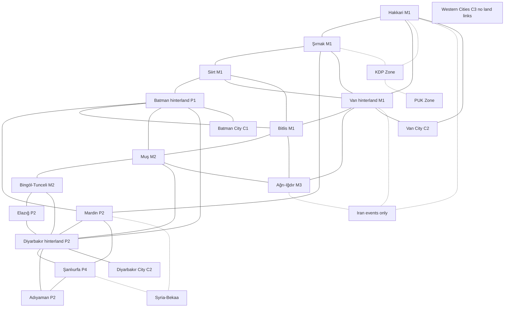

# 03 Map and Spaces

Status: rules draft for the 1984-1999 campaign. Every number in this file is a design value. Values marked [tune] need playtest calibration. Binding decisions: DD-05 (as amended by DD-22), DD-06, DD-07 and DD-09 in `../project-management/design-decisions.md`. Shapes follow the 81-province reference map: `docs/map-proposals/proposal-2/`.

## 1. Map overview

The map has 18 domestic spaces and five external boxes. DD-22 (Proposal 2 v2) replaced the 13-space map of DD-05.

1. Domestic spaces hold pieces of both factions. They count for victory.
2. External boxes hold PKK pieces only, except the KDP Zone and PUK Zone during a State Cross-Border action (06, section 3.2). External boxes never count for victory (DD-14.4).

One Pop is about 250,000 people. Pop values are design weights rounded from 1990 province totals [Q-004; Q-012; Q-018; Q-026; Q-035; Q-044; Q-045; Q-046; Q-053; Q-061; Q-079; Q-087; Q-096; Q-104; Q-109; Q-117; Q-125]. Most of these rows have Low confidence. Pop is not a count of Kurds and does not measure ethnic preference [Q-168; Q-169; M-028]. Print "[design]" beside every Pop value on the board.

## 2. Domestic spaces

| Space | 1990s provinces | Terrain | Pop | Foreign border | Basis for Pop (1990 total, rounded) |
|---|---|---|---:|---|---|
| Hakkari | Hakkari | Mountain | 1 | Iraq, Iran | 172,479; raised to minimum 1 [Q-061] |
| Şırnak | Şırnak | Mountain | 1 | Iraq, Syria (note 2) | 262,006, rounds to 1.05 and so 1 [Q-109] |
| Siirt | Siirt | Mountain | 1 | none | 243,435, rounds to 0.97 and so 1 [Q-096] |
| Batman hinterland | Batman (outside the city) | Plain | 1 | none | Batman 344,669 is 1.4 Pop in total [Q-018]. The hinterland takes 1 (note 8) |
| Batman City | Batman (urban) | City | 1 | none | Small city, design weight 1 (note 8) |
| Mardin | Mardin | Plain | 2 | Syria | 557,727, rounds to 2.2 and so 2 [Q-079] |
| Van hinterland | Van (outside the city) | Mountain | 1 | Iran | Van 637,433 is 2.55 Pop in total, which rounds to 3 [Q-125]. The city takes 2 and the hinterland 1 (note 7) |
| Van City | Van (urban) | City | 2 | none | Designer decision, design weight 2 (note 7) |
| Bitlis | Bitlis | Mountain | 1 | none | 330,115, rounds to 1.3 and so 1 [Q-035] |
| Muş | Muş | Mountain | 2 | none | 376,543, rounds to 1.5 and so 2 [Q-087] |
| Bingöl-Tunceli | Bingöl, Tunceli | Mountain | 2 | none | 250,966 + 133,143, each raised to minimum 1 [Q-026; Q-117] |
| Elazığ | Elazığ | Plain | 2 | none | 498,225 [Q-053] |
| Diyarbakır City | Diyarbakır (urban) | City | 2 | none | 600,640 [Q-045] |
| Diyarbakır hinterland | Diyarbakır (rest) | Plain | 2 | none | 494,356 [Q-046] |
| Şanlıurfa | Şanlıurfa | Plain | 4 | Syria | 1,001,455 [Q-104] |
| Adıyaman | Adıyaman | Plain | 2 | none | 513,131 [Q-004] |
| Ağrı-Iğdır | Ağrı, Iğdır | Mountain | 3 | Iran | Ağrı 437,093, rounds to 1.75 and so 2 [Q-012]. Iğdır has no census row in the repository: design weight 1 (note 9) |
| Western Cities | Istanbul, Ankara, İzmir, Adana, Mersin (abstract) | City | 3 | none | Design node, no census basis [L-035; Q-176] |

Total domestic Pop: 33. Without Western Cities: 30. DD-05 had 32 and 29. The extra point is Batman City and Iğdır, less the Van rounding (note 7).

Notes:

1. Place names follow the location registry rule: Turkish name first, Kurdish name where sourced (DD-15.5). Print "Tunceli (Dersim)" for the Tunceli part of Bingöl-Tunceli on the board key, because the registry gives Dersim as the historical regional name [L-016] (DD-22 replaces the DD-15.5 "Dersim" space name). Print Amed beside Diyarbakır City [L-010]. Other Kurdish names in the registry are marked "n/v" or "model knowledge" and are not printed until verified [L-021 to L-030].
2. Şırnak province borders Syria as well as Iraq, near Cizre (source in section 4). DD-17.2 records the border. The short Syrian border has no game effect, because Syria-Bekaa is not a movement space for State pieces and its PKK link uses Mardin and Şanlıurfa only.
3. Terrain is a design tag. Only provincial seat elevations were found in the research. Mountain and Plain tags follow DD-05, except Siirt (Mountain), Batman hinterland (Plain), Iğdır and Bingöl-Tunceli (Mountain), which DD-22 added. Mark them "unverified assumption" in the Playbook until a terrain source is read.
4. Display only: the atlas magnifies the map smoothly around Batman (1.9 times, radius 330 map units at scale 1) so its labels stay readable. Borders stay shared and none cross. This is not a rule.
5. Display only: the atlas draws every Turkish province outside the playable area as faded terrain marked "OUT OF PLAY" (Malatya, Kars, Erzurum and others). They hold no pieces and have no links.
6. A reference map shows small orange areas in Kars, Erzurum, Kahramanmaraş and Gaziantep. None is a space in this version.
7. Van City is a City space (designer decision, DD-22). Van hinterland is the rest of Van province. Van City links to Van hinterland and, by designer decision, to Hakkari. The city location is approximate.
8. Batman City is a small City space. Batman hinterland is the rest of Batman province. The two together carry Pop 2, more than the 1.4 that the census gives. Needs a designer decision if the extra point matters in play.
9. Iğdır became a province in 1992 (unverified assumption: check TÜİK). Before 1992 its area belonged to Kars. It is grouped with Ağrı as one space in every scenario, so no rule changes with the date.

### 2.1 Terrain effects

| Terrain | Effect |
|---|---|
| Mountain | Sweep and Garrison activate one Underground Guerrilla per 2 eligible State pieces, round down. Assault removes one PKK piece per 2 Troops, round down (CT 1.3.2, 3.2.2 to 3.2.4). |
| Plain | No modifier. |
| City | Police count as Troops for Assault (CT 3.2.4). PKK may Rally in a City only if it is Neutral or Opposition (CT 3.3.1). Exception: the PKK may also Rally in Western Cities at Passive Support or Active Support (urban migrant networks). This stops a lockout, because Western Cities has no land links. The Passive-only exception failed in the Scenario B desk test: once Western Cities reached Active Support, no PKK action could reach it (11, section 6; IR-36) [tune]. PKK may not place a Base in Western Cities. Village Guards may not be placed in a City. Village Clearance may not target a City. |

## 3. External boxes

| Box | Who may enter | How | Pop | Notes |
|---|---|---|---:|---|
| Syria-Bekaa | PKK only | Rally if Syria posture permits; March to or from Mardin or Şanlıurfa if Syria is Host or Tolerant | 0 | Holds the PKK Leadership marker. State pieces never enter (CT 1.3.4, 5.1.8 pattern) [F-007; F-020; E-0053; L-088] |
| KDP Zone | PKK; State by Cross-Border only | March from Hakkari, Şırnak or PUK Zone; Rally if KDP posture permits | 0 | Bahdinan border area [L-031; F-022] |
| PUK Zone | PKK; State by Cross-Border only | March from KDP Zone only; Rally if PUK posture permits | 0 | Soran area near Iran [L-032; F-022] |
| Iran | PKK only, by event | No Rally, no March. Events may place or remove up to 2 Guerrillas | 0 | Evidence is Low [F-025; E-0166]. A Low-confidence event carries no hard effect (DD-15.4) |
| Europe | No pieces | Off-map track (04, section 3.6) | 0 | Diaspora resources and international pressure [L-033; F-040] |

Rules for all external boxes:

1. External boxes have no Support or Opposition and no Control. They never count for victory.
2. A host posture change never deletes pieces in a box. It suspends Rally and income there (DD-09.5).
3. For Rally, treat an external box as Pop 1 when you compute the Guerrilla limit at a Base (CT 1.3.4).
4. State pieces in the KDP Zone or PUK Zone after a Cross-Border action must leave in the next Redeploy phase (05, section 6.7).
5. The PUK Zone touches no domestic space. Turkey's Iraqi border in this map faces the KDP-held Bahdinan area [L-031; L-060; L-069]. This is a design simplification, not a party territorial map.

### 3.1 How each host works in play

| Box | PKK uses | State answer | Closes when |
|---|---|---|---|
| Syria-Bekaa | Leadership safety, training Base, entry to the Syrian border spaces | Diplomacy SA, Pivotal Event "Coercive Diplomacy on Syria", events | Syria posture reaches Hostile. Leadership flips to its Abroad side. Capture is an event effect only (DD-09.6) [F-020; F-021] |
| KDP Zone | Camps near the border, staging into Hakkari and Şırnak | Cross-Border SA, Diplomacy SA, events | KDP posture reaches Restricted or worse. Cross-Border opens [F-022; F-023; F-059] |
| PUK Zone | Rear area behind the KDP Zone | Cross-Border SA (only if KDP posture also permits), Diplomacy SA | PUK posture reaches Restricted or worse [F-022] |
| Iran | Event-driven deniable use | Events only | Never by rule |
| Europe | Resources and political pressure | Diplomacy SA, events (bans) | Ban marker caps the track (04) [E-0064] |

Posture effects are in 07, section 5. Closing one host never moves another automatically (DD-09.1).

## 4. Adjacency

Two domestic spaces are adjacent if any province in one shares a land border with any province in the other (CT 1.3.5). Province borders were checked on 26 Oct 2026 against the Turkish Wikipedia province articles: Hakkâri (il), Şırnak (il), Siirt Province (English article), Mardin (il), Batman Province (English article), Diyarbakır (il), Adıyaman (il), Elazığ (il), Tunceli (il), Bingöl (il), Muş (il), Bitlis (il), Van (il) and Ağrı (il), at https://tr.wikipedia.org/wiki/ and https://en.wikipedia.org/wiki/. These are tertiary sources. Confidence: Moderate. Verify against an official province map (General Directorate of Mapping) before print.

Province borders found (domestic provinces only):

| Province | Borders (map provinces) | Off-map neighbors |
|---|---|---|
| Hakkari | Şırnak, Van | Iraq, Iran |
| Şırnak | Hakkari, Van, Siirt, Mardin | Iraq, Syria |
| Siirt | Şırnak, Van, Bitlis, Batman, Mardin | none |
| Batman | Siirt, Bitlis, Muş, Diyarbakır, Mardin | none |
| Mardin | Şırnak, Siirt, Batman, Diyarbakır, Şanlıurfa | Syria |
| Diyarbakır | Batman, Mardin, Şanlıurfa, Adıyaman, Elazığ, Bingöl, Muş | Malatya |
| Şanlıurfa | Mardin, Diyarbakır, Adıyaman | Gaziantep, Syria |
| Adıyaman | Diyarbakır, Şanlıurfa | Malatya, Kahramanmaraş, Gaziantep |
| Elazığ | Diyarbakır, Bingöl, Tunceli | Malatya, Erzincan |
| Tunceli | Elazığ, Bingöl | Erzincan |
| Bingöl | Elazığ, Tunceli, Diyarbakır, Muş | Erzincan, Erzurum |
| Muş | Bingöl, Diyarbakır, Batman, Bitlis, Ağrı | Erzurum |
| Bitlis | Muş, Ağrı, Van, Siirt, Batman | none |
| Van | Ağrı, Bitlis, Siirt, Hakkari, Şırnak | Iran |
| Ağrı | Muş, Bitlis, Van | Kars, Erzurum, Iğdır, Iran |

Two corrections to the input concepts follow from this check. Elazığ does not border Adıyaman (Malatya lies between). Batman has a short border with Muş.

### 4.1 Printed adjacency list

| Space | Adjacent domestic spaces | Special links |
|---|---|---|
| Hakkari | Şırnak, Van hinterland, Van City | KDP Zone |
| Şırnak | Hakkari, Siirt, Mardin, Van hinterland | KDP Zone |
| Siirt | Şırnak, Batman hinterland, Van hinterland, Bitlis | none |
| Batman hinterland | Siirt, Batman City, Mardin, Bitlis, Muş, Diyarbakır hinterland | none |
| Batman City | Batman hinterland | none |
| Mardin | Şırnak, Batman hinterland, Diyarbakır hinterland, Şanlıurfa | Syria-Bekaa (PKK only, Syria Host or Tolerant) |
| Van hinterland | Hakkari, Şırnak, Siirt, Van City, Bitlis, Ağrı-Iğdır | Iran (events only) |
| Van City | Hakkari, Van hinterland | none |
| Bitlis | Siirt, Batman hinterland, Van hinterland, Muş, Ağrı-Iğdır | none |
| Muş | Batman hinterland, Bitlis, Bingöl-Tunceli, Diyarbakır hinterland, Ağrı-Iğdır | none |
| Bingöl-Tunceli | Muş, Elazığ, Diyarbakır hinterland | none |
| Elazığ | Bingöl-Tunceli, Diyarbakır hinterland | none |
| Diyarbakır hinterland | Batman hinterland, Mardin, Muş, Bingöl-Tunceli, Elazığ, Diyarbakır City, Şanlıurfa, Adıyaman | none |
| Diyarbakır City | Diyarbakır hinterland | none |
| Şanlıurfa | Mardin, Diyarbakır hinterland, Adıyaman | Syria-Bekaa (PKK only, Syria Host or Tolerant) |
| Adıyaman | Diyarbakır hinterland, Şanlıurfa | none |
| Ağrı-Iğdır | Van hinterland, Bitlis, Muş | Iran (events only) |
| Western Cities | none | No land adjacency (section 4.2) |
| KDP Zone | Hakkari, Şırnak, PUK Zone | Restricted (section 3) |
| PUK Zone | KDP Zone | Restricted (section 3) |

Count check: 31 domestic links (30 shared borders of the atlas plus Van City to Hakkari by designer decision), 3 KDP and PUK links (Hakkari and Şırnak to the KDP Zone, and KDP Zone to PUK Zone: 3 links in all), 2 Syria-Bekaa links.

Design choices in the list:

1. A city inside a province touches only its hinterland: Diyarbakır City, Van City and Batman City. Other spaces reach a city through its hinterland. Van City also links to Hakkari by designer decision (DD-22).
2. Hakkari borders Iran and Iraq [L-021]. Mardin borders Syria [L-023]. Van borders Iran [L-025]. Nusaybin faces Qamishli [L-042; L-014]. Habur faces Zakho [L-060; L-069]. These records agree with the check above.

### 4.2 Western Cities

Western Cities is a noncontiguous political node. It is not a shortcut across Turkey.

1. No piece may March, Sweep or Garrison into or out of Western Cities.
2. State pieces enter or leave only by Train placement, Air Mobility or Redeploy.
3. PKK Guerrillas enter only by Rally. They may leave only by removal.
4. Reception markers from Village Clearance may go to Western Cities (07, section 3) [M-018; Q-175; Q-176].

### 4.3 Adjacency diagram

Solid lines are ordinary adjacency. Dotted lines are restricted links. M, P and C give terrain (Mountain, Plain, City) and the number is Pop.

## 5. Stacking

1. Maximum two Bases of each faction in a domestic space. A State Base and a PKK Base may share a space.
2. Maximum two PKK Bases in each external box (CT 1.4.2).
3. No PKK Base in Western Cities. No State Base in an external box.
4. Village Guards may stack only in Mountain or Plain spaces. Maximum three Guards per space [tune].
5. Only PKK pieces may be in Syria-Bekaa and Iran. State Troops may be in the KDP Zone or PUK Zone only through Cross-Border (DD-05).
6. Office markers stack without limit, but the Legal Politics procedure places at most one Office per space (07, section 6).
7. Markers do not count for stacking or Control.

## 6. Control

A faction Controls a space if the number of its pieces in the space exceeds the number of the other faction's pieces (CT 1.7). Count Troops, Police, Village Guards and State Bases for the State. Count Guerrillas (Underground and Active) and PKK Bases for the PKK. Office markers never count (DD-10.2). Equal numbers or no pieces mean the space is Uncontrolled. External boxes have no Control.

Village Guards count only in their home space (DD-06.1). Guards never move, so every Guard on the map is in its home space.

Adjust Control after each action and after both factions finish Redeploy.

## 7. Scenario notes on Batman and Şırnak

Batman and Şırnak became provinces in 1990. Before that, Batman districts belonged to Siirt and Mardin, and Şırnak districts belonged to Siirt and Mardin [L-028; L-022; Q-163; Q-164]. Cizre was in Mardin before 1990, per an unverified registry note [L-039].

Rules:

1. The space names stay fixed in every scenario (DD-05, DD-22). Şırnak, Siirt, Mardin and the two Batman spaces name today's provinces, not legal units of 1984.
2. In C1 and C2 the Playbook explains that the area of Şırnak and Batman belonged to the old Siirt and Mardin provinces. No rule changes.
3. Pop stays fixed. Do not read the 1985 to 1990 change in the four provinces as migration [Q-163; Q-164].
4. Event cards dated before 1990 that name "Siirt" or "Mardin" affect the space that holds the named place today: Eruh is in Siirt [L-002], Nusaybin and Midyat are in Mardin [L-041; L-042], Cizre is in Şırnak.
5. The emergency region list changed over time. Batman and Şırnak were added in May 1990 (one source, Low) and Mardin left in Nov 1996 [F-014; E-0219]. The game uses one national Emergency Rule track (07, section 8). Province-level changes are event effects only (DD-12.4).

## 8. Map tests

1. Check that the PUK Zone link through the KDP Zone does not make PUK access useless. If the PKK never uses the PUK Zone, link it to Hakkari and record the change.
2. Check that each City with one land link (Diyarbakır City, Van City, Batman City) is reachable enough. Count March and Sweep moves into each per game. Van City also links to Hakkari.
3. Check that Western Cities with no land links still sees play. Count Rally and Train actions there.
4. Two readers must produce the same adjacency for every space from section 4.1 alone.
