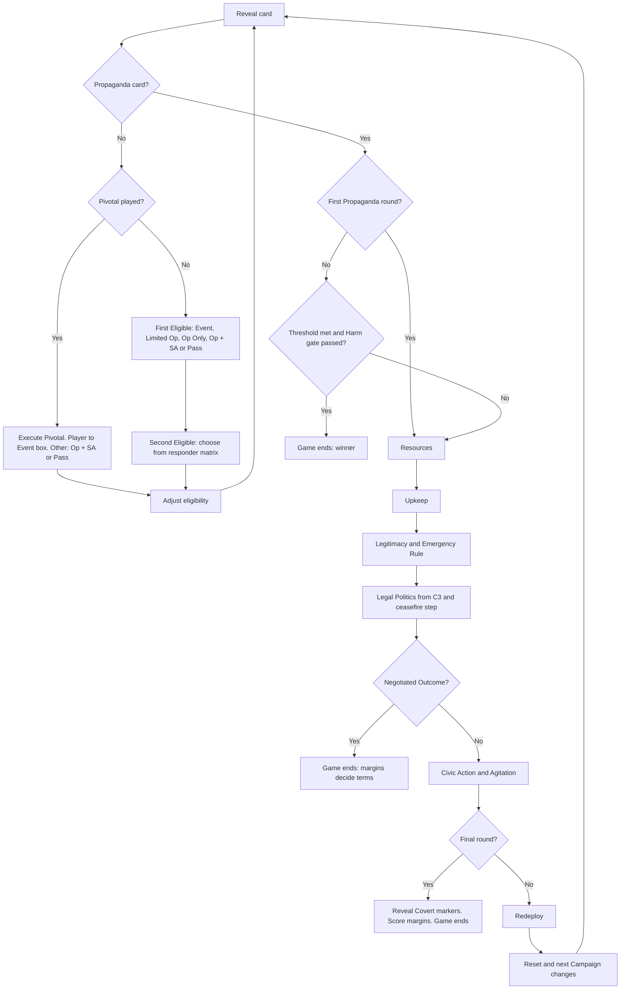

# 05 Sequence of Play

Status: rules draft. Binding decisions: DD-04, DD-13 and DD-14. CT means Colonial Twilight, rule numbers from `research/rules/md/colonial-twilight--rules.md`. Values marked [tune] need playtest calibration.

## 1. Game structure

1. The deck has five piles, one per Campaign (C1 to C5). Each pile has 12 Event cards and one Propaganda card (DD-13.1). A Campaign is the Event cards between two Propaganda rounds (CT 2.4.1; DD-01.3).
2. Play one card at a time. Only the current card is face up. There is no next-card preview (CT 2.2; DD-04.5).
3. Each Event card gives both factions at most one action. A Propaganda card starts a Propaganda round (section 6).
4. The game ends after the fifth Propaganda round, at an earlier victory check (09) or at a Negotiated Outcome (07, section 7.4).

### 1.1 Deck building

Do this for each Campaign pile, C1 to C5:

1. Take the Campaign's mandatory structural cards (10, section 6.1). C1: Law 3175 and KDP Orders PKK Out. C2: OHAL and Syria Security Protocol. C3: HEP Founded and Northern Iraq Vacuum. C4: none. C5: Capture.
2. From that Campaign's pool of at least 14 deck-eligible cards (DD-13.2, DD-13.3), draw at random until the pile has 12 Event cards in total. Never draw research leads outside a declared playtest.
3. Shuffle the 12 Event cards. Deal the top 8 face down and keep the bottom 4 apart.
4. Mandatory cards must be in the top 8. If a mandatory card is in the bottom 4, swap it with the lowest non-mandatory card of the top 8 (DD-17.1). If a chain pair in 08, section 8, ends in a mandatory card, the earlier card of that pair also counts as mandatory for this step.
5. Apply the chain order in 08, section 8, now, before the Propaganda card goes in. Swap the two cards of a pair if the later card lies above the earlier one.
6. Shuffle the Propaganda card into the bottom 4. Put the 8 on top of these 5. The Propaganda card is now the 9th to 13th card (DD-13.1 bottom-third rule).
7. Stack the piles with C1 on top. Set unused pool cards aside unseen (CT 10.0).

Cards that fall below a Propaganda card are played in the next Campaign. This follows CT 10.0, where the Propaganda card is shuffled into its pile.

## 2. Initiative

### 2.1 Initiative track

Each faction has one cylinder. The track has five boxes: Event, Limited Op, Op Only, Op + SA, Pass (CT 2.3.1, 2.3.2; DD-04.1). The PKK is First Eligible at the start of every scenario and after every Reset (CT 10.0, 6.5; DD-04.6).

### 2.2 Card procedure

1. Reveal the card.
2. Pivotal check: either faction may play a Pivotal Event now (section 4).
3. The First Eligible faction chooses one option and executes it fully. Place its cylinder in the matching box:
   - Event: execute the card's Event. Box: Event.
   - Limited Op: one Operation in one location, no Special Activity. Box: Limited Op.
   - Op Only: one Operation in two or more locations, no Special Activity. Box: Op Only.
   - Op + SA: one Operation in any number of locations plus one Special Activity. Box: Op + SA.
   - Pass: gain Resources (section 3.2). Box: Pass.
4. The Second Eligible faction chooses one box from the responder matrix (section 2.3), executes it and places its cylinder.
5. Adjust eligibility (section 2.4).
6. Reveal the next card (CT 2.3.6).

### 2.3 Responder matrix

The Second Eligible faction may choose a box adjacent to the First Eligible cylinder (CT 2.3.2). The CT rule text does not print the box layout. The cells below are labeled by source.

| First Eligible chose | Second Eligible may choose | Source of the cell |
|---|---|---|
| Op + SA | Event, Limited Op, Pass | CT rule: 2.3.2 adjacency, confirmed by CT playbook worked examples |
| Op Only | Limited Op, Pass | CT rule: 2.3.2 adjacency, confirmed by CT playbook worked examples |
| Limited Op | Op Only, Op + SA, Pass | CT rule: 2.3.2 adjacency, confirmed by CT playbook worked examples |
| Event | Op + SA, Pass | CT playbook worked example (twelfth card: after a Pivotal Event in the Event box, the other player may choose Op + Special Activity or Pass). The same cells follow from the symmetry of the confirmed rows |
| Pass | Event, Limited Op, Op Only, Op + SA, Pass | Design choice. CT text gives no response after Pass except that both may Pass (CT 2.3.3). The design treats Pass as adjacent to every box |

The derived adjacency graph is: Pass touches all four other boxes; Op + SA touches Event and Limited Op; Limited Op touches Op Only. Print this graph on the track.

Notes:

1. If the First Eligible took the Event, the responder can never take the same Event. A faction can block an Event only by taking it. Pass is its own box (CT 2.3.2), so a faction cannot take the Event box and then pass, as The British Way allows (BW 2.3.3).
2. When the responder takes Op Only or Op + SA after a Limited Op, it may use any number of locations. Design choice: CT 2.3.2 says "any number of spaces" for these boxes, but the CT 2.3.5 clarification can be read as one location. This design follows 2.3.2.
3. Declare Ceasefire (07, section 7.1) is a PKK action that uses the Limited Op box. It is legal wherever Limited Op is legal.

### 2.4 Adjust eligibility

Next-card order depends on the First Eligible choice only (CT 2.3.5; DD-04.2):

1. First Eligible chose Op Only or Op + SA: the other faction becomes First Eligible.
2. First Eligible chose Event, Limited Op or Pass: it stays First Eligible.
3. Both factions passed: no change (CT 2.3.3).
4. A Pivotal Event player is First Eligible on the next card (section 4).

## 3. Limited Op and Pass

### 3.1 Limited Op

A Limited Op is one Operation in one location, with no Special Activity (CT 2.3.4).

1. A location is one map space or one external box. The Europe track is a location for PKK Rally (CT 2.3.5 clarification; 06, section 4.1).
2. Garrison, Sweep and March as a Limited Op may take pieces from several spaces, but all must go to one destination space (CT 2.3.4).
3. Train with its Civic Action and Rally with its Agitate stay Limited if they select one space (CT 3.2.1, 3.3.1).
4. A Special Activity is never allowed with a Limited Op (CT 4.1).

### 3.2 Pass

A faction that passes takes no action on this card. The State gains +2 Resources. The PKK gains +1 Resource (CT 2.3.3; DD-04.4). Passing keeps the First Eligible faction First Eligible. It costs tempo only in what the faction did not do.

## 4. Pivotal Events

Each faction starts the campaign with two Pivotal Event cards in hand (DD-13.4). Each short scenario lists the Pivotals that each faction holds (10).

| Faction | Pivotal Event | Earliest Campaign | Board precondition | Effect summary | Evidence |
|---|---|---|---|---|---|
| State | Area Domination | C4 | Emergency Rule is OHAL Extended Powers and Total Opposition is 12 or more | Free Sweep, then free Assault, in up to 3 Mountain spaces. Village Clearance may accompany one of them at normal cost | E-0202; E-0204; F-036 |
| State | Coercive Diplomacy on Syria | C5 | Syria posture is Tolerant or Restricted and Legitimacy is 5 or more | Syria posture to Hostile. Leadership flips to Abroad. PKK pieces in Syria-Bekaa stay but earn nothing | E-0124; E-0126; E-0127; E-0018; E-0019; F-020 |
| PKK | ARGK Formed | C1 | 8 or more Guerrillas in domestic spaces and at least 2 domestic PKK Bases | Place up to 4 Guerrillas in spaces with PKK Bases, flip all Guerrillas in every space with a PKK Base Underground (DEC-55), PKK +3 Resources | E-0075 |
| PKK | Serhildan | C3 | Total Opposition is 14 or more and Mardin-Batman or Botan is at Opposition (DD-19.5) | Shift up to 3 spaces with PKK pieces and no Office one level toward Opposition (Diyarbakır City may be one). Europe +1 | E-0173; E-0271; E-0272; F-035 |

Procedure (CT 2.3.7):

1. A faction may play a Pivotal Event only after the card is revealed and before the First Eligible faction chooses an option.
2. The printed Campaign and board preconditions must be met.
3. If both factions want to play one, the Second Eligible faction has priority. The First Eligible faction keeps its card.
4. Place the Pivotal card on the current card. Execute the Pivotal instead of the current Event. The current card's Event is not available. Its "Always" line (structural cards) still applies.
5. The Pivotal player becomes or stays First Eligible. Its cylinder goes in the Event box.
6. The other faction may then take Op + SA or Pass. It becomes or stays Second Eligible.
7. A played Pivotal stays in the played pile. Only one Pivotal per card.

## 5. Event execution

1. Most cards are dual-use. The executing faction chooses either the unshaded or the shaded text, not both (CT 5.2). Either faction may choose either side unless the card restricts it. Exception (DD-10.5): the PKK may not execute an event side that places or resolves a Closure Case, bans the legal party, removes Offices or moves Legal Space. The non-player Office sides of DK-065, DK-067 and DK-094 stay open to either faction (08, section 6), because they run the procedure table and give no choice of space.
2. Event text overrides rules. It cannot break stacking, place pieces that are not Available (unless it says so) or raise Resources above 50 (CT 5.1.1).
3. Do as much of the text as you can (CT 5.1.3). The current Event wins a conflict with a lasting effect (CT 5.1.2).
4. Free Operations and Special Activities granted by events cost no Resources and do not change eligibility. Civic Action, Agitate and Redress still cost Resources (CT 3.1.2, 5.5).
5. Capability: place the marker on the chosen side. It lasts the game (CT 5.3; DD-13.5).
6. Momentum: keep the card in view. It lasts until the next Reset (CT 5.4; DD-13.5).
7. Structural cards have an "Always" line. Apply it when the card is revealed, whether or not anyone executes the Event (10, section 6.1). The Event text is an extra effect.
8. Contested attribution: the card title is neutral and Harm goes to a Disputed marker (DD-15.4; 07, section 10).
9. Sensitivity tiers T0 to T3 apply. No card gives points for killing (DD-13.6).

## 6. Propaganda round

When a Propaganda card is revealed, carry out the phases below in this exact order. Never conduct two Propaganda rounds in a row. A second Propaganda card in a row is set aside with no round (CT 6.0). Each step lists who acts first.

### 6.1 Victory phase

Skip this phase in the first Propaganda round of any scenario (CT 6.1; DD-14.1). Otherwise compute both victory scores and Harm counts and apply 09, section 3. Count face-down Covert markers as 09, section 3, step 1 says. If a faction wins, the game ends.

### 6.2 Resources phase

1. State income: 8 + (Legitimacy / 2, round down) + Pop of each Mountain or Plain space with State Control and a State Base [tune]. The Legitimacy term follows the research link between conduct and external support [E-0265]. The Base term adapts CT 6.2.1.
2. PKK income: +1 per domestic PKK Base, +1 per PKK Base in an external box whose host is Host or Tolerant, +2 if the Leadership is Present and Syria is Host or +1 if Syria is Tolerant, plus the Europe income from 04, section 3.6 [tune]. Adapts CT 6.2.2.
3. Maximum 50.

### 6.3 Upkeep phase

1. The State pays 1 Resource per 2 Village Guards on the map, round up (DD-08.3) [tune] [Q-347].
2. If the State cannot pay in full, it removes Guards of its choice to Available until the remaining Guards are paid for.

### 6.4 Legitimacy and Emergency Rule phase

Apply in this order. Legitimacy stays between 0 and 20.

1. Emergency Rule drain: Martial Law -1, OHAL -1, OHAL Extended Powers -2, Normalizing 0 (DD-12.3).
2. Late cost of Village Clearance: -1 per Displacement marker on its New side. Flip each to Old.
3. Reception: -1 if 3 or more Reception markers are on the map.
4. Disputed harm: -1 if 3 or more Disputed Harm markers are on the map.
5. Covert exposure: if 3 or more face-down Covert markers are on the map, the PKK picks one at random and reveals it. It becomes a State Harm marker. Legitimacy -2.
6. Europe adjustment: Europe +1 if the State Harm count is at least 3 more than the PKK Harm count. Europe -1 if the PKK Harm count is at least 3 more than the State Harm count. Then, if Europe is 4 or 5, Legitimacy -1.
7. Gains: +1 if Legal Space is Open and 2 or more Offices are on the map. +1 if Ceasefire is Reciprocal Restraint or Talks and the State has no Restraint Broken marker. +1 if step 2 flipped no marker.
8. Emergency Rule step: the State may move the track one step (07, section 8.2).

### 6.5 Legal Politics phase (from C3)

Skip in C1 and C2 while Legal Space is Absent.

1. Closure filing: the State may file a closure case (07, section 6.3).
2. Run the Legal Politics procedure table (07, section 6.4), all lines in order.
3. Ceasefire step: resolve 07, section 7.3.

### 6.6 Civic Action and Agitation phase

1. State Civic Action first, then PKK Agitation. Procedures in 07, section 1.3. Adapts CT 6.3.1 and 6.3.2.
2. State total spending in this phase cannot exceed half of current Legitimacy, round down (CT 6.3.1 pattern, with Legitimacy in place of Commitment; halved after the desk test in 11, IR-02) [tune]. In this phase Civic Action needs State Control, Troops and Police in the space (CT 6.3.1; 07, section 1.3) [tune].
3. Final round only: after this phase, reveal all Covert markers (each becomes a State Harm marker and costs Legitimacy 2), then end the game and score margins (09, section 4). Skip phases 6.7 and 6.8 (CT 6.3.3).

### 6.7 Redeploy phase

State first. Do not adjust Control until both factions finish (CT 6.4).

1. State: move any Troops on the map to any City or any space with a State Base. All Troops in the KDP Zone or PUK Zone must move this way. Move any Police to any State-Controlled space. Guards never move (DD-08.2).
2. PKK: move any Guerrillas to an adjacent space or box that has a PKK Base. Movement into an external box follows posture limits (07, section 5).
3. Adjust Control in all spaces.

### 6.8 Reset phase

1. Remove one Coercion marker from each space that has any (CT 6.5).
2. Flip all Guerrillas Underground, including those in Hostile or Aligned host boxes (CT 6.5; prototype DEC-53, designer decision 2026-10-30).
3. Discard Momentum cards (CT 6.5).
4. Remove Restraint Broken markers.
5. Advance the Campaign marker. Apply the structural changes for the new Campaign (10, section 6.1).
6. Set the PKK First Eligible (CT 6.5; DD-04.6).
7. Reveal the next card.

## 7. End of game

The game ends at the first of:

1. A victory phase in which a faction meets its threshold and passes its Harm gate (09, section 3).
2. A Negotiated Outcome (07, section 7.4; 09, section 5).
3. The end of phase 6.6 in the final Propaganda round. Score margins (09, section 4).

After the game, fill in the outcome record sheet (09, section 6). It is a record, not a second score (DD-14.5).

## 8. Play aid (one page)

| Step | What happens | Rule |
|---|---|---|
| Card | Reveal. Pivotal check. First Eligible acts. Second Eligible responds from the matrix. Adjust eligibility | 2, 4 |
| First chose Op + SA | Second: Event, Limited Op, Pass. Next card: Second becomes First | CT 2.3.2, 2.3.5 |
| First chose Op Only | Second: Limited Op, Pass. Next card: Second becomes First | CT 2.3.2, 2.3.5 |
| First chose Limited Op | Second: Op Only, Op + SA, Pass. First stays First | CT 2.3.2, 2.3.5 |
| First chose Event | Second: Op + SA, Pass. First stays First | Design choice |
| First chose Pass | Second: any box. First stays First. Both pass: no change | Design choice; CT 2.3.3 |
| Limited Op | One location, no SA. Garrison, Sweep, March: many origins, one destination | CT 2.3.4 |
| Pass | State +2, PKK +1 | CT 2.3.3 |
| Pivotal | Before First chooses. Second Eligible has priority. Player goes to Event box; other may Op + SA or Pass | CT 2.3.7 |
| P1 Victory | Skip in first round. Threshold and Harm gate | 09 |
| P2 Resources | State 8 + Legit/2 + Pop of Controlled non-City spaces with State Base. PKK Bases + host Bases + Leadership + Europe | 6.2 |
| P3 Upkeep | State pays 1 per 2 Guards | 6.3 |
| P4 Legitimacy | Emergency drain, New Displacement, Reception 3+, Disputed 3+, Covert 3+, Europe, gains, Emergency step | 6.4 |
| P5 Legal Politics | From C3: closure filing, procedure table, ceasefire step | 07 |
| P6 Civic Action / Agitation | State (cap = Legitimacy / 2; Control, Troops and Police), then PKK. Final round: reveal Covert, score, end | 6.6 |
| P7 Redeploy | State Troops to Cities or State Bases; Police to State Control; PKK to adjacent PKK Base | 6.7 |
| P8 Reset | -1 Coercion per space, flip Underground, discard Momentum, next Campaign changes, PKK First Eligible | 6.8 |

## 9. Flowchart

## 10. Tests

1. Two readers must find the same legal responses for every row of the matrix without discussion.
2. Count initiative streaks. A streak longer than 4 cards in more than one game in three needs a fix.
3. Count Pass choices per faction per Campaign. If the PKK passes more than half its turns, its income is too low.

## Proposed decision changes

Status: all five proposals below were accepted as DD-17.1 to DD-17.5. The rules text above already applies them. The list stays as a record.

1. DD-13 (deck). Problem: structural changes from DD-01 (Law 3175, OHAL, HEP, northern Iraq vacuum, capture) depend on cards. A random 12-card draw from a pool of 14 can leave them out, and players can decline an Event. Proposed change: name these as mandatory structural cards, always in their pile and dealt into the top 8 cards, with an "Always" line that applies on reveal. The pile still draws its other cards from the pool, so each game sees a different subset.
2. DD-05 (map). Problem: Şırnak province borders Syria near Cizre as well as Iraq (Turkish Wikipedia, Şırnak (il), read 26 Oct 2026). The DD-05 table gives Botan the Iraq border only. Proposed change: add Syria to the Botan border column as a printed fact with no movement effect. Syria-Bekaa links stay Mardin-Batman and Şanlıurfa.
3. DD-11 (ceasefire) and DD-04 (initiative). Problem: DD-11 does not say when the PKK may declare. Proposed change: Declare Ceasefire is a PKK action from C3 that occupies the Limited Op box, so it costs tempo like other actions and fits the CT track without a new box.
4. DD-12 (Emergency Rule). Problem: "higher steps" is undefined for a track printed in date order, and DD-07.2 uses "OHAL or higher". Proposed change: replace "higher" with an explicit table (07, section 8). Village Clearance is legal at OHAL and OHAL Extended Powers only.
5. DD-14.3 (PKK Harm gate). Problem: "a Harm gate on its own coercion" does not say what counts. Proposed change: PKK Harm count = PKK Harm markers + Coercion markers on the map (04, section 4.2).
